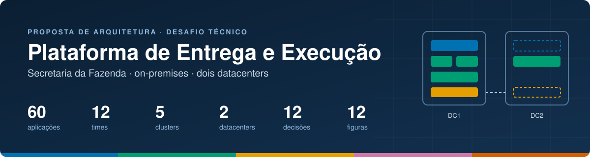
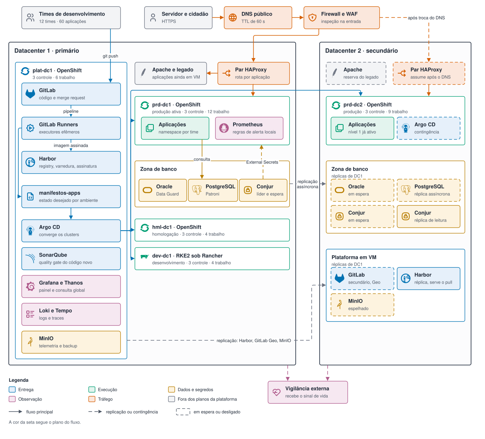

<div align="center">



<p>
<a href="#a-proposta-em-uma-página"><b>Proposta</b></a> ·
<a href="#por-onde-começar"><b>Por onde começar</b></a> ·
<a href="#o-enunciado-item-por-item"><b>Enunciado item por item</b></a> ·
<a href="#decisões-de-arquitetura"><b>Decisões</b></a> ·
<a href="#artefatos"><b>Artefatos</b></a> ·
<a href="#premissas"><b>Premissas</b></a>
</p>

</div>

Proposta de arquitetura e plano de implantação para modernizar a plataforma da Secretaria da
Fazenda: 60 aplicações em produção, 12 times de desenvolvimento, infraestrutura on-premises
virtualizada.

O documento responde aos oito tópicos do desafio. O diretório [`exemplos/`](exemplos/) traz os
artefatos que sustentam o desenho — pipeline, manifestos GitOps, chart, política de admissão,
regras de alerta, borda e infraestrutura — em arquivos que podem ser lidos e criticados linha a
linha.

**Figura 1.1 — Panorama da plataforma.**



A topologia física, com a quantidade de nós de cada cluster, está na Figura 2.1, em
[docs/02](docs/02-topologia.md).

---

## Por onde começar

| Tempo | Caminho |
|---|---|
| **5 minutos** | Esta página: a Figura 1.1 e as cinco teses logo abaixo |
| **Conferir o enunciado** | [O enunciado, item por item](#o-enunciado-item-por-item): cada pergunta do desafio com a resposta curta e o link para o documento do tópico |
| **20 minutos** | [docs/01](docs/01-visao-geral.md), [docs/03](docs/03-cicd.md) e [docs/05](docs/05-resiliencia.md): o desenho, o caminho do commit até produção e o que acontece quando um datacenter cai |
| **Leitura técnica** | [docs/09](docs/09-gitops-argocd.md) com [`exemplos/gitops/`](exemplos/gitops/), e [docs/04](docs/04-observabilidade.md) com [`exemplos/observabilidade/`](exemplos/observabilidade/) |
| **Decisões** | As [doze ADRs](#decisões-de-arquitetura), cada uma com a alternativa descartada e o critério que a faria mudar |
| **Limites declarados** | Os pontos de falha que permanecem, em [docs/05](docs/05-resiliencia.md), e a expectativa real de migração, em [docs/08](docs/08-plano-evolucao.md) |

## A proposta em uma página

**1 · Cinco clusters, dois datacenters.** Produção roda em OpenShift, em dois clusters
independentes (um por datacenter). Homologação roda em OpenShift com a mesma configuração de
produção e um terço da capacidade. Desenvolvimento roda em RKE2 sob Rancher, que custa menos e
tolera instabilidade. A esteira e a observabilidade ficam num cluster de plataforma separado, para
que uma falha de pipeline não alcance produção.
<br><sub>Onde ver: [docs/02](docs/02-topologia.md) · [ADR-001](docs/adr/ADR-001-openshift-producao-rancher-dev.md) · [ADR-002](docs/adr/ADR-002-dois-clusters-independentes.md) · [Figura 2.1](docs/diagramas/topologia.drawio.svg)</sub>

**2 · O pipeline publica, o GitOps implanta.** O GitLab CI compila, testa, analisa, constrói a
imagem, assina e publica no registry. Ele nunca recebe credencial de cluster de produção. A
implantação acontece quando o Argo CD observa uma alteração no repositório de manifestos e converge
o cluster para o estado declarado.
<br><sub>Onde ver: [docs/03](docs/03-cicd.md) · [ADR-003](docs/adr/ADR-003-gitops-em-vez-de-deploy-por-pipeline.md) · [`exemplos/ci/`](exemplos/ci/) · [`exemplos/gitops/`](exemplos/gitops/)</sub>

**3 · A promoção move um identificador, não um artefato.** A imagem é referenciada pelo digest
`sha256:...` desde o primeiro build. Promover de homologação para produção altera uma linha de
manifesto. Nenhum estágio reconstrói a imagem, então o que foi testado é bit a bit o que executa.
<br><sub>Onde ver: [ADR-007](docs/adr/ADR-007-promocao-por-digest.md) · [ADR-010](docs/adr/ADR-010-promocao-por-merge-request.md) · [`promocao.yml`](exemplos/ci/templates/promocao.yml) · [`exigir-imagem-assinada.yaml`](exemplos/politicas/exigir-imagem-assinada.yaml)</sub>

**4 · O alerta que acorda alguém nasce de orçamento de erro.** O time de plataforma mede nível de
serviço por aplicação e dispara chamada telefônica apenas quando a taxa de consumo do orçamento
indica que ele acaba em poucos dias. O resto vira chamado ou fica no painel.
<br><sub>Onde ver: [docs/04](docs/04-observabilidade.md) · [`prometheus-rules.yaml`](exemplos/observabilidade/prometheus-rules.yaml) · [`alertmanager.yaml`](exemplos/observabilidade/alertmanager.yaml)</sub>

**5 · A migração acontece por onda, com o tráfego decidindo.** O HAProxy fica na frente do legado
e da plataforma nova ao mesmo tempo. Cada aplicação migrada passa a receber tráfego por regra de
rota, e volta para o legado invertendo essa regra. Nenhuma onda depende da anterior ter terminado.
<br><sub>Onde ver: [docs/08](docs/08-plano-evolucao.md) · [`haproxy.cfg`](exemplos/borda/haproxy.cfg)</sub>

## Ferramentas por plano

Cada selo tem a cor do plano a que a ferramenta pertence, a mesma das figuras.

| Plano | Ferramentas |
|---|---|
| **Entrega** |           |
| **Execução** |        |
| **Dados e segredos** |        |
| **Observação** |       |
| **Tráfego** |    |

## O enunciado, item por item

Cada tópico do desafio tem um documento próprio, na mesma ordem do enunciado. Abaixo, cada
pergunta do enunciado aparece com a resposta em uma ou duas frases e o link para a seção que a
detalha. O detalhe mora só no documento; aqui fica o caminho até ele.

| # | Tópico do desafio | Documento completo |
|---|---|---|
| 1 | Visão geral da arquitetura | **[docs/01-visao-geral.md](docs/01-visao-geral.md)** |
| 2 | Topologia de clusters e ambientes | **[docs/02-topologia.md](docs/02-topologia.md)** |
| 3 | Fluxo de entrega (CI/CD) | **[docs/03-cicd.md](docs/03-cicd.md)**, aprofundado em **[docs/09-gitops-argocd.md](docs/09-gitops-argocd.md)** |
| 4 | Observabilidade e operação | **[docs/04-observabilidade.md](docs/04-observabilidade.md)** |
| 5 | Resiliência e continuidade | **[docs/05-resiliencia.md](docs/05-resiliencia.md)** |
| 6 | Infraestrutura como código | **[docs/06-iac.md](docs/06-iac.md)** |
| 7 | Experiência dos times de desenvolvimento | **[docs/07-experiencia-dev.md](docs/07-experiencia-dev.md)** |
| 8 | Plano de evolução | **[docs/08-plano-evolucao.md](docs/08-plano-evolucao.md)** |

### 1 · Visão geral da arquitetura

**Documento completo → [docs/01-visao-geral.md](docs/01-visao-geral.md)**

| O enunciado pede | Resposta curta | Detalhe |
|---|---|---|
| Diagramas com clusters, ambientes, registry, CI/CD, observabilidade e entrada de tráfego | O panorama (Figura 1.1, no topo desta página) e a topologia física (Figura 2.1). As peças se dividem em cinco planos: entrega, execução, dados e segredos, observação e tráfego | [O desenho](docs/01-visao-geral.md#o-desenho) |
| O papel de cada peça | Cada peça aparece com o papel e o motivo de estar ali, incluindo as que foram acrescentadas às ferramentas do enunciado, como Harbor, Argo CD, Conjur e Kyverno | [O papel de cada peça](docs/01-visao-geral.md#o-papel-de-cada-peça) · [O que foi acrescentado](docs/01-visao-geral.md#o-que-foi-acrescentado-além-do-enunciado) |

### 2 · Topologia de clusters e ambientes

**Documento completo → [docs/02-topologia.md](docs/02-topologia.md)**

| O enunciado pede | Resposta curta | Detalhe |
|---|---|---|
| Quantos clusters, onde ficam e para que serve cada um | Cinco. Em DC1: `plat-dc1` (esteira, registry, observabilidade e Argo CD), `dev-dc1` em RKE2, `hml-dc1` e `prd-dc1`. Em DC2: `prd-dc2`. A produção são dois clusters independentes, e não um cluster esticado entre os sítios (ADR-002) | [O inventário](docs/02-topologia.md#o-inventário) · [Por que cada cluster existe](docs/02-topologia.md#por-que-cada-cluster-existe) |
| Como separar desenvolvimento, homologação e produção | Por cluster, e não só por namespace, em quatro camadas ao mesmo tempo: cluster, rede, dado (sintético, anonimizado ou real) e permissão. Em produção, só o Argo CD escreve | [Como os ambientes se separam](docs/02-topologia.md#como-os-ambientes-se-separam) |

### 3 · Fluxo de entrega (CI/CD)

**Documento completo → [docs/03-cicd.md](docs/03-cicd.md)** · aprofundamento em [docs/09-gitops-argocd.md](docs/09-gitops-argocd.md)

| O enunciado pede | Resposta curta | Detalhe |
|---|---|---|
| O caminho do commit até produção | Dois pipelines. O do merge request decide se a alteração entra; o de `main` constrói a imagem uma vez, assina e publica. Depois, o Argo CD leva o mesmo digest por `dev`, `hml` e produção (Figura 3.1) | [O caminho do commit até produção](docs/03-cicd.md#o-caminho-do-commit-até-produção) |
| Quais verificações bloqueiam e quais apenas informam | Bloqueia o que o time consegue corrigir hoje e indica risco real: teste, cobertura das linhas alteradas abaixo de 80 por cento, quality gate do código novo, vulnerabilidade crítica com correção publicada, segredo no código e assinatura ausente. Informa a dívida acumulada e o que depende de terceiro: cobertura total, vulnerabilidade sem correção e teste de carga sem linha de base | [O que bloqueia e o que apenas informa](docs/03-cicd.md#o-que-bloqueia-e-o-que-apenas-informa) |
| Como garantir que o artefato testado é o que vai para produção | A imagem é construída uma vez e referenciada pelo digest `sha256:...`. A promoção é um commit que copia esse digest, e o cluster recusa imagem não assinada (ADR-007) | [Como o artefato testado é o que vai para produção](docs/03-cicd.md#como-o-artefato-testado-é-o-que-vai-para-produção) |
| Como é feito o deploy | Por GitOps: o Argo CD aplica o que está no repositório de manifestos, e o pipeline nunca recebe credencial de cluster (ADR-003). A produção muda por merge request aprovado por duas pessoas do time (ADR-010) | [Como a implantação acontece](docs/03-cicd.md#como-a-implantação-acontece) |
| Como é feito o rollback | Em três níveis: automático durante o canário do nível 1; `git revert` do commit do digest, em um a dois minutos; e `argocd app rollback` quando o GitLab está fora. O limite fica declarado: voltar a aplicação não volta o banco, por isso a migração é feita em duas etapas, expandir e contrair | [Como o retorno de versão funciona](docs/03-cicd.md#como-o-retorno-de-versão-funciona) |

### 4 · Observabilidade e operação

**Documento completo → [docs/04-observabilidade.md](docs/04-observabilidade.md)**

| O enunciado pede | Resposta curta | Detalhe |
|---|---|---|
| O que coletar (métricas, logs e traces) e como as ferramentas se integram | A métrica é raspada pelo Prometheus de cada cluster, com o histórico no Thanos. Log e trace passam pelo coletor OpenTelemetry até o Loki e o Tempo. Tudo aparece no Grafana, e a retenção longa fica no MinIO (Figura 4.1) | [Como os sinais fluem](docs/04-observabilidade.md#como-os-sinais-fluem) · [O que coletar](docs/04-observabilidade.md#o-que-coletar) |
| Como os alertas devem funcionar para serem levados a sério | Cinco regras: chamada telefônica só pelo consumo do orçamento de erro, com duas janelas simultâneas (1 hora e 5 minutos a 14,4 vezes); alerta sobre sintoma, e não sobre causa; todo alerta com dono e roteiro de resposta; agrupamento e inibição; e revisão quinzenal que rebaixa o alerta com menos de 50 por cento de ação | [Como os alertas funcionam](docs/04-observabilidade.md#como-os-alertas-funcionam-para-serem-levados-a-sério) |

### 5 · Resiliência e continuidade

**Documento completo → [docs/05-resiliencia.md](docs/05-resiliencia.md)**

| O enunciado pede | Resposta curta | Detalhe |
|---|---|---|
| Falha de um nó | O Kubernetes reagenda os pods; as três réplicas ficam espalhadas por rack, e o vSphere reinicia a máquina. Não há ação humana | [Falha de um nó](docs/05-resiliencia.md#falha-de-um-nó) |
| Falha de um cluster | O nível 1 já roda nos dois sítios, e o HAProxy retira o cluster com falha em cerca de 6 segundos. O nível 2 sobe as réplicas em DC2 por decisão humana | [Falha de um cluster inteiro](docs/05-resiliencia.md#falha-de-um-cluster-inteiro) |
| Falha de um banco de dados | Dentro do sítio, a troca de papel é automática (Data Guard e Patroni). Entre sítios, é sempre decisão humana, para nunca existirem dois bancos principais com dado fiscal divergente | [Falha de um banco de dados](docs/05-resiliencia.md#falha-de-um-banco-de-dados) |
| Falha de um datacenter inteiro | O nível 1 volta a ler em cerca de 9 minutos e a escrever em 20, depois de duas decisões humanas: o DNS, que é reversível, e o banco, que não é (Figura 5.1) | [Falha de um datacenter inteiro](docs/05-resiliencia.md#falha-de-um-datacenter-inteiro) |
| Quais componentes têm redundância e quais pontos de falha restam | A redundância está numa tabela por componente. Restam doze pontos de falha, declarados com a mitigação e o risco residual de cada um. O mais provável é a própria equipe; o mais perigoso, a partição de rede com os dois sítios vivos | [O que tem redundância](docs/05-resiliencia.md#o-que-tem-redundância) · [Pontos de falha que permanecem](docs/05-resiliencia.md#pontos-de-falha-que-permanecem) |

### 6 · Infraestrutura como código

**Documento completo → [docs/06-iac.md](docs/06-iac.md)**

| O enunciado pede | Resposta curta | Detalhe |
|---|---|---|
| O que fica em código e com quais ferramentas | Quatro camadas. As máquinas virtuais fora do OpenShift usam Terraform com o provedor vSphere e Ansible. Os clusters usam a instalação IPI do OpenShift com `MachineSet`, e o Terraform do Rancher para o RKE2. Os componentes de plataforma ficam no Argo CD. A configuração das ferramentas usa Terraform com os provedores do GitLab, do Harbor, do Keycloak e do Grafana | [As quatro camadas](docs/06-iac.md#as-quatro-camadas-e-as-ferramentas-de-cada-uma) |
| Onde esse código fica | Em sete repositórios no grupo `plataforma/` do GitLab, separados por quem precisa aprovar cada alteração | [Onde o código fica](docs/06-iac.md#onde-o-código-fica) |
| Como é revisado e aplicado | Por merge request, com o plano do Terraform comentado nele, e quem revisa lê o plano. A aplicação parte de `main`, num runner dedicado, e nunca da máquina de uma pessoa. Uma verificação diária procura desvios | [Como o código é revisado e aplicado](docs/06-iac.md#como-o-código-é-revisado-e-aplicado) · [O que não entra em código](docs/06-iac.md#o-que-não-entra-em-código-e-por-quê) |

### 7 · Experiência dos times de desenvolvimento

**Documento completo → [docs/07-experiencia-dev.md](docs/07-experiencia-dev.md)**

| O enunciado pede | Resposta curta | Detalhe |
|---|---|---|
| Como um time coloca uma aplicação nova em produção | O time abre um merge request com uma ficha de cerca de 50 linhas no catálogo. Com o merge, um pipeline cria o repositório, os namespaces, o caminho no cofre, os manifestos, o painel e os alertas, e o primeiro push chega a desenvolvimento no mesmo dia. A produção recebe a aplicação por um merge request de uma linha, aprovado por duas pessoas do time | [Colocando uma aplicação nova em produção](docs/07-experiencia-dev.md#colocando-uma-aplicação-nova-em-produção) |
| O que é da plataforma e o que é do time | A plataforma responde pelo que é comum a todas as aplicações: clusters, esteira, registry, cofre, imagem base e observabilidade. O time responde pelo que é específico da sua: código, testes, valores do chart, nível de serviço e o atendimento do alerta da própria aplicação | [Quem responde pelo quê](docs/07-experiencia-dev.md#quem-responde-pelo-quê) |

### 8 · Plano de evolução

**Documento completo → [docs/08-plano-evolucao.md](docs/08-plano-evolucao.md)**

| O enunciado pede | Resposta curta | Detalhe |
|---|---|---|
| Roteiro em fases para 6 a 12 meses: o que vem primeiro e por quê | Cinco fases em doze meses: descoberta, fundação, produção no sítio primário com a primeira onda de 10 aplicações, segundo sítio com mais 20, e maturidade. Cada fase entrega algo verificável a um time, e a ordem segue a dependência técnica: sem registry não há GitOps. A expectativa honesta é de 40 a 45 das 60 aplicações migradas | [Visão das fases](docs/08-plano-evolucao.md#visão-das-fases) |
| Quais riscos e como mitigar | Oito riscos, cada um com a mitigação. O primeiro é a equipe de plataforma virar gargalo | [Riscos](docs/08-plano-evolucao.md#riscos) · [Como medir se deu certo](docs/08-plano-evolucao.md#como-medir-se-deu-certo) |

## Decisões de arquitetura

Cada decisão que admite alternativa defensável tem um registro em [docs/adr/](docs/adr/), com o
contexto, a alternativa descartada, a consequência aceita e o critério que faria a decisão mudar.

| ADR | Decisão | Alternativa descartada |
|---|---|---|
| [001](docs/adr/ADR-001-openshift-producao-rancher-dev.md) | OpenShift em produção, RKE2 sob Rancher em desenvolvimento | Padronizar em uma distribuição só |
| [002](docs/adr/ADR-002-dois-clusters-independentes.md) | Dois clusters de produção independentes, um por sítio | Um cluster esticado entre os dois sítios |
| [003](docs/adr/ADR-003-gitops-em-vez-de-deploy-por-pipeline.md) | Implantação por Argo CD, não por `kubectl` no pipeline | Pipeline com credencial de cluster |
| [004](docs/adr/ADR-004-bancos-fora-do-kubernetes.md) | Oracle e PostgreSQL permanecem em máquina virtual | Operadores de banco dentro do cluster |
| [005](docs/adr/ADR-005-sem-service-mesh-na-fase-inicial.md) | Sem malha de serviço nos doze primeiros meses | Istio ou Linkerd desde a fundação |
| [006](docs/adr/ADR-006-harbor-como-registry.md) | Harbor como registry de contêiner | Quay, ou o registry interno do GitLab |
| [007](docs/adr/ADR-007-promocao-por-digest.md) | Promoção entre ambientes move o digest da imagem | Reconstruir a imagem por ambiente |
| [008](docs/adr/ADR-008-conjur-como-cofre.md) | Conjur como cofre, rotação pelo PAM, consumo pelo External Secrets | Vault ou OpenBao; aplicação chamando a API do cofre |
| [009](docs/adr/ADR-009-argocd-central-com-contingencia.md) | Um Argo CD central, com contingência desligada em DC2 | Uma instância por cluster |
| [010](docs/adr/ADR-010-promocao-por-merge-request.md) | Promoção por merge request aberto pela esteira | Argo CD Image Updater ou Kargo |
| [011](docs/adr/ADR-011-ambiente-por-diretorio.md) | Ambiente é diretório no mesmo branch | Um branch por ambiente |
| [012](docs/adr/ADR-012-sonarqube-community.md) | SonarQube Community, com cobertura do merge request pelo `diff-cover` | Edição Developer |

## Como ler os diagramas

As doze figuras seguem uma convenção só. A cor diz a qual plano a peça pertence; o traço e a forma
dizem o estado dela. Cada figura tem número e título acima, numerada pelo documento onde está.

| Cor | Plano | Exemplos |
|---|---|---|
|  | Entrega | GitLab, executores, Harbor, Argo CD |
|  | Execução | Clusters e aplicações |
|  | Dados e segredos | Oracle, PostgreSQL, Conjur, MinIO |
|  | Observação | Prometheus, Grafana, Thanos, Loki, Tempo |
|  | Tráfego | DNS público, firewall, HAProxy |
|  | Fora dos planos da plataforma | Pessoas, legado, serviços externos |

| Sinal | Significado |
|---|---|
| Linha cheia | Fluxo principal |
| Linha tracejada | Replicação, contingência ou caminho assíncrono |
| Borda tracejada | Componente em espera ou desligado |
| Trapézio | Passo que exige decisão humana |

Os fluxos estão em Mermaid, dentro do próprio texto, para que cada mudança apareça no diff do
merge request. O panorama e a topologia estão em draw.io, em [docs/diagramas/](docs/diagramas/): o
arquivo `.drawio.svg` é a imagem e a fonte editável ao mesmo tempo, e abre direto no draw.io.

## Onde o desenho se apoia em operação real

Parte das escolhas vem de operação em produção, em ambiente financeiro regulado que o autor opera
hoje. Onde a escolha aqui é diferente da de lá, o motivo está registrado.

| Peça | O que o autor opera | O que muda nesta proposta, e por quê |
|---|---|---|
| OpenShift | Clusters de produção | Nada. É a razão de o controle de contexto de segurança pesar na escolha (ADR-001) |
| GitLab CI | Esteira com quality gate do SonarQube obrigatório | O template central fixado por tag, para doze times em vez de um |
| SonarQube | Edição Developer, com análise de merge request | Edição Community, com a cobertura do merge request calculada fora dele, até o inventário mostrar o custo da licença (ADR-012) |
| Argo CD | Implantação por GitOps em ambiente on-premises | Nada no modelo; o desenho de repositório, permissão e contingência está em `docs/09` |
| Conjur | Rotação pelo CPM do PAM, aplicação chamando a API do Conjur | A rotação continua no PAM; o consumo passa ao External Secrets, para que 60 aplicações não carreguem SDK de cofre (ADR-008) |
| Grafana e OpenTelemetry | Painéis e instrumentação de aplicação | Nada |

Terraform para vSphere e HAProxy em produção o autor não operou. Essas partes foram estudadas e
desenhadas, e o texto as trata com o mesmo cuidado, sem fingir experiência.

## Artefatos

| Diretório | O que tem |
|---|---|
| [`exemplos/ci/`](exemplos/ci/) | Pipeline da aplicação Java e os templates centrais que ela inclui, com a estratégia de testes |
| [`exemplos/gitops/`](exemplos/gitops/) | ApplicationSet e AppProject, valores da aplicação, overlays por ambiente e por sítio, canário, configuração do Argo CD e o pipeline do repositório de manifestos |
| [`exemplos/helm/`](exemplos/helm/) | Chart base: Route ou Ingress, sondas, limites, escala automática, orçamento de interrupção, referência a segredo, migração de banco e teste de fumaça como ganchos |
| [`exemplos/segredos/`](exemplos/segredos/) | Política do Conjur e a conexão do External Secrets com ele, por identidade de ServiceAccount |
| [`exemplos/terraform/`](exemplos/terraform/) | Módulo que cria nós do RKE2 no vSphere; o mesmo padrão serve às máquinas fora do OpenShift |
| [`exemplos/ansible/`](exemplos/ansible/) | Role de linha de base do sistema operacional |
| [`exemplos/borda/`](exemplos/borda/) | Configuração do HAProxy com troca entre datacenters e corte por aplicação |
| [`exemplos/observabilidade/`](exemplos/observabilidade/) | Regras de alerta por orçamento de erro e de queda total, roteamento do Alertmanager e coletor OpenTelemetry |
| [`exemplos/politicas/`](exemplos/politicas/) | Política de admissão que recusa imagem não assinada ou fora do registry interno |
| [`exemplos/catalogo/`](exemplos/catalogo/) | O arquivo que um time preenche para colocar uma aplicação nova na plataforma |

Os artefatos são parciais de propósito. Cada um mostra a decisão que sustenta o texto, com a
sintaxe real da ferramenta, e omite o que não acrescenta à discussão: variáveis de módulo,
scripts auxiliares referenciados como `/scripts/...` e o utilitário `conjur-segredo`, que a
plataforma forneceria.

## Premissas

O enunciado não fixa alguns números que mudam o desenho. As premissas abaixo valem para todo o
documento, e cada uma aponta o que mudaria se fosse falsa.

| Premissa | Se for falsa |
|---|---|
| Existem dois datacenters próprios com enlace dedicado, por duas operadoras distintas, e latência abaixo de 5 ms | Sem o segundo sítio, a continuidade cai para restauração de backup, com objetivo de retomada em dia e não em hora. Com uma operadora só, a partição de rede entre sítios sobe para o primeiro lugar da tabela de riscos |
| A virtualização é VMware vSphere, com vCenter | O módulo de infraestrutura troca de provedor; o restante do desenho não muda |
| Já existe diretório corporativo para autenticação | A identidade passa a ser gerida na própria plataforma, o que cria mais um ponto de falha |
| Há subscrição Red Hat OpenShift válida para produção | O cluster de produção passa a ser RKE2 sob Rancher, e a diferença entre ambientes aumenta |
| As 60 aplicações rodam hoje em servidor de aplicação sobre máquina virtual | A ordem das ondas de migração muda, o desenho não |
| A maior parte das aplicações é escrita em Java | O exemplo e o primeiro template de linguagem passam a ser os da linguagem predominante no inventário. O chart base já prevê .NET, e o template de pipeline .NET entra na fase 1; o desenho não muda |
| A Secretaria já usa o CyberArk PAM para governar contas privilegiadas, e há orçamento para o Conjur comercial | O cofre passa a ser o OpenBao, com credencial dinâmica de banco no lugar da rotação; o consumo pelo External Secrets continua igual (ADR-008) |
| A equipe de plataforma começa com quatro pessoas e chega a seis na fase 2 | Com menos gente, a fase 3 (segundo sítio e contingência do Argo CD) escorrega seis meses, e o plantão contínuo da plataforma não fecha a escala |
| Os times de desenvolvimento podem assumir o plantão da própria aplicação | Se forem fábrica de software contratada, o plantão da aplicação vira cláusula de contrato ou passa à central de operações da Secretaria, com roteiro de resposta obrigatório |
| As áreas de negócio aceitam a janela de mudança de produção em dias úteis, das 7h às 19h | A janela vira configuração por projeto no Argo CD; o desenho não muda, só o horário |
| O vSphere existente comporta cerca de 50 máquinas virtuais novas: cerca de 680 vCPU e 2,7 TB de memória somando os cinco clusters (15 nós de controle de 8 vCPU e 32 GB, 35 nós de trabalho de 16 vCPU e 64 GB) | A compra de hospedeiros entra na fase 0, e a fase 1 desloca pelo prazo de compra pública, de três a seis meses |
| A Secretaria tem SIEM e uma ferramenta de escala de plantão com acionamento por telefone | A auditoria continua guardada com bloqueio de escrita, mas sem correlação; a chamada telefônica passa a depender de serviço contratado, viável porque o alerta não carrega dado fiscal |

## Estrutura do repositório

```
.
├── README.md            esta página
├── docs/
│   ├── 01 … 08          os oito tópicos do desafio
│   ├── 09               aprofundamento de GitOps com Argo CD
│   ├── adr/             as doze decisões de arquitetura
│   ├── diagramas/       panorama e topologia em .drawio.svg
│   └── assets/          capa desta página
├── exemplos/            artefatos que sustentam o desenho, em dez áreas
├── build-pdf.sh         consolida tudo num HTML único para imprimir em PDF
└── template.html        tipografia e regras de impressão do consolidado
```

O documento consolidado sai com `bash build-pdf.sh`, que precisa de pandoc e node. O resultado,
`dist/proposta.html`, é impresso em PDF pelo navegador.
