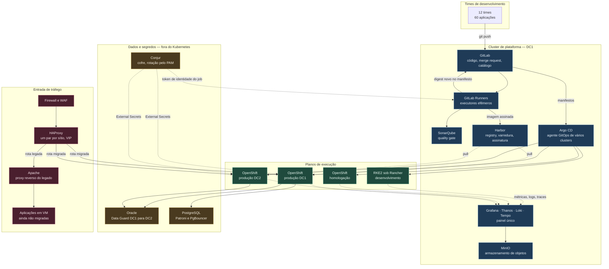
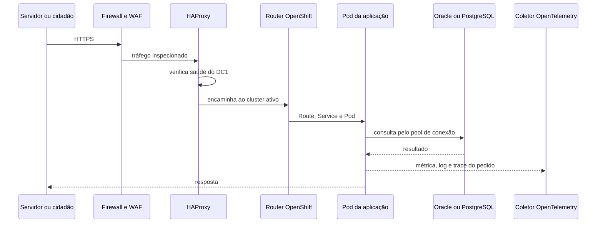

# 1. Visão geral da arquitetura

A plataforma tem cinco planos que se tocam em pontos definidos: o plano de entrega, que transforma
commit em artefato publicado; o plano de execução, onde a aplicação roda; o plano de dados, onde
ficam os bancos e o cofre; o plano de observação, que diz se a aplicação está saudável; e o plano
de tráfego, que leva o cidadão e o servidor até ela. Com os planos separados, trocar uma
ferramenta não obriga a reescrever o resto.

A regra que organiza o todo: **o pipeline publica, o GitOps implanta**. Quem constrói não tem
credencial de produção, e quem implanta não constrói nada. Entre os dois há um registry de imagens
e um repositório Git de manifestos, que são as únicas fronteiras por onde uma alteração atravessa.

Ao longo do texto, GitOps é o modelo em que o estado desejado do cluster vive num repositório Git
e um agente dentro do cluster converge a realidade para esse estado.

---

## O desenho

---

## O papel de cada peça

### Plano de entrega

**GitLab** guarda três famílias de repositório que não se misturam: o código das aplicações, os
manifestos de implantação e a infraestrutura como código. A separação importa porque o pipeline de
uma aplicação precisa escrever no repositório de manifestos. Conceder essa permissão sobre o
repositório de código abriria caminho para alterar o próprio pipeline que concede a permissão.

**GitLab Runners** executam os jobs em contêineres descartados ao fim de cada execução. Rodam no
cluster de plataforma, com escalonamento automático por fila. Runners de produção ficam em pool
separado, com acesso de rede restrito ao registry e ao repositório de manifestos.

**SonarQube** mede qualidade e cobertura, e devolve um veredito. O veredito só reprova a entrega
quando incide sobre código novo, pelo motivo exposto no fluxo de entrega.

**Harbor** é o registry interno. Guarda a imagem, roda a varredura de vulnerabilidade com Trivy,
armazena a assinatura Cosign e a lista de componentes do artefato. Também guarda cópia local das
imagens de registries públicos, o que remove a dependência de internet no momento da implantação.

> *Decisão: o registry é Harbor e não Quay porque varredura, assinatura e replicação vêm no produto
> sem subscrição adicional. O custo é operar mais um componente com banco e armazenamento próprios.
> Com OpenShift Platform Plus já contratado, Quay passa a ser a escolha melhor (ADR-006).*

**Argo CD** roda no cluster de plataforma e gerencia os quatro clusters de execução por conexão de
saída. Lê o repositório de manifestos, compara com o que existe no cluster e converge. Guarda o
histórico de sincronizações, o que torna o retorno à versão anterior uma operação de segundos. Uma
segunda instância fica instalada e desligada em DC2, para assumir `prd-dc2` em minutos se DC1 cair
(ADR-009). O desenho completo do GitOps está em [`docs/09`](09-gitops-argocd.md).

**Conjur**, da CyberArk, guarda segredo de aplicação, credencial de banco e credencial da própria
esteira. A rotação é do CyberArk PAM, que troca a senha no banco e sincroniza o valor novo para o
Conjur. Nenhum segredo vive no repositório, nem em variável de pipeline de longa duração. O
operador External Secrets, dentro de cada cluster, autentica no Conjur pela identidade da
ServiceAccount e materializa o segredo como objeto do Kubernetes. A aplicação lê variável de
ambiente e não sabe que o cofre existe.

O Conjur roda em máquina virtual, fora dos clusters. Ele é necessário para reconstruir um cluster,
e não pode morar dentro do que precisa reconstruir.

> *Decisão: o cofre é o Conjur, integrado ao PAM, e não o Vault. Com o PAM já governando as contas
> privilegiadas, um segundo sistema dividiria a auditoria em duas fontes. O custo é a licença
> comercial. Sem o PAM, a decisão se inverte para o OpenBao (ADR-008).*

### Plano de execução

**OpenShift** sustenta homologação e produção. A escolha é por suporte contratado, por controle de
contexto de segurança no momento da admissão e por ciclo de atualização previsível. Os três pesam
quando o dado é fiscal e há órgão de controle externo auditando.

**RKE2 sob Rancher** sustenta desenvolvimento. O ambiente onde o time experimenta não precisa de
subscrição por nó, e o Rancher ainda serve como inventário e console único dos cinco clusters.

> *Decisão: as duas ferramentas de Kubernetes do parque ficam, com papéis distintos, em vez de uma
> ser descontinuada. O custo é manter duas distribuições atualizadas. A diferença entre
> desenvolvimento e produção é contida por teste de conformidade e por chart base comum (ADR-001).*

**MinIO** é o armazenamento de objetos on-premises. Recebe o histórico longo de métricas, os logs,
os traces e os backups de recursos do Kubernetes. Estar on-premises é o que permite reter dado
fiscal dentro do perímetro da Secretaria.

### Plano de dados

**Oracle e PostgreSQL ficam em máquina virtual**, fora do Kubernetes. O ganho de rodar banco em
contêiner é pequeno quando há um banco por aplicação e já existe rotina madura de backup. O custo
de aprender a operar um operador de banco durante uma migração de plataforma é alto.

> *Decisão: banco de dados permanece fora do Kubernetes nos primeiros doze meses. O custo é o banco
> ficar fora do GitOps, com processo próprio de mudança. A reavaliação acontece quando houver
> demanda por muitos bancos pequenos e de vida curta (ADR-004).*

### Plano de observação

**Prometheus** raspa a métrica da aplicação dentro de cada cluster, avalia ali mesmo as regras de
alerta e guarda quinze dias. **Thanos** une os cinco clusters numa consulta só e guarda o histórico
longo no MinIO. **Loki** recebe log, **Tempo** recebe trace, e o **coletor OpenTelemetry** é o
ponto único por onde log e trace saem da aplicação. **Grafana** é o painel onde os três sinais se
cruzam pelo identificador de trace.

### Plano de tráfego

**HAProxy** é a porta de entrada, com um par ativo-passivo em cada sítio e endereço virtual
compartilhado por VRRP dentro do sítio. VRRP é o protocolo que move esse endereço para o nó
sobrevivente quando o ativo cai.
O HAProxy decide duas coisas: para qual datacenter mandar, conforme a saúde do roteador de cada
cluster, e se a aplicação pedida já migrou.

**Apache** continua como proxy reverso das aplicações que ainda vivem em máquina virtual, e serve
conteúdo estático. Essa configuração é o que torna a migração reversível: a rota de uma aplicação
migrada aponta para o cluster, e inverter a aponta de volta para o Apache. O arquivo
[`exemplos/borda/haproxy.cfg`](../exemplos/borda/haproxy.cfg) mostra as duas regras lado a lado.

---

## O caminho de um pedido em produção

A decisão de datacenter é do HAProxy, com base em
verificação ativa de saúde do roteador, e nenhum componente dentro do cluster participa dela.
O pool de conexão fica fora do pod, no PgBouncer, porque dezenas de réplicas abrindo conexão direta
esgotam o limite do banco antes de esgotar a CPU. E a telemetria sai por caminho assíncrono: se o
coletor cair, o pedido continua sendo respondido.

---

## O que foi acrescentado além do enunciado

| Componente | Por quê |
|---|---|
| Harbor | O enunciado cita CI/CD sem dizer onde a imagem fica. Sem registry interno, a entrega depende de internet e perde rastreabilidade |
| Argo CD | Separa a credencial de produção do pipeline e torna o retorno à versão anterior uma operação de Git |
| Conjur, External Secrets e Reloader | Credencial de banco fiscal não pode viver em variável de pipeline, e a rotação dela não pode derrubar a aplicação |
| Prometheus, Thanos, Loki, Tempo, Grafana | O enunciado pede observabilidade e não nomeia ferramenta |
| MinIO | Retenção longa de telemetria e destino de backup, dentro do perímetro |
| Kyverno | Transforma regra escrita em regra aplicada no momento da admissão do pod |
| Velero | Backup dos objetos do Kubernetes e dos volumes persistentes |
| Keycloak | Login único no OpenShift, GitLab, Harbor, Argo CD e Grafana, integrado ao diretório corporativo |
| Argo Rollouts | Implantação canário para as aplicações de nível 1, a partir da terceira fase |

O que foi deliberadamente deixado de fora também diz algo. **Não há malha de serviço na proposta
inicial.** Ela resolve criptografia mútua entre serviços, política de tráfego fina e observabilidade
sem instrumentar código. Cobra por isso um proxy por pod, um plano de controle a operar e uma
classe nova de incidente. Com 60 aplicações ainda não containerizadas e um time de plataforma em
formação, esse custo chega antes do benefício.

> *Decisão: a malha de serviço entra em avaliação quando houver exigência formal de criptografia em
> trânsito entre serviços, ou mais de cem serviços conversando entre si (ADR-005).*

---

## Sigilo fiscal, LGPD e auditoria

O dado que circula nesta plataforma está protegido duas vezes: pelo sigilo fiscal, do artigo 198
do Código Tributário Nacional, e pela LGPD. A plataforma não resolve essas exigências sozinha, mas
cada uma tem um controle concreto, e não uma intenção.

| Exigência | Como a plataforma atende | Onde está |
|---|---|---|
| Ninguém lê dado fiscal sem necessidade | Nenhum grupo humano lê `Secret` em homologação e produção. Massa de homologação anonimizada antes da carga, fora dos clusters | `docs/02`, ADR-008 |
| Todo acesso fica registrado | Auditoria do servidor de API, do Argo CD, do Conjur, do GitLab e do Harbor enviada ao SIEM da Secretaria e guardada por cinco anos em armazenamento com bloqueio de escrita | `docs/04` |
| Dado pessoal não vaza por log | A aplicação não registra; o coletor mascara CPF, CNPJ e cabeçalho de autorização como rede de segurança | `docs/04`, coletor OpenTelemetry |
| Criptografia em trânsito | TLS na borda e da borda até o roteador, com certificado conferido; IPsec entre os nós de cada cluster; TLS nativo entre aplicação e banco | `exemplos/borda/haproxy.cfg` |
| Criptografia em repouso | etcd cifrado nos clusters; datastore do vSphere cifrado; TDE nos bancos Oracle com dado fiscal | Este documento |
| Chave de assinatura e certificado digital | No Conjur, desde o início. Se a Secretaria tiver HSM, a chave do Cosign e os certificados ICP-Brasil das aplicações migram para ele | ADR-008 |

> *Decisão: a criptografia entre o roteador e o pod, e entre pods, é a da rede do cluster, por IPsec
> entre os nós, e não TLS em cada aplicação nem malha de serviço. Exigir TLS em cada pod obrigaria
> 60 aplicações a gerir certificado; a malha de serviço tem o custo descrito acima. O custo aceito
> é que o IPsec cifra, mas não autentica um serviço para o outro: dentro do mesmo nó, o tráfego
> entre pods não passa pelo túnel. Se a auditoria exigir autenticação mútua entre serviços, é o
> critério do ADR-005 para reavaliar a malha.*

O TDE do Oracle depende da opção Advanced Security, que é licenciada à parte. A proposta o aplica
só aos bancos com dado fiscal, e o custo entra no levantamento da fase 0. Sem ele, a proteção em
repouso desses bancos fica na cifra do datastore, que protege contra o disco roubado, mas não
contra quem tem acesso à máquina virtual.
