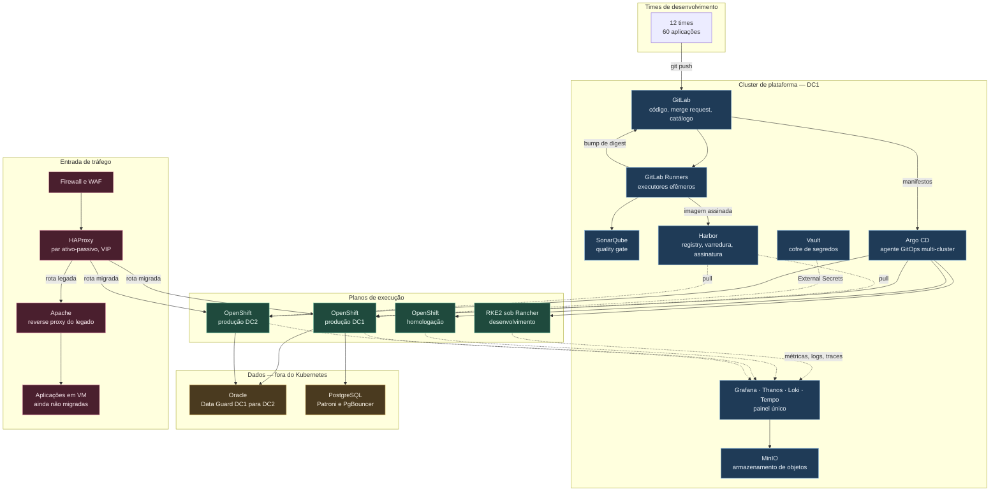
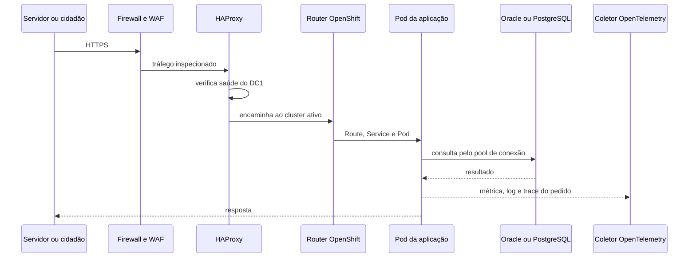

# 1. Visão geral da arquitetura

A plataforma tem quatro planos que se tocam em pontos definidos: o plano de entrega, que transforma
commit em artefato publicado; o plano de execução, onde a aplicação roda; o plano de observação,
que diz se ela está saudável; e o plano de tráfego, que leva o cidadão e o servidor até ela.
Separar esses planos é o que permite trocar uma ferramenta sem reescrever o resto.

A regra que organiza o todo: **o pipeline publica, o GitOps implanta**. Quem constrói não tem
credencial de produção, e quem implanta não constrói nada. Entre os dois há um registry de imagens
e um repositório Git de manifestos, que são as únicas fronteiras por onde uma alteração atravessa.

Ao longo do texto, GitOps é o modelo em que o estado desejado do cluster vive num repositório Git
e um agente dentro do cluster converge a realidade para esse estado.

---

## O desenho

---

## O papel de cada peça

### Plano de entrega

**GitLab** guarda três famílias de repositório que não se misturam: o código das aplicações, os
manifestos de implantação e a infraestrutura como código. A separação importa porque o pipeline de
uma aplicação precisa escrever no repositório de manifestos. Conceder essa permissão sobre o
repositório de código abriria caminho para alterar o próprio pipeline que concede a permissão.

**GitLab Runners** executam os jobs em contêineres descartados ao fim de cada execução. Rodam no
cluster de plataforma, com escalonamento automático por fila. Runners de produção ficam em pool
separado, com acesso de rede restrito ao registry e ao repositório de manifestos.

**SonarQube** mede qualidade e cobertura, e devolve um veredito. O veredito só reprova a entrega
quando incide sobre código novo, pelo motivo exposto no fluxo de entrega.

**Harbor** é o registry interno. Guarda a imagem, roda a varredura de vulnerabilidade com Trivy,
armazena a assinatura Cosign e a lista de componentes do artefato. Também funciona como cache de
proxy para registries públicos, o que remove a dependência de internet no momento da implantação.

> *Decisão: o registry é Harbor e não Quay porque varredura, assinatura e replicação vêm no produto
> sem subscrição adicional. Com OpenShift Platform Plus já contratado, Quay passa a ser a escolha
> melhor (ADR-006).*

**Argo CD** roda no cluster de plataforma e gerencia os quatro clusters de execução por conexão de
saída. Lê o repositório de manifestos, compara com o que existe no cluster e converge. Guarda o
histórico de sincronizações, o que torna o retorno à versão anterior uma operação de segundos.

**Vault** guarda segredo de aplicação e credencial de banco. Nenhum segredo vive no repositório,
nem em variável de pipeline de longa duração. O operador External Secrets, dentro de cada cluster,
materializa o segredo como objeto do Kubernetes a partir do cofre.

### Plano de execução

**OpenShift** sustenta homologação e produção. A escolha é por suporte contratado, por controle de
contexto de segurança no momento da admissão e por ciclo de atualização previsível. Os três pesam
quando o dado é fiscal e há órgão de controle externo auditando.

**RKE2 sob Rancher** sustenta desenvolvimento. O ambiente onde o time experimenta não precisa de
subscrição por nó, e o Rancher ainda serve como inventário e console único dos quatro clusters.

> *Decisão: as duas ferramentas de Kubernetes do parque ficam, com papéis distintos, em vez de uma
> ser descontinuada. A diferença entre desenvolvimento e produção é contida por teste de
> conformidade e por chart base comum (ADR-001).*

**MinIO** é o armazenamento de objetos on-premises. Recebe o histórico longo de métricas, os logs,
os traces e os backups de recursos do Kubernetes. Estar on-premises é o que permite reter dado
fiscal dentro do perímetro da Secretaria.

### Plano de dados

**Oracle e PostgreSQL ficam em máquina virtual**, fora do Kubernetes. O ganho de rodar banco em
contêiner é pequeno quando há um banco por aplicação e já existe rotina madura de backup. O custo
de aprender a operar um operador de banco durante uma migração de plataforma é alto.

> *Decisão: banco de dados permanece fora do Kubernetes nos primeiros doze meses. A reavaliação
> acontece quando houver demanda por muitos bancos pequenos e de vida curta (ADR-004).*

### Plano de observação

**Prometheus** coleta métrica dentro de cada cluster, com retenção curta local. **Thanos** une os
quatro clusters numa consulta só e empurra o histórico para o MinIO. **Loki** recebe log, **Tempo**
recebe trace, e o **coletor OpenTelemetry** é o único ponto por onde a aplicação envia qualquer um
dos três. **Grafana** é o painel onde os três se cruzam pelo identificador de trace.

### Plano de tráfego

**HAProxy** em par ativo-passivo, com endereço virtual compartilhado por VRRP, é a porta de
entrada. VRRP é o protocolo que move esse endereço para o nó sobrevivente quando o ativo cai.
O HAProxy decide duas coisas: para qual datacenter mandar, conforme a saúde do roteador de cada
cluster, e se a aplicação pedida já migrou.

**Apache** continua como reverse proxy das aplicações que ainda vivem em máquina virtual, e serve
conteúdo estático. Essa configuração é o que torna a migração reversível: a rota de uma aplicação
migrada aponta para o cluster, e inverter a aponta de volta para o Apache. O arquivo
[`exemplos/borda/haproxy.cfg`](../exemplos/borda/haproxy.cfg) mostra as duas regras lado a lado.

---

## O caminho de um pedido em produção

Três pontos desse caminho merecem destaque. A decisão de datacenter é do HAProxy, com base em
verificação ativa de saúde do roteador, e nenhum componente dentro do cluster participa dela.
O pool de conexão fica fora do pod, no PgBouncer, porque dezenas de réplicas abrindo conexão direta
esgotam o limite do banco antes de esgotar a CPU. E a telemetria sai por caminho assíncrono: se o
coletor cair, o pedido continua sendo respondido.

---

## O que foi acrescentado além do enunciado

| Componente | Por quê |
|---|---|
| Harbor | O enunciado cita CI/CD sem dizer onde a imagem fica. Sem registry interno, a entrega depende de internet e perde rastreabilidade |
| Argo CD | Separa a credencial de produção do pipeline e torna o retorno à versão anterior uma operação de Git |
| Vault e External Secrets | Credencial de banco fiscal não pode viver em variável de pipeline |
| Prometheus, Thanos, Loki, Tempo, Grafana | O enunciado pede observabilidade e não nomeia ferramenta |
| MinIO | Retenção longa de telemetria e destino de backup, dentro do perímetro |
| Kyverno | Transforma regra escrita em regra aplicada no momento da admissão do pod |
| Velero | Backup dos objetos do Kubernetes e dos volumes persistentes |
| Keycloak | Login único no OpenShift, GitLab, Harbor, Argo CD e Grafana, integrado ao diretório corporativo |
| Argo Rollouts | Implantação canário para as aplicações de maior criticidade, a partir da terceira fase |

O que foi deliberadamente deixado de fora também diz algo. **Não há malha de serviço na proposta
inicial.** Ela resolve criptografia mútua entre serviços, política de tráfego fina e observabilidade
sem instrumentar código. Cobra por isso um proxy por pod, um plano de controle a operar e uma
classe nova de incidente. Com 60 aplicações ainda não containerizadas e um time de plataforma em
formação, esse custo chega antes do benefício.

> *Decisão: a malha de serviço entra em avaliação quando houver exigência formal de criptografia em
> trânsito entre serviços, ou mais de cem serviços conversando entre si (ADR-005).*
