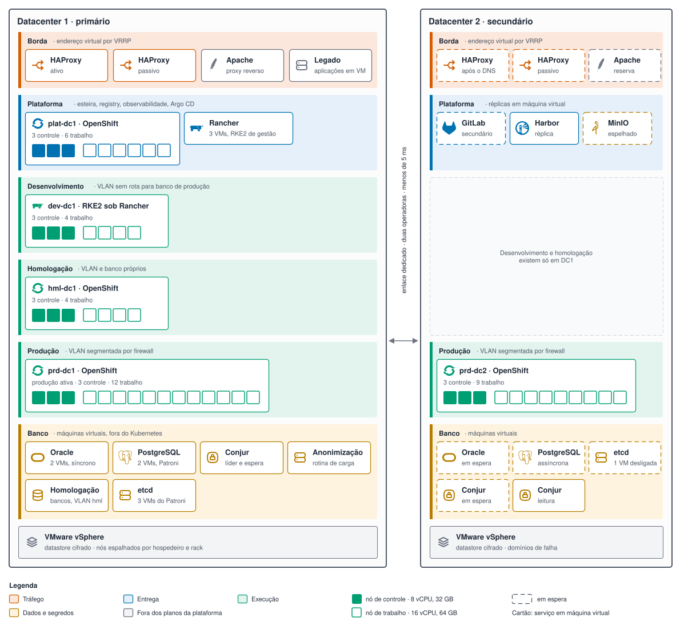

# 2. Topologia de clusters e ambientes

São cinco clusters em dois datacenters. A separação entre ambientes é física, por cluster, e não
lógica, por namespace. A razão é direta: namespace isola cota e permissão, mas não isola versão do
Kubernetes, falha de nó de controle, saturação de rede nem erro humano em recurso de escopo global.
Em plataforma que hospeda dado fiscal, esses quatro casos importam mais que a economia de hardware.

---

## O inventário

| Cluster | Sítio | Distribuição | Papel | Nós de controle | Nós de trabalho |
|---|---|---|---|---|---|
| `plat-dc1` | DC1 | OpenShift | Esteira, registry, observabilidade, Argo CD | 3 | 6 |
| `dev-dc1` | DC1 | RKE2 sob Rancher | Desenvolvimento dos 12 times | 3 | 4 |
| `hml-dc1` | DC1 | OpenShift | Homologação, espelho de configuração da produção | 3 | 4 |
| `prd-dc1` | DC1 | OpenShift | Produção, sítio primário | 3 | 12 |
| `prd-dc2` | DC2 | OpenShift | Produção, sítio secundário | 3 | 9 |

Nó de controle tem 8 vCPU e 32 GB; nó de trabalho, 16 vCPU e 64 GB. Homologação tem um terço dos
nós de trabalho de `prd-dc1`, com a mesma configuração por nó. `prd-dc2` tem 70 por cento da
capacidade de `prd-dc1`, o que cobre o nível 1 e o nível 2 com as aplicações suspensíveis
desligadas ([`docs/05`](05-resiliencia.md)).

Os números são ponto de partida, a ser revisto com o inventário de consumo real das 60 aplicações,
levantado na fase de descoberta. O que não é negociável é o três em nó de controle: abaixo disso o
etcd perde quórum com uma única falha.

Fora da tabela, em máquina virtual, ficam três grupos de peças:

- **Os bancos e o Conjur.** O cofre tem líder e réplica de espera em DC1, réplica de espera e
  réplica de leitura em DC2. Ele não roda em nenhum dos cinco clusters porque é necessário para
  reconstruir qualquer um deles.
- **Os pares de HAProxy**, um por sítio.
- **As réplicas de plataforma em DC2**: o GitLab secundário, a réplica do Harbor e o MinIO
  espelhado. DC2 não tem cluster de plataforma; essas três peças rodam em máquinas virtuais
  dedicadas, instaladas pelos instaladores oficiais de cada produto para máquina virtual. O Argo
  CD de contingência é a exceção: fica dentro de `prd-dc2`, desligado (ADR-009).

**Figura 2.1 — Topologia física dos dois datacenters.**



---

## Por que cada cluster existe

**`plat-dc1` existe para que a esteira não compita com a aplicação.** Um build pesado de Java
consome CPU e memória de forma imprevisível. Se o runner dividir nó com a aplicação de produção, o
pico do build vira latência do contribuinte. Separar também cria uma fronteira de permissão: o
runner não tem rota de rede para o plano de controle dos clusters de produção.

**`dev-dc1` existe para que o time quebre coisas sem pedir licença.** O desenvolvedor tem permissão
de edição no seu namespace, pode aplicar manifesto direto e pode derrubar o que quiser. O cluster
é recriável por código em menos de uma hora, e nenhum dado dele é insubstituível. Como roda RKE2,
não consome subscrição por nó.

**`hml-dc1` existe para que a diferença com produção seja só de tamanho.** Mesma distribuição,
mesma versão, mesmas políticas de admissão, mesmo controlador de entrada, mesmo chart base. O que
muda é a quantidade de réplicas e a capacidade dos nós. Essa igualdade é o que torna o resultado da
homologação uma evidência útil.

**`prd-dc1` e `prd-dc2` existem separados, e não como um cluster esticado entre sítios.** Um
cluster esticado coloca o quórum do etcd dependendo do enlace entre datacenters: uma oscilação de
rede de trinta segundos vira perda de plano de controle nos dois lados. Dois clusters independentes
trocam essa fragilidade por um custo de operação maior, que é pagar duas atualizações em vez de uma.

> *Decisão: produção é dois clusters independentes, um por sítio, em vez de um cluster esticado.
> O critério que inverteria a escolha é enlace com latência abaixo de 2 ms e três sítios para o
> quórum, que a Secretaria não tem (ADR-002).*

---

## Como os ambientes se separam

A separação acontece em quatro camadas ao mesmo tempo. Nenhuma delas sozinha é suficiente.

| Camada | Desenvolvimento | Homologação | Produção |
|---|---|---|---|
| Cluster | `dev-dc1` | `hml-dc1` | `prd-dc1` e `prd-dc2` |
| Rede | VLAN de desenvolvimento, sem rota para banco de produção | VLAN de homologação, banco de homologação | VLAN de produção, segmentada por firewall |
| Dado | Massa sintética | Massa anonimizada, gerada por rotina própria | Dado real |
| Permissão | Time edita o próprio namespace | Time só lê; alteração vem do Argo CD | Ninguém edita; apenas o Argo CD escreve |
| Entrada | Rota interna, sem publicação externa | Rota interna com autenticação | Publicada pelo HAProxy |

A regra de permissão em produção é a mais importante e a mais difícil de sustentar politicamente.
**Em `prd-dc1` e `prd-dc2`, nenhuma pessoa tem permissão de escrita no estado da aplicação.** O
acesso humano é de leitura. Durante um incidente, o plantão age sobre o processo pelo Argo CD
(sincronizar, desligar a sincronização de uma aplicação, voltar à versão anterior), com registro,
e não edita objeto à mão ([`docs/09`](09-gitops-argocd.md)). Quem quiser mudar produção abre merge
request no repositório de manifestos.

A massa de homologação é anonimizada porque dado fiscal copiado para um ambiente com permissão mais
larga é incidente de privacidade esperando acontecer. A rotina de carga mascara documento, nome e
valor antes da restauração. Ela roda numa máquina virtual dedicada, na zona de banco, operada pela
equipe de banco, e não em nenhum cluster: o cluster de plataforma executa build de código dos
doze times e não pode ter rota até o banco de produção.

---

## Como as 60 aplicações se organizam dentro do cluster

Cada aplicação tem um namespace por ambiente, nomeado `<sigla-do-time>-<aplicacao>-<ambiente>`.
Doze times e sessenta aplicações dão cerca de cento e oitenta namespaces somados os três ambientes,
o que é tranquilo para um cluster do porte proposto.

Cada namespace nasce com seis objetos, criados pelo mesmo processo que cria o namespace:

- **ResourceQuota**, que limita CPU, memória e quantidade de objetos. Sem ela, uma aplicação com
  vazamento de memória consome o nó e derruba as vizinhas.
- **LimitRange**, que define valor padrão de requisição e limite. Pod sem requisição declarada
  atrapalha o escalonador e é a causa mais comum de nó desequilibrado.
- **NetworkPolicy** de negação por padrão, que bloqueia todo tráfego de entrada e libera apenas o
  controlador de entrada e os namespaces declarados como dependência.
- **RoleBinding** ligado ao grupo do diretório corporativo do time dono.
- **ServiceAccount** `conjur-leitor`, registrada como identidade no Conjur, para que o External
  Secrets obtenha segredo apresentando o token dela, sem credencial estática. A política do Conjur
  só deixa essa identidade ler os caminhos da aplicação naquele ambiente.
- **SecretStore** que liga o namespace ao Conjur por essa identidade. O time não pode criá-lo nem
  alterá-lo; se pudesse, apontaria para outra identidade
  ([`exemplos/segredos/`](../exemplos/segredos/)).

> *Decisão: a negação por padrão na rede entra desde o primeiro namespace, e não como endurecimento
> posterior. Ligar negação por padrão num cluster que já tem tráfego implícito entre sessenta
> aplicações exige mapear dependências que ninguém documentou. O custo é atrito na primeira semana
> de cada aplicação: toda dependência precisa estar declarada no catálogo antes de funcionar.*

A classificação de criticidade da aplicação, declarada no catálogo, define onde o pod pode rodar.
Aplicações de nível 1 recebem tolerância para um conjunto de nós reservado, com hardware melhor e
sem compartilhamento com lote. O arquivo em
[`exemplos/catalogo/exemplo-aplicacao.yaml`](../exemplos/catalogo/exemplo-aplicacao.yaml) mostra o
campo que dispara isso.

---

## Distribuição dos nós dentro do sítio

Dentro de `prd-dc1`, os doze nós de trabalho não podem viver no mesmo hospedeiro físico nem no
mesmo chassi. Nos clusters OpenShift, quem espalha as máquinas virtuais são os domínios de falha do
vSphere, declarados na instalação ([`docs/06`](06-iac.md)); no RKE2, uma regra de anti-afinidade do
vSphere. A restrição de dispersão topológica do Kubernetes espalha os pods sobre essas máquinas.

Cada nó recebe rótulo de zona conforme o rack onde está o hospedeiro:

```yaml
topology.kubernetes.io/zone: dc1-rack-a
```

Com esse rótulo, uma aplicação com três réplicas fica com uma em cada rack sempre que houver
capacidade. Perder um rack inteiro remove um terço da capacidade, não a aplicação. A regra é
preferencial, e não obrigatória, de propósito: com um rack em manutenção, a obrigatória deixaria o
pod pendente para sempre. O chart base aplica essa restrição sem
que o time precise saber dela, como se vê em
[`exemplos/helm/app-base/templates/deployment.yaml`](../exemplos/helm/app-base/templates/deployment.yaml).

---

## O que acontece com Rancher e OpenShift convivendo

A objeção previsível é que manter duas distribuições dobra o aprendizado. A resposta tem três
partes.

Primeiro, o aprendizado comum é maior que a diferença. Deployment, Service, ConfigMap, HPA,
NetworkPolicy e RBAC são idênticos. O que difere é o objeto de entrada, Route no OpenShift e
Ingress no RKE2, e o controle de contexto de segurança, SecurityContextConstraints no OpenShift e
Pod Security Admission no RKE2.

Segundo, essa diferença é absorvida pelo chart base. O time preenche valores; o template decide se
emite Route ou Ingress conforme o ambiente. Nenhum desenvolvedor escreve os dois.

Terceiro, há um teste que protege contra a divergência silenciosa. A cada atualização de qualquer
cluster, um job do pipeline de plataforma instala uma aplicação de referência nos quatro clusters de
execução e
verifica o mesmo conjunto de comportamentos. Se a aplicação de referência passa em desenvolvimento
e falha em produção, a divergência aparece antes de uma aplicação real tropeçar nela.

O Rancher também ganha um papel que o OpenShift não cobre: inventário único. Os cinco clusters
ficam importados nele, o que dá uma lista só de nós, versões e estado de atualização. Com equipe
pequena, essa lista única poupa horas de conferência a cada atualização.
