# 3. Fluxo de entrega

Uma alteração atravessa a plataforma em dois movimentos separados por um registry. O primeiro
movimento é o pipeline do GitLab CI, que vai do commit até uma imagem assinada e publicada. O
segundo é o Argo CD, que vai de uma linha de manifesto alterada até o pod novo em execução.

O que liga os dois é um identificador: o digest da imagem, no formato `sha256:...`, calculado a
partir do conteúdo. Ele é o fio que garante que o que foi testado é o que executa.

---

## O caminho do commit até produção

```mermaid
flowchart TD
    C["Commit em branch<br/>de funcionalidade"] --> MR["Merge request aberto"]

    subgraph PMR["Pipeline do merge request"]
        direction TB
        V0["Validação<br/>segredo no código"]
        V1["Compilação e teste unitário<br/>Maven · JUnit"]
        V2["Teste de integração<br/>banco real, versão de produção"]
        V3["Cobertura das linhas alteradas<br/>JaCoCo e diff-cover"]
        V4["Segurança do código<br/>Semgrep · Trivy"]
        V0 --> V1 --> V2 --> V3 --> V4
    end

    MR --> V0
    V4 --> REV["Revisão humana<br/>CODEOWNERS"]
    REV --> MAIN["Merge em main"]

    subgraph PMAIN["Pipeline de main"]
        direction TB
        Q["Quality gate do código novo<br/>SonarQube"]
        B["Build da imagem<br/>Kaniko, sem daemon"]
        SC["Varredura · componentes · assinatura<br/>Trivy · Syft · Cosign"]
        PUB["Publicação no Harbor<br/>digest registrado"]
        Q --> B --> SC --> PUB
    end

    MAIN --> Q
    PUB --> BUMP["Digest no overlay de dev"]

    BUMP --> AD["Argo CD sincroniza<br/>dev-dc1"]
    AD --> T1["Teste de fumaça<br/>e teste de contrato"]

    T1 -->|aprovado| PH["Merge request automático<br/>overlay de homologação"]
    PH --> AH["Argo CD sincroniza<br/>hml-dc1"]
    AH --> T2["Teste ponta a ponta · carga<br/>varredura dinâmica"]

    T2 -->|aprovado e 24 h estável| PP["Merge request de promoção<br/>overlay de produção"]
    PP --> APR["Aprovação de duas pessoas<br/>janela de mudança"]
    APR --> AP["Argo CD sincroniza<br/>prd-dc1 e prd-dc2"]
    AP --> CAN["Nível 1: canário 10 por cento<br/>por 15 minutos"]
    CAN --> FULL["Promoção total"]

    CAN -.->|erro acima do limiar| RB["Retorno automático"]

    classDef ci fill:#1f3b57,stroke:#8fb8de,color:#eaf2fa
    classDef gitops fill:#1f4a3d,stroke:#7fc8ab,color:#eafaf3
    classDef risco fill:#4a1f2e,stroke:#d98fa6,color:#fae9ef
    class V0,V1,V2,V3,V4,Q,B,SC,PUB,BUMP ci
    class AD,AH,AP,CAN,FULL gitops
    class RB risco
```



O pipeline completo está em [`exemplos/ci/.gitlab-ci.yml`](../exemplos/ci/.gitlab-ci.yml), e os
templates que ele inclui estão em [`exemplos/ci/templates/`](../exemplos/ci/templates/). O time
dono da aplicação escreve cerca de trinta e cinco linhas, quase todas de configuração; a lógica
vem do template central.

São dois pipelines com papéis diferentes. **O do merge request decide se a alteração pode entrar.**
Ele roda em minutos, sem construir imagem, e responde a uma pergunta só: este código está pronto
para ir para `main`? **O de `main` produz o artefato.** Ele roda uma vez por merge, constrói a
imagem uma única vez e a entrega ao GitOps.

---

## O que bloqueia e o que apenas informa

**Bloqueia o que o time tem como corrigir hoje e cuja falha indica
risco real.** Informa o que depende de terceiro, o que mede dívida acumulada ou o que ainda não tem
linha de base confiável.

### Bloqueiam a entrega

| Verificação | Ferramenta | Critério |
|---|---|---|
| Compilação | Maven | Qualquer erro |
| Teste unitário | JUnit | Qualquer falha |
| Teste de integração | PostgreSQL real, na mesma versão de produção | Qualquer falha |
| Cobertura das linhas alteradas | JaCoCo e `diff-cover`, no merge request | Abaixo de 80 por cento |
| Quality gate do código novo | SonarQube, em `main`, antes do build da imagem | Reprovação no perfil de código novo |
| Vulnerabilidade de código | Semgrep, e o SonarQube em `main` | Severidade alta ou crítica, confirmada |
| Dependência vulnerável | Trivy | Severidade crítica **com correção publicada** |
| Vulnerabilidade na imagem | Harbor com Trivy | Severidade crítica em camada própria |
| Segredo no código | Gitleaks | Qualquer ocorrência |
| Manifesto inválido | `kustomize build` e `kubeconform`, no pipeline de `manifestos-apps` | Qualquer erro |
| Política de admissão | Kyverno CLI, no pipeline de `manifestos-apps` | Violação de regra obrigatória |
| Assinatura da imagem | Cosign | Ausente ou inválida |
| Revisão humana | GitLab CODEOWNERS | Menos de uma aprovação, ou duas em produção |

### Apenas informam

| Verificação | Por que não bloqueia |
|---|---|
| Cobertura total do repositório | Uma aplicação legada com 12 por cento de cobertura não sobe para 80 numa entrega. Bloquear aqui faz o time desligar o teste |
| Problema de manutenção e complexidade | Medem dívida, não risco imediato. Entram como meta trimestral do time, não como portão |
| Vulnerabilidade sem correção publicada | O time não tem o que fazer. Vira exceção registrada, com prazo e reavaliação semanal automática |
| Teste de carga | Sem linha de base histórica, o resultado é ruído. Vira bloqueante a partir da terceira fase, quando houver série temporal |
| Licença de dependência | Exige julgamento jurídico, não técnico. Gera relatório para a área responsável |
| Vulnerabilidade na imagem base | Corrigir é trocar a base, o que é trabalho do time de plataforma. Gera chamado automático para a plataforma, não reprova o time |
| Teste de mutação | Mede se o teste verifica o que executa, mas leva dez vezes mais que a suíte. Roda à noite em `main` e vira indicador do time |
| Varredura dinâmica em homologação | O OWASP ZAP contra a aplicação em execução gera falso positivo até ser calibrado por aplicação. Abre item de acompanhamento; vira bloqueante por aplicação depois de calibrado |

O princípio por trás da segunda tabela: **um portão que o time não consegue atravessar vira um
portão que o time aprende a contornar.** Cobertura global obrigatória em código legado produz
teste que só executa linha sem verificar nada. Medir apenas o código novo resolve isso, porque o
que o time acabou de escrever ele tem como testar.

Toda verificação informativa aparece no mesmo relatório da bloqueante, no merge request. A
diferença está em quem decide, não em quem vê.

> *Decisão: o SonarQube é a edição Community, que não analisa merge request. A cobertura das linhas
> alteradas é calculada no merge request pelo `diff-cover`, e o quality gate do SonarQube roda em
> `main`, antes do build da imagem. A edição Developer, que o autor opera hoje em ambiente
> financeiro regulado, junta as duas peças num lugar só; ela entra quando o inventário da fase 0
> mostrar o custo da licença, que é cobrada por linha de código. O custo aceito até lá é o
> desenvolvedor ver os problemas de manutenção só depois do merge (ADR-012).*

---

## A estratégia de testes

Cobertura alta não prova que o teste verifica alguma coisa. Um teste que chama o método e não
confere o resultado cobre cem por cento das linhas e não pega defeito nenhum. Por isso a
plataforma define o que cada tipo de teste prova, onde ele roda e quanto tempo pode levar, em vez
de exigir só um número.

| Tipo | O que prova | Onde roda | Ferramenta no template Java | Tempo máximo |
|---|---|---|---|---|
| Unitário | A regra de negócio, isolada | Merge request | JUnit 5 e Mockito | 5 minutos |
| Integração | A aplicação conversa com o banco de verdade, o mesmo de produção | Merge request | Oracle ou PostgreSQL como serviço do job na esteira; Testcontainers na máquina do desenvolvedor | 10 minutos, 15 com Oracle |
| Contrato | A interface que outro sistema consome não quebrou | Merge request e `dev` | Spring Cloud Contract | 3 minutos |
| Fumaça | A versão implantada sobe, responde e alcança as dependências | Os três ambientes, como gancho do Argo CD depois de cada sincronização | Job do chart base | 1 minuto |
| Ponta a ponta | O fluxo de negócio completo funciona com as integrações reais de homologação | `hml` | Suíte do time | 20 minutos |
| Carga | A versão nova não piorou latência nem consumo | `hml` | k6 | 15 minutos |
| Mutação | O teste unitário falha quando o código muda | `main`, à noite | PIT | Sem limite |

Três regras dão sentido à tabela.

**Teste de integração usa banco de verdade.** Banco em memória, como o H2, aceita SQL que o
PostgreSQL recusa e recusa SQL que o Oracle aceita. O teste passa, a migração quebra em
homologação. Na esteira, o banco sobe como serviço do próprio job, com a mesma imagem de produção,
e é descartado no fim. Na máquina do desenvolvedor, o mesmo teste sobe o banco pelo
Testcontainers.

> *Decisão: na esteira, banco como serviço do job, e não Testcontainers. O Testcontainers precisa
> de um daemon de contêiner, e daemon dentro de job exige contêiner privilegiado, que a plataforma
> recusa pelo mesmo motivo que constrói a imagem com Kaniko. O custo é haver dois jeitos de subir o
> banco de teste. A versão da imagem vem de uma única propriedade do `pom.xml`, para os dois nunca
> divergirem.*

**Teste intermitente não é repetido, é corrigido.** O template central repete job só por falha de
infraestrutura do runner, nunca por falha de teste. Repetir até passar ensina o time a ignorar o
vermelho, e o dia em que o vermelho for real ninguém olha.

**O teste de mutação responde à crítica que a cobertura não responde.** O PIT altera o código
compilado, troca um `>` por `>=`, remove uma chamada, e roda a suíte de novo. Se o teste continua
passando com o código errado, ele não verificava aquilo. A métrica fica informativa porque é cara;
ela serve para o time descobrir onde a cobertura é decorativa.

---

## Como o artefato testado é o que vai para produção

O risco é reconstruir. Um `docker build` do mesmo Dockerfile em dias diferentes produz imagens
diferentes, porque a imagem base mudou, porque `apt-get update` trouxe outra versão de biblioteca,
porque o espelho do repositório de pacotes foi atualizado. A imagem testada em homologação deixa de
ser a imagem que executa em produção, sem que nada no processo registre isso.

A plataforma resolve com quatro regras combinadas.

**Primeira: a imagem é construída uma vez.** O estágio de build roda apenas quando um commit entra
em `main`. Nenhum estágio posterior tem `docker build`. A promoção entre ambientes nunca reconstrói.

**Segunda: a referência é o digest, não a tag (ADR-007).** O manifesto de qualquer ambiente aponta para
`harbor.sefaz.interno/time/app@sha256:9f2c...`, e não para `app:1.4.2`. O digest é o hash do
conteúdo do manifesto da imagem. Duas imagens com o mesmo digest são a mesma imagem; não há como
sobrescrever.

**Terceira: a promoção é um commit que copia o digest.** Promover de homologação para produção é
substituir uma linha de YAML no overlay de produção pelo digest já em homologação. O merge request
mostra a diferença, que é uma linha. Essa é toda a cerimônia.

```diff
 images:
   - name: app
     newName: harbor.sefaz.interno/fiscal/nfe
-    digest: sha256:4a1d9e...   # versão 1.4.1, em produção desde 12/03
+    digest: sha256:9f2c7b...   # versão 1.4.2, validada em hml em 18/03
```

**Quarta: o cluster recusa imagem não assinada.** O job de assinatura busca a chave privada no
Conjur pela identidade do job, assina em memória e a descarta. A política do Kyverno verifica a
assinatura Cosign contra a chave pública correspondente antes de admitir o pod. Imagem construída fora da esteira,
ou publicada por alguém com acesso ao registry, não executa. A política está em
[`exemplos/politicas/exigir-imagem-assinada.yaml`](../exemplos/politicas/exigir-imagem-assinada.yaml).

Junto com a imagem, o pipeline publica a lista de componentes do artefato, gerada pelo Syft. Quando
a próxima vulnerabilidade de ampla divulgação aparecer, a pergunta "quais das nossas 60 aplicações
usam essa biblioteca" se responde varrendo as sessenta listas guardadas ao lado das imagens, e
não abrindo chamado para doze times.

---

## Como a implantação acontece

A implantação é do Argo CD, não do pipeline. O pipeline não possui `kubeconfig` de nenhum cluster
de execução, e os runners não têm rota de rede para a porta do servidor de API de produção.

A única credencial de escrita que o pipeline usa é o token do repositório de manifestos, e ele não
mora em variável de CI. O job de promoção recebe do GitLab um token de identidade de curta duração,
que diz qual projeto, qual branch e se o branch é protegido. O Conjur troca esse token pelo segredo
apenas quando a política dele permite: projeto autorizado, branch protegido, runner restrito
(ADR-008).

O Argo CD observa o repositório de manifestos e aplica o que encontra. Cada aplicação em cada
cluster é um objeto `Application`, gerado automaticamente por um `ApplicationSet` que cruza os
diretórios do repositório com os clusters registrados. Aplicação nova não exige nenhuma
configuração no Argo CD: basta o diretório existir.

Em produção, a sincronização é automática depois do merge aprovado, dentro da janela de dias úteis,
das 7h às 19h. A correção automática de desvio fica ligada nos três ambientes. Alguém que edite um
Deployment direto no cluster de produção vê a alteração desfeita em segundos, e o evento fica
registrado. É isso que mantém o Git como descrição verdadeira do ambiente. Fora da janela, a
correção automática também espera, e o desvio aparece como alerta para o plantão.

A organização do repositório, a ordem dentro de uma sincronização, as permissões, o acesso de
emergência e a resiliência do próprio Argo CD estão em [`docs/09`](09-gitops-argocd.md).

> *Decisão: a implantação é por GitOps e não por `kubectl apply` no pipeline, porque isso remove a
> credencial de produção da esteira e transforma o retorno de versão numa operação de Git
> auditável. O custo é mais uma ferramenta para operar e a pergunta "meu pipeline passou, por que
> não subiu", que a notificação no merge request responde (ADR-003).*

---

## Como o retorno de versão funciona

Há três níveis, do mais rápido ao mais completo.

**Durante o canário, é automático.** Vale para as aplicações de nível 1. O Argo Rollouts envia 10
por cento do tráfego à versão nova por quinze minutos e compara duas métricas com as da versão
estável, ao mesmo tempo: taxa de resposta com erro de servidor e latência no percentil 95. Se o
canário ficar pior, o controlador devolve o tráfego inteiro para a versão estável e interrompe a
promoção. Ninguém é acordado; o canal do time recebe o aviso e o estado do commit fica vermelho.
As demais aplicações fazem atualização gradual do Deployment.

**Depois da promoção total, é um `git revert`.** O commit que mudou o digest é revertido no
repositório de manifestos; o Argo CD sincroniza; os pods voltam à imagem anterior. Como a imagem
anterior ainda está no Harbor e o nó provavelmente ainda a tem guardada, o tempo típico é de um a
dois minutos depois do merge. No nível 1, o Rollout reconhece uma das três últimas revisões e pula
os passos do canário, para o retorno não levar os 25 minutos de uma promoção. O histórico fica legível: dá para ver quem promoveu, quem reverteu e quando.

**Durante um incidente com o GitLab indisponível, é `argocd app rollback`.** O comando volta a
aplicação à sincronização anterior sem passar pelo Git. O Argo CD só o aceita com a sincronização
automática desligada, porque ela traria o estado do Git de volta no ciclo seguinte. O plantão da
plataforma desliga a sincronização daquela aplicação, executa o retorno, abre o `git revert`
correspondente e religa a sincronização depois do revert aplicado. O procedimento completo, e o
detalhe que o faz funcionar com `Applications` geradas por `ApplicationSet`, está em
[`docs/09`](09-gitops-argocd.md).

### O limite do retorno de versão

**Retornar a aplicação não retorna o banco de dados.** Essa é a parte que mais produz incidente
longo, e nenhuma ferramenta resolve por si.

A plataforma obriga migração em duas etapas, no padrão de expandir e contrair:

1. **Expandir** acompanha a entrega que precisa do campo novo. Adiciona coluna que aceita nulo,
   cria tabela, cria índice de forma concorrente. O esquema passa a atender a versão antiga e a
   nova ao mesmo tempo.
2. **Contrair** vem numa entrega posterior, depois que a versão nova estiver estável em produção
   por pelo menos uma semana. Remove coluna, remove tabela, aplica restrição de obrigatoriedade.

Entre as duas, o retorno de versão é seguro, porque a versão antiga continua funcionando contra o
esquema novo. O pipeline recusa migração que remova ou renomeie objeto no mesmo lançamento que
introduz o uso dele, e a verificação é um job que analisa o script antes da revisão humana.

Em Oracle, o script roda pelo Liquibase num job do Kubernetes, executado pelo Argo CD como gancho
na onda anterior à da versão nova. O job usa um usuário de migração, separado do usuário da aplicação, sem permissão de alteração
estrutural fora da janela. Se ele falhar, a sincronização para e a versão anterior continua
servindo. Em PostgreSQL, o mesmo, com atenção a
`CREATE INDEX CONCURRENTLY`, que não roda dentro de transação e precisa de marcação específica.

---

## Correção urgente

Sexta-feira, 22h, a emissão de nota está devolvendo erro por um defeito de código. A correção
percorre o mesmo caminho de qualquer entrega, com três etapas encurtadas e registradas:

1. **Merge request com a correção**, aprovado por uma pessoa do time e pelo plantão da plataforma.
   Os portões bloqueantes continuam todos: teste, cobertura das linhas alteradas, segurança.
2. **A imagem nasce de `main`**, como sempre, e chega a `dev` e `hml` pelo promotor. A permanência
   de 24 horas em homologação é dispensada pelo plantão da plataforma, com justificativa no merge
   request de promoção. O teste de fumaça e o ponta a ponta em homologação não são dispensados.
3. **Fora da janela de mudança**, o plantão sincroniza manualmente, com registro. O canário do nível
   1 roda normalmente: ele protege justamente a correção feita às pressas.

O tempo típico, do merge à produção, fica entre 40 e 60 minutos, a maior parte em teste. Se isso
for longo demais para o incidente, o caminho é voltar à versão anterior, que leva minutos, e
corrigir com calma. O que não existe é imagem construída fora da esteira: a política de admissão
recusaria, e é bom que recuse.

---

## O que o time escreve de verdade

O pipeline de uma aplicação nova é este arquivo, sem nenhuma linha a mais:

```yaml
include:
  - project: 'plataforma/templates-ci'
    ref: 'v3'
    file:
      - '/base/estagios.yml'
      - '/base/qualidade.yml'
      - '/base/seguranca.yml'
      - '/base/imagem.yml'
      - '/base/promocao.yml'
      - '/linguagens/java.yml'

variables:
  APP_NAME: nfe-emissor
  APP_TIME: fiscal
  APP_TIER: "1"
  SONAR_PROJECT_KEY: fiscal_nfe-emissor
  JAVA_VERSION: "21"
  BANCO_TESTE: oracle
  COBERTURA_MINIMA_CODIGO_NOVO: "80"
```

O arquivo de exemplo acrescenta um job próprio, o teste de contrato contra o autorizador, porque é
o que foge do padrão daquela aplicação. Toda a lógica de build, teste, varredura, assinatura,
publicação e promoção vive no template central, versionado por tag. Quem altera o digest é o
próprio pipeline, abrindo merge request, e não uma ferramenta que observa o registry (ADR-010). O time fixa a referência `v3` e migra para `v4` quando quiser, no seu tempo.
A plataforma nunca altera o comportamento de um pipeline sem que o time troque a versão.

Essa é a diferença entre um template e uma imposição: o template central corrigido beneficia quem
estiver na mesma versão maior, e quem está numa anterior continua entregando.
