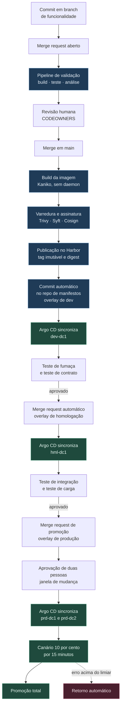

# 3. Fluxo de entrega

Uma alteração atravessa a plataforma em dois movimentos separados por um registry. O primeiro
movimento é o pipeline do GitLab CI, que vai do commit até uma imagem assinada e publicada. O
segundo é o Argo CD, que vai de uma linha de manifesto alterada até o pod novo em execução.

O que liga os dois é um identificador: o digest da imagem, no formato `sha256:...`, calculado a
partir do conteúdo. Ele é o fio que garante que o que foi testado é o que executa.

---

## O caminho do commit até produção



O pipeline completo está em [`exemplos/ci/.gitlab-ci.yml`](../exemplos/ci/.gitlab-ci.yml), e os
templates que ele inclui estão em [`exemplos/ci/templates/`](../exemplos/ci/templates/). O time
dono da aplicação escreve doze linhas; o resto vem do template central.

---

## O que bloqueia e o que apenas informa

A distinção não é arbitrária. **Bloqueia o que o time tem como corrigir hoje e cuja falha indica
risco real.** Informa o que depende de terceiro, o que mede dívida acumulada ou o que ainda não tem
linha de base confiável.

### Bloqueiam a entrega

| Verificação | Ferramenta | Critério |
|---|---|---|
| Compilação | GitLab CI | Qualquer erro |
| Teste unitário e de integração | Framework da linguagem | Qualquer falha |
| Cobertura de código novo | SonarQube | Abaixo de 80 por cento das linhas alteradas |
| Vulnerabilidade de código | SonarQube e Semgrep | Severidade alta ou crítica, confirmada |
| Dependência vulnerável | Trivy | Severidade crítica **com correção publicada** |
| Vulnerabilidade na imagem | Harbor com Trivy | Severidade crítica em camada própria |
| Segredo no código | Gitleaks | Qualquer ocorrência |
| Manifesto inválido | `kubeconform` e `kustomize build` | Qualquer erro |
| Política de admissão | Kyverno, em modo auditoria no pipeline | Violação de regra obrigatória |
| Assinatura da imagem | Cosign | Ausente ou inválida |
| Revisão humana | GitLab CODEOWNERS | Menos de uma aprovação, ou duas em produção |

### Apenas informam

| Verificação | Por que não bloqueia |
|---|---|
| Cobertura total do repositório | Uma aplicação legada com 12 por cento de cobertura não sobe para 80 numa entrega. Bloquear aqui faz o time desligar o teste |
| Code smell e complexidade | Medem dívida, não risco imediato. Entram como meta trimestral do time, não como portão |
| Vulnerabilidade sem correção publicada | O time não tem o que fazer. Vira exceção registrada, com prazo e reavaliação semanal automática |
| Teste de carga | Sem linha de base histórica, o resultado é ruído. Vira bloqueante a partir da terceira fase, quando houver série temporal |
| Licença de dependência | Exige julgamento jurídico, não técnico. Gera relatório para a área responsável |
| Vulnerabilidade na imagem base | Corrigir é trocar a base, o que é trabalho do time de plataforma. Gera chamado automático para a plataforma, não reprova o time |

O princípio por trás da segunda tabela: **um portão que o time não consegue atravessar vira um
portão que o time aprende a contornar.** Cobertura global obrigatória em código legado produz
teste que só executa linha sem verificar nada. Medir apenas o código novo resolve isso, porque o
que o time acabou de escrever ele tem como testar.

Toda verificação informativa aparece no mesmo relatório da bloqueante, no merge request. A
diferença está em quem decide, não em quem vê.

---

## Como o artefato testado é o que vai para produção

O risco é reconstruir. Um `docker build` do mesmo Dockerfile em dias diferentes produz imagens
diferentes, porque a imagem base mudou, porque `apt-get update` trouxe outra versão de biblioteca,
porque o mirror do repositório de pacotes foi atualizado. A imagem testada em homologação deixa de
ser a imagem que executa em produção, sem que nada no processo registre isso.

A plataforma resolve com quatro regras combinadas.

**Primeira: a imagem é construída uma vez.** O estágio de build roda apenas quando um commit entra
em `main`. Nenhum estágio posterior tem `docker build`. A promoção entre ambientes nunca reconstrói.

**Segunda: a referência é o digest, não a tag.** O manifesto de qualquer ambiente aponta para
`harbor.sefaz.interno/time/app@sha256:9f2c...`, e não para `app:1.4.2`. O digest é o hash do
conteúdo do manifesto da imagem. Duas imagens com o mesmo digest são a mesma imagem; não há como
sobrescrever.

**Terceira: a promoção é um commit que copia o digest.** Promover de homologação para produção é
substituir uma linha de YAML no overlay de produção pelo digest já em homologação. O merge request
mostra a diferença, que é uma linha. Essa é toda a cerimônia.

```diff
 images:
   - name: app
     newName: harbor.sefaz.interno/fiscal/nfe
-    digest: sha256:4a1d9e...   # versão 1.4.1, em produção desde 12/03
+    digest: sha256:9f2c7b...   # versão 1.4.2, validada em hml em 18/03
```

**Quarta: o cluster recusa imagem não assinada.** A política do Kyverno verifica a assinatura
Cosign contra a chave pública do pipeline antes de admitir o pod. Imagem construída fora da esteira,
ou publicada por alguém com acesso ao registry, não executa. A política está em
[`exemplos/politicas/exigir-imagem-assinada.yaml`](../exemplos/politicas/exigir-imagem-assinada.yaml).

Junto com a imagem, o pipeline publica a lista de componentes do artefato, gerada pelo Syft. Quando
a próxima vulnerabilidade de ampla divulgação aparecer, a pergunta "quais das nossas 60 aplicações
usam essa biblioteca" se responde consultando o Harbor, e não abrindo chamado para doze times.

---

## Como a implantação acontece

A implantação é do Argo CD, não do pipeline. O pipeline não possui `kubeconfig` de nenhum cluster
de execução, e os runners não têm rota de rede para a porta do servidor de API de produção.

O Argo CD observa o repositório de manifestos e aplica o que encontra. Cada aplicação em cada
ambiente é um objeto `Application`, gerado automaticamente por um `ApplicationSet` que percorre os
diretórios do repositório. Aplicação nova não exige nenhuma configuração no Argo CD: basta o
diretório existir. O gerador está em
[`exemplos/gitops/appsets/aplicacoes.yaml`](../exemplos/gitops/appsets/aplicacoes.yaml).

A configuração de sincronização difere por ambiente, e essa diferença é a definição de controle:

| | Desenvolvimento | Homologação | Produção |
|---|---|---|---|
| Sincronização automática | Sim | Sim | Sim, após o merge aprovado |
| Correção automática de desvio | Sim | Sim | Sim |
| Remoção de recurso órfão | Sim | Sim | Não, exige confirmação |
| Janela de sincronização | Livre | Livre | Dias úteis, das 7h às 19h |

A correção automática de desvio em produção é o que fecha a porta da alteração manual. Alguém que
edite um Deployment direto no cluster vê a alteração desaparecer em até três minutos, e o evento
fica registrado. Não é punição: é o que mantém o Git como descrição verdadeira do ambiente.

> *Decisão: a implantação é por GitOps e não por `kubectl apply` no pipeline, porque isso remove a
> credencial de produção da esteira e transforma o retorno de versão numa operação de Git
> auditável (ADR-003).*

---

## Como o retorno de versão funciona

Há três níveis, do mais rápido ao mais completo.

**Durante o canário, é automático.** O Argo Rollouts envia 10 por cento do tráfego à versão nova
por quinze minutos e observa duas métricas: taxa de resposta com erro de servidor e latência no
percentil 95. Se qualquer uma ultrapassar o limiar da versão anterior, o controlador devolve o
tráfego inteiro para a versão estável e interrompe a promoção. Ninguém é acordado, e o merge
request de promoção é reaberto com a análise anexada.

**Depois da promoção total, é um `git revert`.** O commit que mudou o digest é revertido no
repositório de manifestos; o Argo CD sincroniza; os pods voltam à imagem anterior. Como a imagem
anterior ainda está no Harbor e o nó provavelmente ainda tem a camada em cache, o tempo típico é de
um a dois minutos. O histórico fica legível: dá para ver quem promoveu, quem reverteu e quando.

**Durante um incidente em curso, é `argocd app rollback`.** O comando volta a aplicação à
sincronização anterior sem esperar merge request. O uso exige elevação temporária de permissão,
registrada, e obriga a abrir o `git revert` correspondente em seguida. Sem esse segundo passo, a
correção automática de desvio traria a versão com defeito de volta.

### O limite do retorno de versão

**Retornar a aplicação não retorna o banco de dados.** Essa é a parte que mais produz incidente
longo, e nenhuma ferramenta resolve por si.

A plataforma obriga migração em duas etapas, no padrão de expandir e contrair:

1. **Expandir** acompanha a entrega que precisa do campo novo. Adiciona coluna que aceita nulo,
   cria tabela, cria índice de forma concorrente. O esquema passa a atender a versão antiga e a
   nova ao mesmo tempo.
2. **Contrair** vem numa entrega posterior, depois que a versão nova estiver estável em produção
   por pelo menos uma semana. Remove coluna, remove tabela, aplica restrição de obrigatoriedade.

Entre as duas, o retorno de versão é seguro, porque a versão antiga continua funcionando contra o
esquema novo. O pipeline recusa migração que remova ou renomeie objeto no mesmo lançamento que
introduz o uso dele, e a verificação é um job que analisa o script antes da revisão humana.

Em Oracle, o script roda pelo Liquibase a partir de um job do Kubernetes, com usuário próprio e
sem permissão de alteração estrutural fora da janela. Em PostgreSQL, o mesmo, com atenção a
`CREATE INDEX CONCURRENTLY`, que não roda dentro de transação e precisa de marcação específica.

---

## O que o time escreve de verdade

O pipeline de uma aplicação nova é este arquivo inteiro:

```yaml
include:
  - project: 'plataforma/templates-ci'
    ref: 'v3'
    file:
      - '/dotnet/pipeline-completo.yml'

variables:
  APP_NAME: nfe-emissor
  APP_TIER: "1"
  SONAR_PROJECT_KEY: fiscal_nfe-emissor
```

Toda a lógica de build, varredura, assinatura, publicação e promoção vive no template central,
versionado por tag. O time fixa a referência `v3` e migra para `v4` quando quiser, no seu tempo.
A plataforma nunca altera o comportamento de um pipeline sem que o time troque a versão.

Essa é a diferença entre um template e uma imposição: o template central corrigido beneficia quem
estiver na mesma versão maior, e quem está numa anterior continua entregando.
