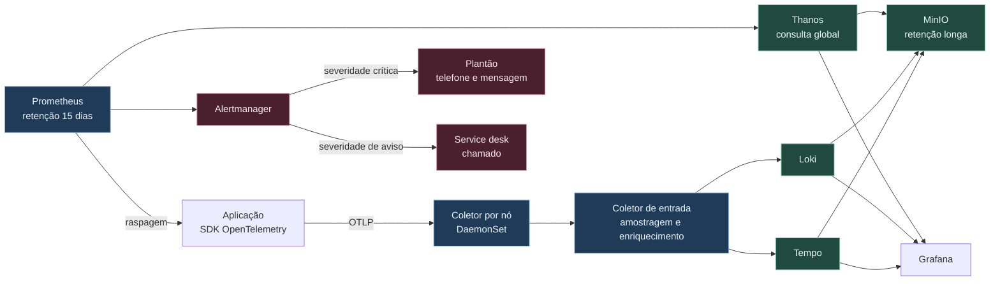

# 4. Observabilidade e operação

Observabilidade aqui tem um objetivo mensurável: reduzir o tempo entre a reclamação do usuário e a
identificação do componente responsável. Tudo o que não contribui para isso é custo de
armazenamento.

A aplicação emite métrica, log e trace para um destino só, o coletor OpenTelemetry. O coletor
decide para onde cada sinal vai. Trocar Tempo por Jaeger, ou Loki por Elasticsearch, passa a ser
alteração de configuração do coletor, sem tocar em nenhuma das 60 aplicações.

---

## Como os sinais fluem



A configuração do coletor está em
[`exemplos/observabilidade/otel-collector.yaml`](../exemplos/observabilidade/otel-collector.yaml).
O ponto central dela é o processador `k8sattributes`, que carimba cada sinal com namespace, pod,
nó e time dono. Sem esse carimbo, o roteamento de alerta por time não funciona.

---

## O que coletar

### Métrica

Toda aplicação expõe o mesmo conjunto mínimo, porque é o que permite comparar sessenta aplicações
no mesmo painel. O chart base injeta a configuração do SDK, então o time não escreve isso.

| Métrica | Para que serve |
|---|---|
| Taxa de requisições, por rota e código de resposta | Numerador e denominador do nível de serviço |
| Latência em histograma, por rota | Percentis 50, 95 e 99 sem recalcular do zero |
| Saturação do pool de conexão com o banco | Primeira coisa que satura em aplicação fiscal |
| Profundidade de fila e atraso de consumo | Em aplicação assíncrona, é onde o problema aparece primeiro |
| Uso de CPU e memória contra o limite | Indica o `OOMKilled` antes de ele acontecer |
| Reinícios de contêiner | Sinal de instabilidade que o usuário ainda não percebeu |

Da infraestrutura vêm as métricas do `kube-state-metrics`, do `node-exporter`, do roteador de
entrada, do HAProxy, do Oracle com um exportador dedicado e do PostgreSQL com o `postgres_exporter`.

**A retenção é escalonada.** Quinze dias de resolução cheia no Prometheus local resolvem a
investigação de incidente. Treze meses de resolução reduzida no MinIO, pelo Thanos, resolvem a
comparação com o mesmo período do ano anterior, que numa Secretaria da Fazenda é a pergunta mais
frequente de capacidade.

### Log

Log estruturado em JSON, uma linha por evento, com campos obrigatórios: horário em UTC, nível,
mensagem, nome do serviço, versão, identificador de trace e identificador de correlação do pedido.
O chart base configura isso e o controle de admissão recusa pod cuja imagem não declare o padrão.

O que não entra no log, e isso é verificado por regra do coletor: documento de identificação,
número de inscrição fiscal, valor de tributo, senha, token e cabeçalho de autorização. O coletor
aplica máscara por expressão regular antes de enviar ao Loki, como rede de segurança. A primeira
linha de defesa continua sendo a aplicação não registrar.

Volume estimado: sessenta aplicações, nível de informação, cerca de 200 GB por mês comprimido no
Loki. Trinta dias em disco rápido, um ano no MinIO. Log de auditoria do servidor de API e do
Harbor tem retenção de cinco anos, por exigência de controle externo, em bucket com bloqueio de
escrita.

### Trace

Rastreamento distribuído com amostragem adaptativa no coletor de entrada. A regra tem três partes:

- **Cem por cento** dos traces que contêm erro ou que ultrapassam um segundo.
- **Cem por cento** dos traces de rotas marcadas como críticas no catálogo.
- **Um por cento** do restante, por amostragem de cauda, que decide depois de ver o trace inteiro.

Amostragem de cauda custa memória no coletor, porque ele segura o trace até completá-lo. Em troca,
evita o problema clássico da amostragem de cabeça: descartar justamente o trace que deu errado.

A correlação entre os três sinais é o que faz a investigação ser rápida. O painel do Grafana mostra
o pico de latência, o clique leva ao trace exemplar daquele ponto, e o trace leva aos logs daquele
identificador. Três cliques entre "está lento" e "a consulta ao Oracle está lenta".

---

## Como os alertas funcionam para serem levados a sério

Um alerta perde a seriedade por um motivo só: disparar quando não havia o que fazer. Depois de
cinco disparos assim, o plantonista silencia o grupo, e o sexto, que era real, passa batido.

A plataforma ataca isso com cinco regras.

### Regra 1: alerta de chamada telefônica nasce de orçamento de erro

Cada aplicação declara no catálogo o seu objetivo de nível de serviço. Uma aplicação de nível 1
declara, por exemplo, 99,9 por cento de disponibilidade mensal. Isso dá 43 minutos de orçamento de
erro por mês.

O alerta não dispara quando o erro aparece. Dispara quando a **velocidade de consumo** do orçamento
indica que ele vai acabar. A regra usa duas janelas simultâneas, para pegar tanto a queda abrupta
quanto a degradação lenta:

| Velocidade | Janelas | Orçamento acabaria em | Ação |
|---|---|---|---|
| 14,4 vezes | 1 hora e 5 minutos | 2 dias | Chamada telefônica |
| 6 vezes | 6 horas e 30 minutos | 5 dias | Chamada telefônica |
| 3 vezes | 1 dia e 2 horas | 10 dias | Chamado |
| 1 vez | 3 dias e 6 horas | 30 dias | Painel |

A janela curta junto com a longa é o que evita dois defeitos. Só a janela longa demora a detectar
uma queda total. Só a curta dispara com qualquer soluço de trinta segundos. Exigir as duas ao mesmo
tempo dá detecção rápida sem ruído. A regra completa está em
[`exemplos/observabilidade/prometheus-rules.yaml`](../exemplos/observabilidade/prometheus-rules.yaml).

### Regra 2: alerta sobre sintoma, não sobre causa

A CPU em 90 por cento não é problema se a latência está normal. Alertar sobre CPU produz chamada
telefônica para uma situação saudável. Os alertas que acordam alguém descrevem o que o usuário
sente: requisição com erro, lentidão, fila que não escoa, processo em lote que não terminou na
janela.

Métrica de causa continua coletada, e aparece no painel ao lado do sintoma. Ela serve para
diagnosticar depois que o sintoma disparou.

A exceção são as métricas de capacidade com horizonte previsível. Disco que, na taxa atual, enche
em quatro horas gera chamada telefônica, porque é problema certo com tempo de agir. O critério é a
previsão, não o percentual.

### Regra 3: todo alerta tem dono, runbook e prazo

Um alerta não entra em produção sem três campos preenchidos:

```yaml
annotations:
  summary: "Consumo acelerado do orçamento de erro em {{ $labels.app }}"
  description: "Taxa de erro em {{ $value | humanizePercentage }} na última hora."
  runbook_url: "https://wiki.sefaz.interno/runbooks/{{ $labels.app }}/erro-5xx"
labels:
  severity: critical
  team: "{{ $labels.team }}"
```

O `team` vem do carimbo que o coletor aplica, e é o que o Alertmanager usa para rotear. Alerta de
aplicação vai para o time dono; alerta de nó, de etcd, de certificado e de registry vai para a
plataforma. O roteamento está em
[`exemplos/observabilidade/alertmanager.yaml`](../exemplos/observabilidade/alertmanager.yaml).

O runbook responde a quatro perguntas: o que isso significa, como confirmar, o que fazer agora e
quando escalar. Dois parágrafos bastam. Runbook ausente é impedimento de aprovação do alerta.

### Regra 4: agrupamento e inibição desde o primeiro dia

Um nó que cai gera, sem tratamento, quarenta pods não prontos, quarenta alertas de disponibilidade
e várias chamadas telefônicas sobre o mesmo evento. O Alertmanager agrupa por cluster e namespace,
e tem regra de inibição: enquanto houver alerta de nó indisponível, os alertas de pod naquele nó
ficam suprimidos.

O silenciamento é possível, sempre com prazo máximo de 24 horas e justificativa obrigatória.
Silêncio sem prazo é como o ruído volta.

### Regra 5: o próprio conjunto de alertas é revisado por dado

Toda quinzena, a equipe de plataforma revisa três números por time:

- Quantos alertas dispararam fora do horário comercial.
- Qual percentual deles levou a alguma ação.
- Quantos foram silenciados sem resolução.

Alerta com menos de 50 por cento de ações é rebaixado para chamado ou removido. Essa reunião é o
que impede a lista crescer para sempre, que é o destino padrão de qualquer conjunto de alertas sem
manutenção.

---

## O que a equipe de plantão vê

Três painéis, nessa ordem.

**Painel de visão geral da plataforma**: estado dos quatro clusters, nós fora do ar, capacidade
livre, certificados vencendo em menos de trinta dias, estado de sincronização do Argo CD, fila de
build.

**Painel por aplicação**, gerado automaticamente para cada entrada do catálogo: as quatro métricas
de ouro, orçamento de erro restante no mês, versão em execução em cada ambiente, últimas cinco
implantações marcadas sobre o gráfico. A marcação da implantação sobre o gráfico de latência é a
peça que mais acelera diagnóstico, porque responde de imediato se a degradação começou com a
entrega.

**Painel de dependências**: latência e taxa de erro do Oracle, do PostgreSQL, do Kafka e das
integrações externas. Quando várias aplicações degradam juntas, a causa quase sempre está aqui.

---

## A operação do dia a dia

Plantão em duas camadas. A primeira é do time dono da aplicação, em horário estendido, para alerta
da própria aplicação. A segunda é da plataforma, em regime contínuo, para alerta de infraestrutura
e para escalonamento.

Toda chamada telefônica gera registro com horário de disparo, horário de reconhecimento, horário de
resolução e causa. Incidente de severidade 1 ou 2 gera análise posterior sem atribuição de culpa,
em até cinco dias úteis, com ações corretivas registradas como tarefa com dono e prazo.

As quatro métricas de desempenho de entrega são publicadas por time, mensalmente: tempo entre
commit e produção, frequência de implantação, percentual de implantações que exigiram correção
urgente e tempo médio de restauração. Elas não servem para comparar times, e sim para mostrar se a
plataforma está melhorando a vida de quem a usa. Um time que entregava toda semana e passou a
entregar todo mês é sinal de que a esteira atrapalhou.
