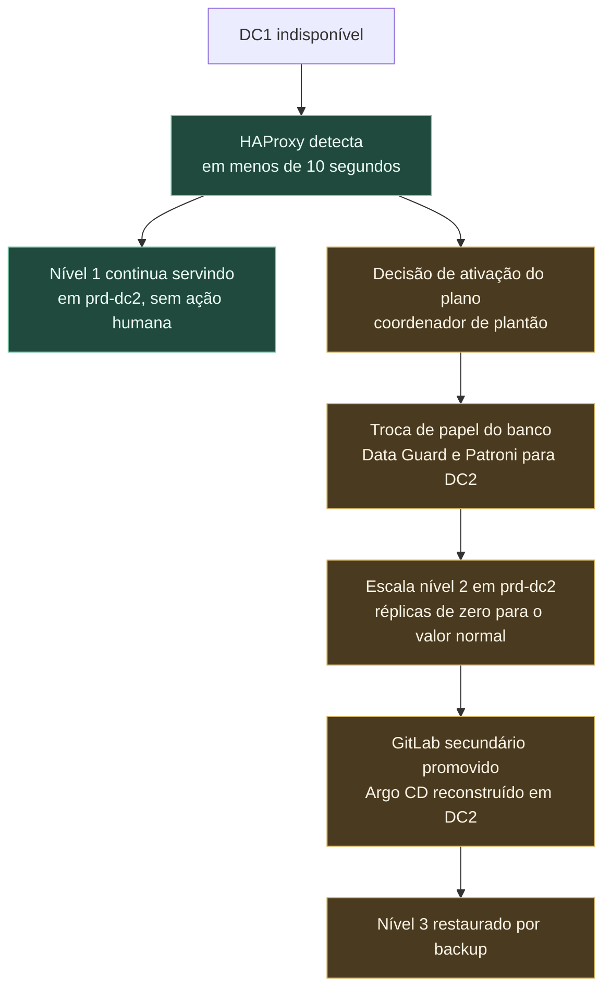

# 5. Resiliência e continuidade

A pergunta correta não é se a plataforma tolera falha, e sim quanto tempo ela leva para voltar em
cada tipo de falha, e quanto dado se perde no caminho. Esta seção responde isso por nível de
falha, declara os números esperados e termina listando os pontos de falha que permanecem.

---

## Classes de aplicação

Nem toda aplicação merece o mesmo investimento. A classificação está no catálogo e determina onde a
aplicação roda, quanta redundância recebe e qual compromisso de retomada a plataforma assume.

| Nível | Exemplo | Tempo máximo de retomada | Perda máxima de dado | Desenho |
|---|---|---|---|---|
| 1 | Emissão de documento fiscal, arrecadação | 15 minutos | 1 minuto | Ativo nos dois sítios, banco com replicação síncrona no sítio e assíncrona entre sítios |
| 2 | Portal do contribuinte, consulta de débito | 1 hora | 5 minutos | Ativo em DC1, espera quente em DC2 |
| 3 | Painel interno, relatório gerencial | 8 horas | 1 hora | Ativo em DC1, restauração em DC2 por backup |
| 4 | Ferramenta administrativa, ambiente interno | 48 horas | 24 horas | Sítio único, backup diário |

Das 60 aplicações, a expectativa é que de 8 a 12 sejam de nível 1. Tratar todas como nível 1
custaria o dobro de hardware e entregaria pior, porque diluiria a atenção.

---

## Falha de um nó

O nó de trabalho é a falha mais comum e a mais barata de absorver. O Kubernetes detecta, marca os
pods como perdidos após o tempo de tolerância e reagenda nos nós restantes.

O que a plataforma faz para isso ser transparente:

- **Mínimo de três réplicas** para aplicação de nível 1 e 2, espalhadas por rack com restrição de
  dispersão topológica. Perder um nó remove no máximo uma réplica.
- **Orçamento de interrupção** que impede a drenagem simultânea de réplicas demais durante
  manutenção. Sem ele, um `drain` de dois nós em sequência derruba a aplicação inteira.
- **Sonda de prontidão separada da sonda de vitalidade.** A de prontidão tira o pod do balanceamento
  quando ele não consegue atender; a de vitalidade reinicia quando ele travou. Usar a mesma
  verificação para as duas causa reinício em cascata quando o banco fica lento.
- **Encerramento gracioso** com `preStop` de cinco segundos, para o pod sair do balanceamento antes
  de parar de aceitar conexão.
- **Requisição e limite declarados**, aplicados por `LimitRange`. Pod sem requisição faz o
  escalonador tomar decisão errada e é causa frequente de desalojamento em cascata.

Abaixo do Kubernetes, o vSphere reinicia a máquina virtual perdida em outro hospedeiro. A
recuperação do nó leva poucos minutos e não exige ação humana. O chart base aplica tudo isso por
padrão, em [`exemplos/helm/app-base/templates/`](../exemplos/helm/app-base/templates/).

**Nó de controle** é caso diferente. São três, e o etcd mantém quórum com dois. Perder um não afeta
nada em execução; perder dois congela o plano de controle, e as aplicações continuam servindo
tráfego enquanto ninguém precisar alterar nada. Essa distinção é importante: cluster sem plano de
controle ainda atende, só não muda.

---

## Falha de um cluster inteiro

A causa mais provável não é hardware, e sim atualização malsucedida ou erro de configuração em
recurso global. Dois clusters independentes de produção existem exatamente para isso.

Para aplicação de nível 1, as réplicas já estão em execução nos dois sítios. O HAProxy distribui o
tráfego entre `prd-dc1` e `prd-dc2`, com verificação ativa de saúde contra o roteador de cada um.
Quando um cluster para de responder, o HAProxy remove o conjunto correspondente e o tráfego
continua no outro, com o tempo de detecção configurado em três verificações falhas de dois
segundos. Nenhuma pessoa decide isso.

Para aplicação de nível 2, a carga está declarada nos dois clusters, mas em `prd-dc2` com réplicas
em zero. Ativar é alterar um valor no overlay e aguardar a sincronização. A operação é de minutos,
exige decisão humana e está descrita em runbook.

O ponto que costuma ser esquecido: **quando `prd-dc1` cai, o cluster de plataforma cai junto**,
porque está no mesmo sítio. Argo CD, Harbor e observabilidade ficam indisponíveis. Daí a replicação
contínua do Harbor para DC2, que permite ao `prd-dc2` continuar puxando imagem, e o GitLab
secundário em DC2, que preserva o repositório de manifestos. Reconstruir o Argo CD em DC2 a partir
do Git leva cerca de trinta minutos, e isso está dentro do compromisso de nível 2, não de nível 1.
Por isso o nível 1 roda ativo nos dois sítios: ele não pode depender dessa reconstrução.

---

## Falha de um banco de dados

Aqui está o tempo de retomada real da maioria das aplicações. A aplicação sobe em segundos; o banco
decide o número.

**Oracle** usa Data Guard, com instância principal em DC1 e instância em espera em DC2. A
replicação é síncrona dentro do sítio, quando há mais de uma instância, e assíncrona entre sítios,
pelo custo de latência. A troca de papel é manual por padrão, com Fast-Start Failover habilitado
apenas para os bancos de nível 1, onde o automatismo compensa o risco de troca indevida.

**PostgreSQL** usa Patroni sobre três instâncias, com réplica síncrona em DC1 e réplica assíncrona
em DC2. O Patroni promove automaticamente em caso de perda da principal, e o PgBouncer redireciona
as conexões. A promoção típica leva menos de trinta segundos.

A aplicação precisa colaborar, e isso é responsabilidade do time:

- **Repetição com espera progressiva e disjuntor** nas chamadas ao banco. Sem isso, a troca de
  papel vira erro voltado ao usuário em vez de uma pausa de alguns segundos.
- **Transação curta.** Transação longa segura bloqueio e impede a promoção limpa.
- **Pool de conexão fora do pod.** Trinta réplicas com pool interno de vinte conexões pedem
  seiscentas conexões ao banco, o que esgota o limite antes de qualquer outro recurso.

O backup segue a regra de três cópias, dois meios, um sítio externo. Cópia completa semanal, cópia
incremental diária, arquivos de registro de transação a cada quinze minutos. **A restauração é
testada mensalmente**, em ambiente separado, com o tempo cronometrado. Backup que nunca foi
restaurado é suposição, não garantia.

---

## Falha de um datacenter inteiro

O cenário de perda total de DC1 é o que define o plano de continuidade. A sequência é esta:

O que é automático está em verde e acontece em segundos. O que exige decisão humana está em âmbar,
porque a troca de papel do banco é irreversível na prática: voltar para DC1 depois exige
ressincronizar no sentido contrário. Automatizar essa decisão transforma uma oscilação de rede de
dois minutos num dia de trabalho de reconstrução.

**Capacidade de DC2.** Se DC2 for dimensionado com metade da capacidade, a operação em sítio único
roda degradada, e é preciso decidir o que desligar. A proposta é dimensionar DC2 com 70 por cento
de DC1, e declarar antecipadamente, no catálogo, quais aplicações de nível 3 e 4 são suspensas em
caso de contingência. Essa lista precisa ser acordada com as áreas de negócio antes do evento, não
durante.

**O exercício semestral é obrigatório.** Um sábado, com DC1 isolado de propósito, a equipe executa
o plano inteiro e cronometra. O primeiro exercício sempre revela algo que o documento não previa:
uma credencial que só existia em DC1, uma entrada de DNS fixada manualmente, um firewall sem a
regra do caminho reverso. Plano de continuidade nunca exercitado é um documento, não um plano.

---

## Pontos de falha que permanecem

Esta é a parte que o desenho não resolve, e declará-la é mais útil do que escondê-la.

| Ponto | Impacto se falhar | Mitigação atual | Risco residual |
|---|---|---|---|
| Enlace entre DC1 e DC2 | Replicação de banco para e os sítios divergem | Dois caminhos de operadoras distintas | Falha simultânea dos dois caminhos; partição de rede com os dois sítios vivos |
| DNS corporativo | Nada se resolve, nem internamente | Dois servidores, um por sítio | Erro de configuração se propaga aos dois |
| Diretório corporativo | Ninguém autentica no OpenShift, GitLab, Grafana | Réplica em DC2 | Conta local de emergência, guardada em cofre físico, com uso auditado |
| vCenter | Nenhuma máquina virtual nova; as existentes continuam | vCenter High Availability | Os clusters sobrevivem, mas a plataforma perde a capacidade de crescer |
| Vault | Pods novos não obtêm segredo; os em execução continuam | Três nós com Raft, selagem automática | Perda das chaves de recuperação; guardadas em cofre físico com custódia dividida |
| GitLab | Sem entrega nova; produção continua rodando | Secundário em DC2 com Geo | Promoção manual, de dezenas de minutos |
| Armazenamento compartilhado | Volumes persistentes indisponíveis | Dois agrupamentos, um por sítio | Aplicação com estado de nível 1 depende de replicação correta entre eles |
| Equipe de plataforma | Nenhuma alteração avança | Dupla por área, documentação viva | Equipe pequena com pessoa única em alguma área; o maior risco dos doze meses |
| Dependência externa | Integração com outros órgãos indisponível | Disjuntor, fila com repetição, modo degradado | Fora da governança da Secretaria |

Dois desses merecem comentário.

**A equipe é o ponto de falha mais provável.** Hardware redundante é comprável; a pessoa que sabe
restaurar o Vault, não. A mitigação é rodízio obrigatório de plantão, runbook escrito por quem não
fez a instalação e exercício de restauração executado por quem nunca executou antes.

**A partição de rede entre sítios com os dois vivos** é o cenário mais perigoso de todos. Pior que
perder DC1 é DC1 e DC2 continuarem operando sem se enxergar, cada um achando que é o principal. É o
que produz divergência de dado fiscal, que não se resolve com restauração. A proteção é não
automatizar a troca de papel do banco entre sítios, mantendo a decisão num humano que consegue
verificar, por um canal independente, se o outro sítio realmente caiu.
