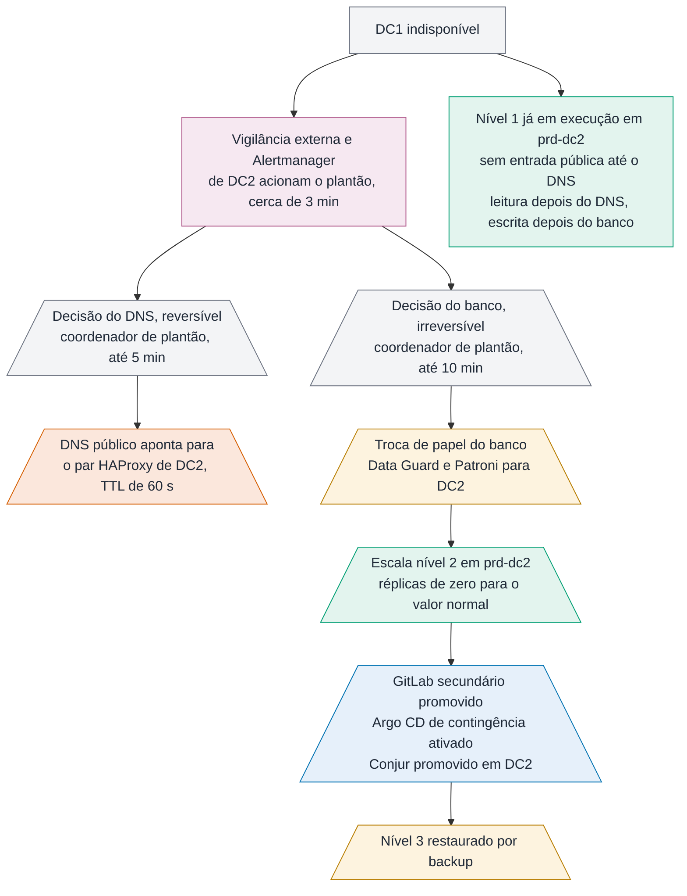

# 5. Resiliência e continuidade

A pergunta correta não é se a plataforma tolera falha, e sim quanto tempo ela leva para voltar em
cada tipo de falha, e quanto dado se perde no caminho. Esta seção responde isso por nível de
falha, declara os números esperados e termina listando os pontos de falha que permanecem.

---

## Classes de aplicação

Nem toda aplicação merece o mesmo investimento. A classificação está no catálogo e determina onde a
aplicação roda, quanta redundância recebe e qual compromisso de retomada a plataforma assume.

| Nível | Exemplo | Tempo máximo de retomada | Perda máxima de dado | Desenho |
|---|---|---|---|---|
| 1 | Emissão de documento fiscal, arrecadação | 20 minutos para voltar a escrever na perda de DC1 (soma de 18: 3 de detecção, até 10 de decisão do banco, cerca de 5 de promoção). Leitura volta em cerca de 9 | 1 minuto, sustentado por alerta de atraso de replicação acima de 30 segundos | Aplicação ativa nos dois sítios, banco com replicação síncrona no sítio e assíncrona entre sítios |
| 2 | Portal do contribuinte, consulta de débito | 1 hora | 5 minutos | Ativo em DC1, espera quente em DC2 |
| 3 | Painel interno, relatório gerencial | 8 horas | 1 hora | Ativo em DC1, restauração em DC2 por backup |
| 4 | Ferramenta administrativa, ambiente interno | 48 horas | 24 horas | Sítio único, backup diário |

A perda máxima de 1 minuto depende da replicação assíncrona entre sítios, que não tem limite
garantido por construção. O controle que sustenta o número é um alerta de atraso de replicação
acima de 30 segundos, que chama o plantão antes de o atraso chegar a um minuto.

O tempo de 20 minutos do nível 1 é a soma de 18 minutos de parcelas, arredondada com 2 de folga. O
cálculo está em "Falha de um datacenter inteiro", abaixo, e o exercício de continuidade mede cada
parcela.

Das 60 aplicações, a expectativa é que de 8 a 12 sejam de nível 1. Tratar todas como nível 1
custaria o dobro de hardware e entregaria pior, porque diluiria a atenção.

---

## Falha de um nó

O nó de trabalho é a falha mais comum e a mais barata de absorver. O Kubernetes detecta, marca os
pods como perdidos após o tempo de tolerância e reagenda nos nós restantes.

O que a plataforma faz para isso ser transparente:

- **Mínimo de três réplicas** para aplicação de nível 1 e 2, espalhadas por rack com restrição de
  dispersão topológica. Perder um nó remove no máximo uma réplica.
- **Orçamento de interrupção** que impede a drenagem simultânea de réplicas demais durante
  manutenção. Sem ele, um `drain` de dois nós em sequência derruba a aplicação inteira.
- **Sonda de prontidão separada da sonda de vitalidade.** A de prontidão tira o pod do balanceamento
  quando ele não consegue atender; a de vitalidade reinicia quando ele travou. Usar a mesma
  verificação para as duas causa reinício em cascata quando o banco fica lento.
- **Encerramento gracioso** com `preStop` de oito segundos, para o pod sair do balanceamento antes
  de parar de aceitar conexão.
- **Requisição e limite declarados**, aplicados por `LimitRange`. Pod sem requisição faz o
  escalonador tomar decisão errada e é causa frequente de desalojamento em cascata.

Abaixo do Kubernetes, o vSphere reinicia a máquina virtual perdida em outro hospedeiro. A
recuperação do nó leva poucos minutos e não exige ação humana. O chart base aplica tudo isso por
padrão, em [`exemplos/helm/app-base/templates/`](../exemplos/helm/app-base/templates/).

**Nó de controle** é caso diferente. São três, e o etcd mantém quórum com dois. Perder um não afeta
nada em execução; perder dois congela o plano de controle, e as aplicações continuam servindo
tráfego enquanto ninguém precisar alterar nada. Cluster sem plano de controle ainda atende; só não
muda.

---

## Falha de um cluster inteiro

A causa mais provável não é hardware, e sim atualização malsucedida ou erro de configuração em
recurso global. Dois clusters independentes de produção existem exatamente para isso.

Para aplicação de nível 1, as réplicas já estão em execução nos dois sítios. O HAProxy distribui o
tráfego entre `prd-dc1` e `prd-dc2`, com verificação ativa de saúde contra o roteador de cada um.
Quando um cluster para de responder, o HAProxy remove o conjunto correspondente e o tráfego
continua no outro, com o tempo de detecção configurado em três verificações falhas de dois
segundos. Nenhuma pessoa decide isso.

Para aplicação de nível 2, a carga está declarada nos dois clusters, mas em `prd-dc2` com réplicas
em zero. Ativar é alterar um valor no overlay e aguardar a sincronização. A operação é de minutos,
exige decisão humana e está descrita em roteiro de resposta.

O ponto que costuma ser esquecido: **quando `prd-dc1` cai, o cluster de plataforma cai junto**,
porque está no mesmo sítio. Argo CD, Harbor e observabilidade ficam indisponíveis. Daí a replicação
contínua do Harbor para DC2, que permite ao `prd-dc2` continuar puxando imagem, e o GitLab
secundário em DC2, que preserva o repositório de manifestos. O Argo CD de contingência, instalado e
desligado em `prd-dc2`, é ativado escalando os componentes, em poucos minutos (ADR-009). Isso cabe
no compromisso de nível 2, não no de nível 1. Por isso o nível 1 roda ativo nos dois sítios: ele
não pode depender de nenhuma ativação.

---

## Falha de um banco de dados

Aqui está o tempo de retomada real da maioria das aplicações. A aplicação sobe em segundos; o banco
decide o número.

**A regra é uma só para os dois bancos: dentro do sítio, a troca de papel é automática; entre
sítios, é sempre decisão humana.** Dentro de DC1, as duas instâncias se enxergam pela mesma rede, e
o automatismo resolve em segundos a perda de uma máquina. Entre sítios, o automatismo não consegue
distinguir "DC1 caiu" de "o enlace caiu e DC1 continua escrevendo". Na segunda situação, promover
DC2 cria dois bancos principais com dado fiscal divergente, o pior desfecho possível desta
plataforma.

**Oracle** usa Data Guard. Os bancos de nível 1 têm duas instâncias em DC1, com replicação
síncrona e Fast-Start Failover entre elas, e uma instância em espera em DC2, com replicação
assíncrona, pelo custo de latência. O observador do Fast-Start Failover fica em DC1 e só arbitra a
troca dentro do sítio. Os demais bancos têm uma instância em DC1 e a espera em DC2.

A aplicação conecta pelo nome de um serviço que só existe na instância que está como principal,
com os endereços dos dois sítios na mesma URL de conexão. Depois de qualquer troca de papel, o
driver encontra a principal nova sem alteração de configuração.

**PostgreSQL** usa Patroni sobre três instâncias: duas em DC1, com réplica síncrona, e uma em DC2,
assíncrona e marcada para nunca ser promovida automaticamente. O etcd que o Patroni usa para
eleger a principal tem três membros, todos em DC1, para que o quórum não dependa do enlace. O
PgBouncer aponta para um endereço virtual que o `vip-manager` mantém sempre na principal. A
promoção dentro do sítio leva menos de trinta segundos.

Na perda de DC1, o etcd inteiro vai junto, e a réplica de DC2 não tem onde decidir. A promoção é
manual, em três passos:

1. Subir o etcd de um membro numa máquina virtual já preparada e desligada em DC2.
2. Reiniciar o Patroni de DC2 apontando para esse etcd, com a réplica promovida a principal.
3. Mover o endereço virtual do `vip-manager` e o PgBouncer de DC2 para a nova principal.

O tempo esperado é de cerca de 5 minutos, a medir no exercício de continuidade. Um etcd de um
membro só não tolera falha, e o roteiro termina recompondo os três membros quando DC1 volta ou
quando houver máquinas novas em DC2.

> *Decisão: troca de papel entre sítios sempre humana, inclusive para o nível 1. A alternativa é o
> Fast-Start Failover entre sítios, com o observador num terceiro local. A Secretaria não tem
> terceiro sítio, e um observador num dos dois sítios só desloca o problema da partição de rede.
> O custo é o nível 1 depender de uma decisão humana em até dez minutos para voltar a escrever, o
> que entra no tempo de retomada declarado na tabela de classes. O DNS público é outra decisão,
> reversível, e por isso não espera a do banco (ver "Falha de um datacenter inteiro").*

A aplicação precisa colaborar, e isso é responsabilidade do time:

- **Repetição com espera progressiva e disjuntor** nas chamadas ao banco. Sem isso, a troca de
  papel vira erro voltado ao usuário em vez de uma pausa de alguns segundos.
- **Transação curta.** Transação longa segura bloqueio e impede a promoção limpa.
- **Pool de conexão fora do pod.** Trinta réplicas com pool interno de vinte conexões pedem
  seiscentas conexões ao banco, o que esgota o limite antes de qualquer outro recurso. No
  PostgreSQL, o PgBouncer faz esse papel. No Oracle, o PgBouncer não serve: o pool fica residente
  no banco (DRCP), e o pool da aplicação tem limite por réplica, declarado no catálogo.

**O cache não entra na conta da retomada.** Cada cluster tem o próprio Valkey por aplicação, sem
replicação entre sítios, e o cache de DC2 começa frio para o nível 2. O banco promovido em DC2
recebe a leitura inteira, e é dimensionado para isso ([`docs/10`](10-dados.md)).

O backup segue a regra de três cópias, dois meios, um sítio externo. Cópia completa semanal, cópia
incremental diária, arquivos de registro de transação a cada quinze minutos. **A restauração é
testada mensalmente**, em ambiente separado, com o tempo cronometrado. Backup que nunca foi
restaurado é suposição, não garantia.

---

## Falha de um datacenter inteiro

O cenário de perda total de DC1 é o que define o plano de continuidade. A sequência é esta:

**Figura 5.1 — A sequência na perda total de DC1.**

Os passos em retângulo são automáticos e acontecem em segundos. Os em trapézio exigem decisão
humana, e são duas decisões de natureza diferente. A troca do DNS público é reversível: se o
enlace voltar, aponta-se o DNS de volta. A troca de papel do banco é irreversível na prática:
voltar para DC1 depois exige ressincronizar no sentido contrário. Automatizar a segunda transforma
uma oscilação de rede de dois minutos num dia de trabalho de reconstrução. A primeira vem antes e
não espera a segunda.

**O nível 1 fica indisponível para o público até a troca do DNS, lê depois dela e escreve depois
da troca do banco.** O DNS público aponta para DC1, então nenhum pedido externo chega a `prd-dc2`
enquanto a troca não acontece. A conta do tempo, contada a partir da perda de DC1:

| Parcela | Tempo |
|---|---|
| Detecção pelo sinal de vida externo | cerca de 3 minutos |
| Decisão do DNS, a partir do acionamento | até 5 minutos |
| Tempo de vida do DNS | 60 segundos |
| **Entrada pública em DC2, com leitura** | **cerca de 9 minutos** |
| Decisão do banco, a partir do acionamento | até 10 minutos |
| Promoção do PostgreSQL ou do Oracle em DC2 | cerca de 5 minutos |
| **Escrita no nível 1** | **cerca de 18 minutos** |

As duas decisões correm em paralelo; a escrita é limitada pela segunda. Os 18 minutos
entram na tabela de classes como 20, com 2 de folga. A emissão de nota, que escreve, devolve erro até a troca de papel do banco. Só o
PostgreSQL lê da réplica de DC2: sem Active Data Guard, a instância Oracle em espera não atende
consulta. Quem quiser menos de 18 minutos tem dois caminhos, DNS com verificação de saúde e
promoção automática do banco, e ambos tiram a decisão humana que esta proposta mantém de
propósito. O roteiro de resposta dessas decisões é o mais ensaiado da plataforma.

### A borda

Cada datacenter tem o próprio par de HAProxy, com endereço virtual mantido por VRRP dentro do
sítio. Nenhuma rede é esticada entre DC1 e DC2. Em operação normal, o DNS público aponta para o
endereço de DC1, e o par de DC1 distribui o tráfego entre os roteadores dos dois sítios. O par de
DC2 fica configurado e testado, sem receber tráfego externo.

Na perda de DC1, o plano inclui apontar o DNS público para o endereço de DC2, em até 5 minutos
depois do acionamento. Com tempo de vida de sessenta segundos nos registros, a troca se completa
em poucos minutos para a maioria dos clientes.
A configuração do par está em [`exemplos/borda/haproxy.cfg`](../exemplos/borda/haproxy.cfg).

> *Decisão: troca da entrada pública por DNS com tempo de vida curto, e não por anúncio de rota
> BGP do mesmo prefixo nos dois sítios. O anúncio BGP troca em segundos e não depende da cópia de
> DNS guardada pelos clientes, mas exige sistema autônomo próprio e operação de roteamento externo que é da
> equipe de rede, não da plataforma. O custo é o cliente com resposta de DNS guardada demorar alguns minutos a
> mais. Se a Secretaria já anunciar prefixo próprio, o BGP passa a ser a escolha.*

### A observabilidade e o alerta na perda de DC1

O Grafana e a consulta global do Thanos ficam em `plat-dc1` e caem junto com DC1. O que não pode
cair junto é a capacidade de acordar alguém. Por isso cada cluster de execução tem o próprio
Prometheus, que avalia as regras de alerta localmente, e há um Alertmanager por cluster, inclusive
em `prd-dc2`. Cada cluster envia o próprio sinal de vida. `prd-dc2` continua avaliando e
notificando sem DC1. A alternativa descartada é um agrupamento de Alertmanager com membros nos
dois sítios, que exige um membro de DC2 fora dos clusters e um enlace saudável para deduplicar. O
custo aceito é o plantão poder receber o mesmo alerta de dois clusters, que a rota de
agrupamento por aplicação reduz a uma chamada.

Falta ainda o caso em que o próprio Alertmanager some. Uma regra que dispara sempre, o sinal de
vida, é enviada a cada minuto para um serviço de vigilância hospedado fora dos dois datacenters.
Se o sinal parar de chegar, esse serviço aciona o plantão por conta própria.

**Capacidade de DC2.** Se DC2 for dimensionado com metade da capacidade, a operação em sítio único
roda degradada, e é preciso decidir o que desligar. A proposta é dimensionar DC2 com 75 por cento
de DC1 (9 de 12 nós de trabalho), e declarar antecipadamente, no catálogo, quais aplicações de nível 3 e 4 são suspensas em
caso de contingência. Essa lista precisa ser acordada com as áreas de negócio antes do evento, não
durante.

**O exercício semestral é obrigatório.** Um sábado, com DC1 isolado de propósito, a equipe executa
o plano inteiro e cronometra. O primeiro exercício sempre revela algo que o documento não previa:
uma credencial que só existia em DC1, uma entrada de DNS fixada manualmente, um firewall sem a
regra do caminho reverso. Plano de continuidade nunca exercitado é um documento, não um plano.

---

## O que tem redundância

| Componente | Redundância | O que acontece na falha de uma instância |
|---|---|---|
| Nó de trabalho | Três réplicas por aplicação de nível 1 e 2, espalhadas por rack | O Kubernetes reagenda; o vSphere reinicia a máquina |
| Plano de controle | Três nós por cluster | Com um a menos, nada muda; com dois, o cluster atende mas não muda |
| Cluster de produção | Dois, um por sítio | O HAProxy tira o cluster em cerca de seis segundos |
| Borda | Par de HAProxy por sítio, com VRRP | O endereço virtual passa ao par em segundos |
| Oracle | Duas instâncias em DC1 com troca automática; espera em DC2 | Troca automática no sítio; entre sítios, decisão humana |
| PostgreSQL | Patroni com três instâncias; PgBouncer atrás de endereço virtual; etcd de três membros em DC1 e uma máquina de reserva em DC2 | Promoção automática no sítio em menos de 30 segundos; entre sítios, roteiro manual de cerca de 5 minutos |
| Conjur | Líder e espera em DC1; espera e réplica de leitura em DC2 | Pods continuam com o `Secret` já no cluster |
| Valkey de aplicação | Nenhuma, de propósito: uma instância por aplicação em cada cluster, sem disco | O Kubernetes recria vazio em segundos; a aplicação lê do banco nesse intervalo |
| Harbor, GitLab, MinIO | Réplica em DC2 | Promoção manual da réplica, em dezenas de minutos |
| Argo CD | Alta disponibilidade em `plat-dc1`; contingência desligada em DC2 | Sem implantação nova até voltar ou até a contingência ser ativada |
| Prometheus e Alertmanager | Um Prometheus e um Alertmanager por cluster, inclusive em `prd-dc2`; cada cluster envia o próprio sinal de vida externo | Cada cluster continua alertando sozinho |

---

## Pontos de falha que permanecem

Esta é a parte que o desenho não resolve, e declará-la é mais útil do que escondê-la.

| Ponto | Impacto se falhar | Mitigação atual | Risco residual |
|---|---|---|---|
| Enlace entre DC1 e DC2 | Replicação de banco para e os sítios divergem | Dois caminhos de operadoras distintas | Falha simultânea dos dois caminhos; partição de rede com os dois sítios vivos |
| DNS corporativo | Nada se resolve, nem internamente | Dois servidores, um por sítio | Erro de configuração se propaga aos dois |
| Diretório corporativo e Keycloak | Ninguém autentica no OpenShift, GitLab, Grafana e Argo CD | Réplica do diretório e instância do Keycloak em DC2; conta local de emergência em cofre físico, com uso auditado | Erro de configuração replicado para a réplica junto com o dado |
| Borda e DNS público | Contribuinte não alcança nenhuma aplicação | Par de HAProxy em cada sítio; DNS com tempo de vida de 60 segundos | A troca do DNS é manual, decidida em até 5 minutos, e o nível 1 fica sem entrada pública até ela; depende também da cópia guardada pelos clientes |
| Firewall da entrada de cada sítio | O sítio inteiro fica sem entrada pública, mesmo com HAProxy e clusters saudáveis | Fora deste desenho: é equipamento da equipe de rede. O esperado é um par ativo e passivo por sítio, com estado das conexões sincronizado, atrás de dois enlaces de operadoras distintas | Se for um equipamento só, a falha dele cai na troca manual de DNS da linha anterior. Balanceador na frente do par foi descartado: só se justifica com os dois firewalls ativos, e sozinho vira outro ponto único |
| Observabilidade em `plat-dc1` | Sem painel e sem consulta global na perda de DC1 | Prometheus e Alertmanager em cada cluster; sinal de vida para vigilância externa | Investigação de incidente em DC2 sem o histórico longo até `plat-dc1` voltar |
| vCenter | Nenhuma máquina virtual nova; as existentes continuam | vCenter High Availability | Os clusters sobrevivem, mas a plataforma perde a capacidade de crescer |
| Conjur | Segredo novo e rotação param; pods em execução e pods reagendados continuam, porque o `Secret` já está no cluster | Líder e réplica de espera em DC1, réplica de espera e réplica de leitura em DC2 | Perda da chave de dados do cofre; guardada em cofre físico com custódia dividida |
| Argo CD central | Sem entrega nova e sem correção de desvio; nada para de executar | Alta disponibilidade em `plat-dc1`, contingência desligada em DC2 | A contingência envelhecer sem ninguém perceber; ativada de verdade no exercício semestral |
| GitLab | Sem entrega nova; produção continua rodando | Secundário em DC2 com Geo | Promoção manual, de dezenas de minutos |
| Armazenamento compartilhado | Volumes persistentes indisponíveis | Dois agrupamentos, um por sítio | Aplicação com estado de nível 1 depende de replicação correta entre eles |
| Cache das aplicações | Latência sobe e o banco recebe a leitura inteira, na falha do Valkey ou na troca de sítio | Banco dimensionado para a carga sem cache; regra do que nunca vai para cache | Aplicação que passou a depender do cache sem ninguém perceber; procurada no teste de carga trimestral com o cache desligado |
| Equipe de plataforma | Nenhuma alteração avança | Dupla por área, documentação viva | Equipe pequena com pessoa única em alguma área; o maior risco dos doze meses |
| Dependência externa | Integração com outros órgãos indisponível | Disjuntor, fila com repetição, modo degradado | Fora da governança da Secretaria |

**A equipe é o ponto de falha mais provável.** Hardware redundante é comprável; a pessoa que sabe
restaurar o cofre de segredos, não. A mitigação é rodízio obrigatório de plantão, roteiro de resposta escrito por quem não
fez a instalação e exercício de restauração executado por quem nunca executou antes.

**A partição de rede entre sítios com os dois vivos** é o cenário mais perigoso de todos. Pior que
perder DC1 é DC1 e DC2 continuarem operando sem se enxergar, cada um achando que é o principal. É o
que produz divergência de dado fiscal, que não se resolve com restauração. A proteção é não
automatizar a troca de papel do banco entre sítios, mantendo a decisão num humano que consegue
verificar, por um canal independente, se o outro sítio realmente caiu.
