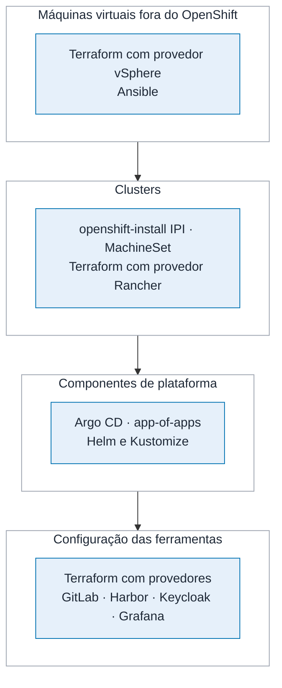

# 6. Infraestrutura como código

A meta é concreta e verificável: **perder qualquer máquina da plataforma, exceto as que guardam
estado, e reconstruí-la a partir do Git, sem consultar ninguém.** O que não passa por esse teste
ainda não está em código, mesmo que exista um arquivo em algum repositório.

Estado, aqui, é dado de banco, conteúdo do registry, histórico do GitLab, segredo do Conjur e
telemetria no MinIO. Esses dependem de backup e restauração, não de reconstrução.

---

## As quatro camadas e as ferramentas de cada uma

**Figura 6.1 — As quatro camadas de infraestrutura como código.**

A ordem importa. Cada camada só pode ser aplicada depois que a de baixo converge, e o pipeline
respeita isso. Tentar aplicar a camada 3 num cluster que a camada 2 ainda está criando é a causa
mais comum de aplicação que falha pela metade.

### Camada 1: máquinas virtuais fora do OpenShift

Esta camada cuida de toda máquina virtual que **não** é nó de OpenShift: os nós do RKE2 de
desenvolvimento, as máquinas de banco, o Conjur, os pares de HAProxy e as réplicas de plataforma em
DC2. Nó de OpenShift é outro assunto, tratado na camada 2: ele roda RHCOS, um sistema imutável que
o próprio cluster cria e configura, e nem Terraform nem Ansible tocam nele.

**Terraform com o provedor vSphere** cria máquina virtual, disco, placa de rede, grupo de portas e
regra de anti-afinidade. A entrada é um modelo preparado, gerado por Packer a partir da imagem
oficial do Red Hat Enterprise Linux, com o agente de virtualização e a linha de base mínima já
embutidos. Gerar o modelo por código evita a máquina de referência que ninguém sabe como nasceu.

**Ansible** aplica a linha de base do sistema: usuários e chaves, endurecimento do acesso remoto,
firewall, SELinux em modo obrigatório, sincronização de horário, repositórios internos, agente de
coleta e agente de backup. O papel está em
[`exemplos/ansible/roles/baseline-rhel/tasks/main.yml`](../exemplos/ansible/roles/baseline-rhel/tasks/main.yml).

A regra que torna esse papel confiável: **ele é idempotente e isso é testado**. O pipeline executa
duas vezes seguidas contra uma máquina descartável e falha se a segunda execução relatar qualquer
alteração. Papel que relata alteração a cada execução esconde desvio de configuração, porque
ninguém mais distingue o normal do anormal.

O módulo que cria nó de trabalho do RKE2 está em
[`exemplos/terraform/vsphere-worker/`](../exemplos/terraform/vsphere-worker/). Ele recebe a função
do nó e devolve a máquina já registrada no inventário dinâmico do Ansible.

### Camada 2: clusters

**OpenShift** nasce de um `install-config.yaml` versionado, por instalação totalmente automatizada
(IPI) sobre o vSphere. O arquivo descreve rede, domínio, registry espelhado e os domínios de falha
do vSphere, que espalham os nós por hospedeiro e por rack e dão a eles o rótulo de zona. Os
segredos que ele consome vêm do Conjur no momento da execução, nunca do repositório.

Depois da instalação, quem cria e substitui nó de trabalho é o próprio OpenShift, pelo
`MachineSet`. Aumentar a capacidade de `prd-dc1` é alterar o número de réplicas de um
`MachineSet` por merge request. A configuração do sistema dos nós, como parâmetros de kernel,
sincronização de horário e repositório interno, é um `MachineConfig`. Os dois são objetos do
cluster, versionados em `infra-clusters` e aplicados pelo Argo CD como os componentes da camada 3.

> *Decisão: instalação IPI, com nós geridos pelo próprio OpenShift, e não UPI, em que a plataforma
> cria as máquinas por Terraform. Com IPI, nó defeituoso é substituído pelo `MachineSet` sem
> intervenção, e a atualização do cluster atualiza também o sistema dos nós. O custo é o
> instalador exigir permissões amplas no vCenter, concedidas a uma conta de serviço própria do
> cluster, com a senha no Conjur.*

**RKE2** nasce pelo provedor Terraform do Rancher, que cria o cluster e registra os nós.

A atualização de cluster também é código: a versão alvo está num arquivo, e alterá-la por merge
request dispara o processo. A ordem é sempre `dev`, `hml`, `prd-dc2`, `prd-dc1`, com uma semana
entre a homologação e a produção. Atualizar o sítio secundário antes do primário significa que, se
a versão tiver defeito, ele aparece no sítio que não está servindo a maior parte do tráfego.

### Camada 3: componentes de plataforma

Tudo o que roda dentro do cluster e não é aplicação de negócio é gerenciado pelo Argo CD, no padrão
de aplicação que gerencia aplicações. Um único objeto raiz aponta para um diretório, e cada
subdiretório vira um componente: controlador de entrada, cert-manager, External Secrets, Reloader,
pilha do Prometheus, coletor OpenTelemetry, Loki, Tempo, Kyverno, Argo Rollouts, Velero e o próprio
Argo CD.

O Argo CD gerenciar a si mesmo tem uma consequência prática: a configuração dele, incluindo
projetos, permissões e repositórios conectados, está no Git. Reconstruir o Argo CD é instalar a
versão mínima e apontar para o repositório. Em menos de trinta minutos, ele reconstrói o resto.

### Camada 4: configuração das ferramentas

A configuração das ferramentas é o que mais costuma escapar para o clique manual, e é onde o desvio
mais machuca, porque ninguém percebe até precisar reconstruir.

| Ferramenta | O que fica em código |
|---|---|
| GitLab | Grupos, projetos, regras de proteção de branch, variáveis, membros, integração com o diretório |
| Harbor | Projetos, cotas, políticas de retenção, regras de replicação, gatilho de varredura |
| Keycloak | Clientes, escopos, mapeamentos para o diretório corporativo |
| Grafana | Fontes de dados, painéis como JSON, pastas e permissões |
| Conjur | Políticas em YAML: identidades, grupos, autenticadores e quem lê cada caminho. O valor do segredo nunca entra |
| Prometheus | Regras de alerta e de registro, como objeto no cluster |

Painel do Grafana criado pela interface e não exportado para o Git é perdido na próxima
reconstrução. A plataforma trata isso de forma explícita: a instância é provisionada apenas por
arquivo, e a edição pela interface fica disponível em modo de rascunho, com exportação obrigatória
para virar permanente.

---

## Onde o código fica

Sete repositórios no grupo `plataforma/` do GitLab, com fronteiras definidas por quem precisa
aprovar a alteração.

| Repositório | Conteúdo | Quem aprova |
|---|---|---|
| `infra-vsphere` | Terraform da camada 1 | Plataforma, duas aprovações |
| `infra-clusters` | Instalação e atualização de cluster | Plataforma, duas aprovações |
| `plataforma-addons` | Camada 3, componentes do cluster e a configuração do Argo CD | Plataforma, duas aprovações |
| `ferramentas-config` | Camada 4 | Plataforma |
| `catalogo-apps` | Uma ficha por aplicação, que dispara a criação de namespace, projeto e diretório | Plataforma |
| `manifestos-apps` | Manifestos das 60 aplicações, por ambiente | Promotor em `dev` e `hml`, sem aprovação humana; em `prd`, duas pessoas do time dono, e a plataforma também quando a mudança vai além do digest |
| `templates-ci` | Templates de pipeline, versionados por tag | Plataforma |

A separação entre `manifestos-apps` e os demais é a que mais importa no dia a dia. Ela permite dar
ao time autonomia sobre a própria implantação sem dar acesso à infraestrutura. Dentro dele, o
arquivo `CODEOWNERS` garante que cada time só aprove o próprio diretório; a aprovação de dono é
exigida nos caminhos de produção, e em `hml` o merge request do promotor entra sozinho quando o
pipeline passa. Em produção, o pipeline
do repositório distingue a promoção pura, que só troca o digest e é aprovada por duas pessoas do
time, da mudança estrutural, que exige também a plataforma
([`exemplos/gitops/.gitlab-ci.yml`](../exemplos/gitops/.gitlab-ci.yml)). Com sessenta aplicações e
dezenas de promoções por dia, a plataforma não pode estar no caminho de cada uma.

---

## Como o código é revisado e aplicado

Nenhuma aplicação parte da máquina de uma pessoa. Não existe `terraform apply` local com acesso ao
vCenter de produção, e a credencial para isso só existe dentro do pipeline.

O fluxo é o mesmo para todas as camadas:

**Figura 6.2 — O caminho de uma mudança de infraestrutura.**

```mermaid
flowchart LR
    MR["Merge request"] --> VAL["Validação<br/>fmt · validate · tflint · checkov"]
    VAL --> PLAN["Plano gerado<br/>comentado no merge request"]
    PLAN --> REV[/"Revisão humana<br/>lê o plano, não só o diff"\]
    REV --> APV[/"Aprovação<br/>uma ou duas, conforme o repo"\]
    APV --> APL["Aplicação a partir de main<br/>runner dedicado"]
    APL --> DRIFT["Verificação diária de desvio"]
    DRIFT -.->|desvio encontrado| ALERTA["Chamado para a plataforma"]

    classDef entrega fill:#E6F0FA,stroke:#0072B2,color:#1F2937
    classDef neutro fill:#F3F4F6,stroke:#6B7280,color:#1F2937
    class MR,VAL,PLAN,REV,APV,APL,DRIFT entrega
    class ALERTA neutro
```

Três detalhes fazem esse fluxo funcionar de verdade.

**O plano vai como comentário no merge request.** Quem revisa lê o que vai acontecer, e não o que o
autor pretendia. Alterar uma variável aparentemente inofensiva e ver no plano que dezoito máquinas
serão destruídas e recriadas é o momento em que a revisão paga o próprio custo.

**O estado do Terraform fica no armazenamento de estado gerenciado pelo GitLab**, com trava e versionamento. Estado
em disco local é o caminho mais curto para duas pessoas aplicarem ao mesmo tempo e destruírem
recurso que a outra acabou de criar.

**A verificação diária de desvio roda contra todos os repositórios.** Ela executa o plano em modo
somente leitura e gera chamado quando encontra diferença. Desvio em infraestrutura aparece de
ajuste de emergência que ninguém levou de volta para o código, e descobrir isso num dia é muito
melhor que descobrir durante uma recuperação de desastre.

A análise de segurança do código de infraestrutura, com `checkov`, bloqueia o que é grave: máquina
exposta à internet sem necessidade, disco sem criptografia, regra de firewall aberta para qualquer
origem, credencial embutida. O resto gera aviso, pela mesma razão exposta no fluxo de entrega.

---

## O que não entra em código, e por quê

Ser honesto sobre isso evita a promessa que não se cumpre.

**Os dados.** Banco, conteúdo do registry, histórico do GitLab e telemetria dependem de backup com
restauração testada. Código recria o continente, não o conteúdo.

**A chave de dados do Conjur e a conta local de emergência.** Ficam em cofre físico, com custódia
dividida entre pessoas diferentes. Guardá-las em sistema que depende do Conjur cria uma dependência
circular que só aparece no pior momento possível.

**A camada física.** Enlace de rede, energia, refrigeração e cabeamento continuam sendo processo
documentado com operação manual.

**A primeira máquina.** O runner que aplica a primeira execução de Terraform precisa existir antes
dela. Esse nó é criado por um procedimento manual curto, com cerca de dez passos, documentado e
executado no exercício de continuidade para confirmar que o procedimento ainda vale.
