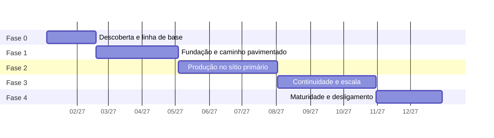

# 8. Plano de evolução

O plano cobre doze meses em cinco fases. O princípio que ordena tudo: **cada fase entrega valor
verificável para algum time de desenvolvimento.** Plataforma construída por seis meses em
isolamento, para ser apresentada pronta, costuma chegar resolvendo o problema errado.

A sequência também respeita uma dependência técnica: não dá para fazer GitOps sem registry, nem
observabilidade útil sem padrão de telemetria, nem migrar com segurança sem saber reverter.

---

## Visão das fases

**Figura 8.1 — Doze meses de implantação, em cinco fases.**

---

## Fase 0 — Descoberta e linha de base (mês 1 e metade do 2)

Antes de instalar qualquer coisa. A tentação de começar subindo cluster é grande, e produz uma
plataforma dimensionada por chute.

**O que se faz:**

- Inventário das 60 aplicações: linguagem, versão de runtime, servidor de aplicação, estado,
  dependência de banco, integrações, janela de uso, consumo real medido no vSphere.
- Classificação por nível de criticidade, acordada com as áreas de negócio.
- Classificação por facilidade de migração, em três grupos: sem estado e já conteinerizável; com
  estado em disco ou sessão, exigindo ajuste; dependente de servidor de aplicação proprietário,
  exigindo reescrita parcial.
- Medição da linha de base: tempo entre commit e produção, frequência de entrega, percentual de
  entregas com correção urgente, tempo de restauração. Sem esse número de partida, não há como
  mostrar resultado no mês 12.
- Formação do time de plataforma, com no mínimo quatro pessoas e dupla por área, e contratação de
  mais duas até a fase 2. Plantão contínuo com quatro pessoas é uma semana de plantão a cada
  quatro, durante doze meses de construção; com seis, a escala fecha sem esgotar ninguém.
- Levantamento do custo de software e abertura das contratações que demoram (ver "Custo e
  contratação", abaixo).
- Definição do que não entra na plataforma nesses doze meses, por escrito.

**Entregável:** inventário publicado, classificação acordada, linha de base registrada, lista das
três aplicações piloto escolhidas com os times voluntários.

**Por que primeiro:** a escolha do piloto define o sucesso político do projeto. O piloto certo é
uma aplicação de nível 2, sem estado, de um time que quer participar. Nem a mais crítica, que não
tolera erro de aprendizado, nem a mais irrelevante, cujo sucesso não convence ninguém.

---

## Fase 1 — Fundação e caminho pavimentado (meses 2 a 4)

**O que se faz:**

- Terraform e Ansible para as máquinas da plataforma, com o papel de linha de base validado.
- Clusters `plat-dc1` e `dev-dc1` em operação.
- Harbor, Keycloak e runners próprios.
- Conjur integrado ao PAM, com a primeira política de rotação em conta dupla e o External Secrets
  autenticando por ServiceAccount em `dev-dc1`.
- Esteira completa para as três aplicações piloto: build, teste, SonarQube, varredura, assinatura,
  publicação.
- Argo CD gerenciando `dev-dc1`, com o repositório de manifestos e o gerador de aplicações.
- Observabilidade mínima com Prometheus, Grafana, Loki e coletor OpenTelemetry.
- Templates de pipeline e chart base, com as linguagens predominantes do inventário.
- Processo de catálogo funcionando ponta a ponta para aplicação nova.

**Entregável:** as três aplicações piloto rodando em desenvolvimento, implantadas por GitOps, com
painel e alertas, e um time conseguindo criar aplicação nova sem ajuda.

**Por que nessa ordem:** registry e cofre vêm antes de tudo porque a esteira depende deles. O
caminho pavimentado vem junto com o piloto, e não depois, porque é o piloto que revela se ele é
usável.

---

## Fase 2 — Produção no sítio primário (meses 5 a 7)

**O que se faz:**

- Clusters `hml-dc1` e `prd-dc1`.
- HAProxy em par, com a regra de corte por aplicação entre legado e plataforma.
- Políticas de admissão com Kyverno, em modo auditoria por um mês e depois obrigatórias.
- Plantão formalizado, com escala, roteiros de resposta e roteamento por time.
- Alertas de orçamento de erro para as aplicações piloto.
- Velero com backup dos quatro clusters e primeira restauração testada.
- Primeira onda de migração: 10 aplicações sem estado, de nível 2 e 3.

**Entregável:** 10 aplicações em produção na plataforma nova, com retorno de versão exercitado em
pelo menos uma delas de propósito.

**Por que aqui:** produção antes da continuidade é deliberado. Operar produção em um sítio durante
três meses ensina o que o segundo sítio precisa ter. Construir os dois sítios antes de ter tráfego
real produz uma contingência desenhada para suposições.

**O que fica descoberto nesta fase, e por que é aceitável.** Até a fase 3, as aplicações migradas
rodam só em DC1. Uma perda de DC1 nesse intervalo deixa essas dez aplicações sem o segundo sítio
que elas tinham no legado. A mitigação é o próprio legado: as máquinas virtuais das aplicações
migradas só são desligadas na fase 4, e o HAProxy de DC2 devolve o tráfego para elas invertendo a
regra de rota. Por isso a primeira onda tem só aplicações de nível 2 e 3, e nenhuma de nível 1.

---

## Fase 3 — Continuidade e escala (meses 8 a 10)

**O que se faz:**

- Cluster `prd-dc2` e replicação do Harbor entre sítios.
- GitLab secundário em DC2.
- Thanos com retenção longa no MinIO.
- Réplica do Oracle por Data Guard e do PostgreSQL por Patroni para DC2, com troca de papel
  testada.
- Primeiro exercício de continuidade, com DC1 isolado de propósito.
- Argo Rollouts com canário para as aplicações de nível 1.
- Segunda e terceira ondas de migração: mais 25 aplicações.

**Entregável:** exercício de continuidade executado com tempo cronometrado, relatório de achados e
correções aplicadas. Cerca de 35 aplicações na plataforma.

**Por que aqui:** o canário entra agora porque exige linha de base histórica de métrica para
comparar. Nas fases anteriores não havia série temporal suficiente para a análise automática
decidir alguma coisa.

---

## Fase 4 — Maturidade e desligamento (meses 11 e 12, continuando adiante)

**O que se faz:**

- Ondas finais de migração, incluindo as aplicações que exigem ajuste de estado.
- Rateio de custo por namespace, com relatório de consumo por time.
- Exercícios de injeção de falha em homologação, de forma controlada.
- Avaliação do portal interno de desenvolvedor, decidida por dado de uso, não por vontade.
- Desligamento das máquinas virtuais das aplicações já migradas, que é onde o retorno financeiro
  aparece.
- Revisão da linha de base contra o número de partida da fase 0.

**Entregável:** maioria das aplicações migradas, legado em desligamento progressivo, comparação
antes e depois publicada.

**Nota sobre o escopo.** Migrar 60 aplicações em doze meses só é realista se uma parte delas for
simples. A expectativa honesta é de 40 a 45 aplicações até o mês 12, com o restante, que depende de
reescrita por causa de servidor de aplicação proprietário, no ano seguinte. Prometer 60 produz
atraso visível no mês 10; prometer 45 e entregar 50 produz confiança.

---

## Riscos

Em ordem de probabilidade multiplicada por impacto.

### Risco 1: a equipe de plataforma vira central de chamados

A forma mais comum de o projeto fracassar sem ninguém perceber. Quatro pessoas atendendo doze times
manualmente não sobra tempo para construir, e a plataforma congela no estado da fase 1.

**Mitigação:** o autoatendimento é entregável da fase 1, não da fase 4. A terceira ocorrência do
mesmo chamado vira item da fila de trabalho. O percentual de tempo da equipe gasto em chamado é medido, e
acima de 40 por cento a migração é pausada até cair.

### Risco 2: resistência dos times

Doze times com processo próprio que funciona não adotam plataforma nova por determinação
administrativa. Adotam por baixo, com formalidade.

**Mitigação:** piloto com time voluntário; resultado medido e divulgado com o número de antes e
depois; adoção por convite nas duas primeiras ondas. A obrigatoriedade só entra depois que houver
prova, e com prazo longo. Um time que vê outro entregando em vinte minutos o que ele leva dois dias
pede para entrar.

### Risco 3: capacidade de hardware subdimensionada

On-premises não tem elasticidade. Descobrir no mês 8 que faltam nós significa processo de compra de
três a seis meses num órgão público.

**Mitigação:** dimensionamento com o consumo real medido na fase 0, mais 40 por cento de margem.
O processo de aquisição do hardware da fase 3 é iniciado na fase 1. Alerta de capacidade com
previsão de 90 dias, e não de percentual atual.

### Risco 4: dado fiscal em ambiente com permissão mais larga

Cópia de produção para homologação sem anonimização é o incidente de privacidade mais provável do
projeto, e o mais caro em órgão fiscalizado.

**Mitigação:** rotina de anonimização obrigatória no caminho da restauração, sem passagem direta.
Negação por padrão na rede desde o primeiro namespace. Auditoria de acesso ao servidor de API
retida por cinco anos. Revisão da área de segurança da informação antes da primeira carga.

### Risco 5: migração que trava no meio

Uma aplicação que não migra, por dependência inesperada, costuma travar a onda inteira e consumir
semanas.

**Mitigação:** cada onda tem critério de desistência declarado. Aplicação que não migra em duas
semanas volta para a fila com o impedimento registrado, e a onda segue. O HAProxy mantendo a rota
no legado torna essa desistência barata e reversível.

### Risco 6: defasagem de conhecimento

Kubernetes, GitOps e observabilidade moderna são novidade para boa parte dos doze times. Plataforma
que exige conhecimento que ninguém tem é plataforma não usada.

**Mitigação:** o chart base esconde o que não precisa ser aprendido de imediato. Trilha de
capacitação com quatro oficinas práticas por trimestre. Programação em par da plataforma com o time
durante a migração de cada aplicação. Documentação escrita para quem está chegando.

### Risco 7: segredo em texto aberto no acervo existente

Credencial dentro de pipeline antigo, de arquivo de configuração e de repositório é quase certa num
parque de 60 aplicações. Migrar sem tratar leva o problema junto.

**Mitigação:** varredura de histórico do Git logo na fase 1, com relatório por time. Conjur e
External Secrets disponíveis antes da primeira migração. Rotação obrigatória de toda credencial
encontrada, porque o que esteve em repositório é considerado comprometido.

### Risco 8: concentração de conhecimento em uma pessoa

Equipe pequena com especialista único por área é o ponto de falha mais provável dos doze meses.

**Mitigação:** dupla por área desde a fase 0. Roteiro de resposta escrito por quem não fez a instalação.
Rodízio de plantão. O exercício de continuidade é executado por quem não o planejou.

### Risco 9: contratação mais lenta que o cronograma

Subscrição de OpenShift, licença do Conjur e do PAM, edição Premium do GitLab, eventual opção de TDE do Oracle e o hardware
de DC2 passam por processo de compra pública, de três a seis meses cada. Uma contratação atrasada
segura a fase inteira que depende dela.

**Mitigação:** levantamento de custo na fase 0 e abertura das contratações da fase 3 ainda na fase
1. Cada componente pago tem alternativa aberta declarada (OpenBao para o Conjur, Quay ou Harbor
para o registry, SonarQube Community para a edição Developer), para que um atraso troque a
ferramenta, e não pare o plano.

---

## Custo e contratação

O valor exato depende do inventário da fase 0 e de preço de contrato, que esta proposta não tem
como estimar com honestidade. O que dá para fazer agora é separar o que custa licença do que não
custa, e dizer do que cada custo depende.

| Item | Modelo de cobrança | Do que depende | Alternativa sem licença |
|---|---|---|---|
| OpenShift | Subscrição por pares de núcleos | Número de nós de `plat-dc1`, `hml-dc1`, `prd-dc1` e `prd-dc2` | RKE2 em produção (premissa do README) |
| Conjur e PAM | Licença por quantidade de identidades | 60 aplicações em três ambientes, mais as identidades da esteira | OpenBao (ADR-008) |
| TDE do Oracle | Opção licenciada à parte, por núcleo do banco | Quantos bancos guardam dado fiscal | Cifra do datastore, com o limite declarado em `docs/01` |
| SonarQube Developer | Por linhas de código analisadas | Tamanho das 60 aplicações | SonarQube Community, já adotado (ADR-012) |
| GitLab Premium | Por usuário | O GitLab secundário em DC2 usa o Geo, que é da edição Premium | Restauração do backup do GitLab em DC2, com retomada em horas e não em minutos |
| Hardware de DC2 | Compra de capital | 70 por cento da capacidade de `prd-dc1` | Continuidade por restauração de backup |
| Harbor, Argo CD, Kyverno, Prometheus, Grafana, Loki, Tempo, Keycloak | Sem licença | Horas da equipe de plataforma | — |

O retorno financeiro aparece na fase 4, com o desligamento das máquinas virtuais das aplicações
migradas e das licenças de servidor de aplicação que elas usavam.

---

## Como medir se deu certo

Quatro números comparados com a linha de base da fase 0, publicados trimestralmente.

| Indicador | Hoje, estimado | Meta no mês 12 |
|---|---|---|
| Tempo entre commit e produção | Semanas | Menos de 1 dia para nível 2 e 3 |
| Frequência de entrega por aplicação | Mensal | Semanal |
| Entregas que exigiram correção urgente | Sem medição | Abaixo de 15 por cento |
| Tempo médio de restauração | Horas | Menos de 30 minutos |

Dois indicadores complementares, que medem a plataforma em vez da entrega: percentual de aplicações
com nível de serviço declarado e com alerta funcionando, e tempo entre o pedido de aplicação nova e
a primeira implantação em desenvolvimento, cuja meta é de um dia.

Se esses números não melhorarem, a plataforma adicionou complexidade sem entregar benefício, e isso
precisa aparecer no relatório tanto quanto o sucesso.
