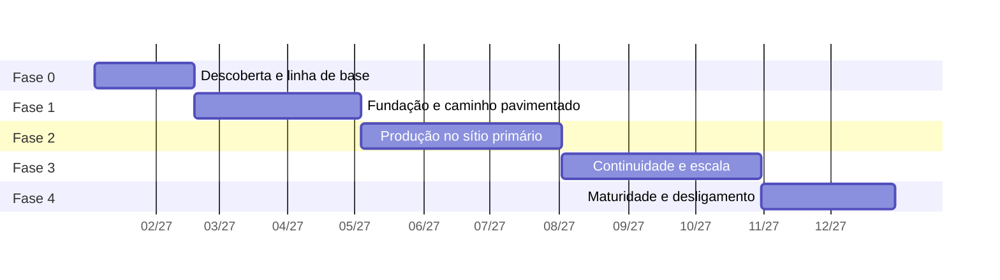

# 8. Plano de evolução

O plano cobre doze meses em cinco fases. O princípio que ordena tudo: **cada fase entrega valor
verificável para algum time de desenvolvimento.** Plataforma construída por seis meses em
isolamento, para ser apresentada pronta, costuma chegar resolvendo o problema errado.

A sequência também respeita uma dependência técnica: não dá para fazer GitOps sem registry, nem
observabilidade útil sem padrão de telemetria, nem migrar com segurança sem saber reverter.

---

## Visão das fases

**Figura 8.1 — Doze meses de implantação, em cinco fases.**



---

## Fase 0 — Descoberta e linha de base (mês 1 e metade do 2)

Antes de instalar qualquer coisa. A tentação de começar subindo cluster é grande, e produz uma
plataforma dimensionada por chute.

**O que se faz:**

- Inventário das 60 aplicações: linguagem, versão de runtime, servidor de aplicação, estado,
  dependência de banco, integrações, janela de uso, consumo real medido no vSphere.
- Inventário das regras que o Apache aplica por aplicação: reescrita e redirecionamento de URL,
  autenticação feita antes da aplicação, cabeçalhos, limite de tamanho e conexão com o servidor de
  aplicação, inclusive as que estão em `.htaccess`. Cada regra ganha um destino na plataforma nova
  (Route, HAProxy, Keycloak ou o próprio código) antes da onda da aplicação. Sem isso, a aplicação
  migrada sobe saudável e perde, em silêncio, a autenticação ou a URL que outros órgãos ainda
  chamam.
- Classificação por nível de criticidade, acordada com as áreas de negócio.
- Classificação por facilidade de migração, em três classes: **A**, sem estado e já
  conteinerizável; **B**, com estado em disco ou sessão, exigindo ajuste; **C**, dependente de
  servidor de aplicação proprietário, exigindo reescrita parcial. A classe de cada aplicação
  alimenta a matriz de custo, esforço e tempo (ver "Custo, esforço e tempo da migração", abaixo).
- Medição da linha de base: tempo entre commit e produção, frequência de entrega, percentual de
  entregas com correção urgente, tempo de restauração. Sem esse número de partida, não há como
  mostrar resultado no mês 12.
- Formação do time de plataforma, com no mínimo quatro pessoas e dupla por área, e contratação de
  mais duas até a fase 2. Plantão contínuo com quatro pessoas é uma semana de plantão a cada
  quatro, durante doze meses de construção; com seis, a escala fecha sem esgotar ninguém.
- Levantamento do custo de software e abertura das contratações que demoram (ver "Custo e
  contratação", abaixo). As compras da fase 1, o Conjur e o PAM, o GitLab Premium e o que mais a
  fase 1 exigir além da subscrição OpenShift, abrem no dia 1 da fase 0, porque a compra pública
  leva de três a seis meses e a fase 1 começa no dia 46.
- Definição do que não entra na plataforma nesses doze meses, por escrito.

**Entregável:** inventário publicado, classificação acordada, linha de base registrada, matriz de
custo, esforço e tempo preenchida com a contagem real de aplicações por classe, lista das três
aplicações piloto escolhidas com os times voluntários.

**Por que primeiro:** a escolha do piloto define o sucesso político do projeto. O piloto certo é
uma aplicação de nível 2, sem estado, de um time que quer participar. Nem a mais crítica, que não
tolera erro de aprendizado, nem a mais irrelevante, cujo sucesso não convence ninguém.

---

## Fase 1 — Fundação e caminho pavimentado (meses 2 a 4)

**O que se faz:**

- Terraform e Ansible para as máquinas da plataforma, com o papel de linha de base validado.
- Clusters `plat-dc1` e `dev-dc1` em operação, e o Rancher em três máquinas virtuais próprias, num
  RKE2 de gestão, porque o provedor Terraform dele precisa existir antes do `dev-dc1`.
- Harbor, Keycloak e runners próprios.
- Conjur integrado ao PAM, com a primeira política de rotação em conta dupla e o External Secrets
  autenticando por ServiceAccount em `dev-dc1`. Se a compra atrasar, o OpenBao faz a ponte (risco 2).
- Esteira completa para as três aplicações piloto: build, teste, SonarQube, varredura, assinatura,
  publicação.
- Argo CD gerenciando `dev-dc1`, com o repositório de manifestos e o gerador de aplicações.
- Observabilidade mínima com Prometheus, Grafana, Loki e coletor OpenTelemetry.
- Templates de pipeline e chart base, com as linguagens predominantes do inventário.
- Processo de catálogo funcionando ponta a ponta para aplicação nova.

**Entregável:** as três aplicações piloto rodando em desenvolvimento, implantadas por GitOps, com
painel e alertas, e um time conseguindo criar aplicação nova sem ajuda. O esforço gasto nos
pilotos, medido em pessoas-dia, substitui a estimativa da classe A na matriz antes da primeira
onda.

**Por que nessa ordem:** registry e cofre vêm antes de tudo porque a esteira depende deles. O
caminho pavimentado vem junto com o piloto, e não depois, porque é o piloto que revela se ele é
usável.

---

## Fase 2 — Produção no sítio primário (meses 5 a 7)

**O que se faz:**

- Clusters `hml-dc1` e `prd-dc1`.
- HAProxy em par, com a regra de corte por aplicação entre legado e plataforma.
- Políticas de admissão com Kyverno, em modo auditoria por um mês e depois obrigatórias.
- Plantão formalizado, com escala, roteiros de resposta e roteamento por time.
- Alertas de orçamento de erro para as aplicações piloto.
- Velero com backup dos quatro clusters e primeira restauração testada.
- Primeira onda de migração: 10 aplicações da classe A, de nível 2 e 3.

**Entregável:** 10 aplicações em produção na plataforma nova, com retorno de versão exercitado em
pelo menos uma delas de propósito.

**Por que aqui:** produção antes da continuidade é deliberado. Operar produção em um sítio durante
três meses ensina o que o segundo sítio precisa ter. Construir os dois sítios antes de ter tráfego
real produz uma contingência desenhada para suposições.

**O que fica descoberto nesta fase, e por que é aceitável.** Até a fase 3, as aplicações migradas
rodam só em DC1. Uma perda de DC1 nesse intervalo deixa essas dez aplicações sem o segundo sítio
que elas tinham no legado. A mitigação é o próprio legado: as máquinas virtuais das aplicações
migradas só são desligadas na fase 4, e o HAProxy de DC2 devolve o tráfego para elas invertendo a
regra de rota. Por isso a primeira onda tem só aplicações de nível 2 e 3, e nenhuma de nível 1.

---

## Fase 3 — Continuidade e escala (meses 8 a 10)

**O que se faz:**

- Cluster `prd-dc2` e replicação do Harbor entre sítios.
- GitLab secundário em DC2.
- Contingência do Argo CD instalada e desligada em `prd-dc2`.
- Réplicas do Conjur em DC2, a de espera e a de leitura.
- Réplica do diretório e instância do Keycloak em DC2.
- MinIO espelhado e Thanos com retenção longa.
- Contrato da vigilância externa, com um sinal de vida por cluster.
- Réplica do Oracle por Data Guard e do PostgreSQL por Patroni para DC2, com a máquina do etcd
  de reserva e a troca de papel testada.
- Primeiro exercício de continuidade, com DC1 isolado de propósito.
- Argo Rollouts com canário para as aplicações de nível 1.
- Contagem de pontos de função das aplicações da classe C, para que a contratação da reescrita
  corra durante a fase 4 e não segure o ano seguinte (ver "Depois do mês 12", abaixo).
- Segunda onda de migração: mais 20 aplicações da classe A, o dobro das 10 da fase 2. O ritmo sobe porque os
  templates e o chart base já foram exercitados na primeira onda. Somadas às 10 da fase 2, são 30
  no fim da fase 3, e as de 10 a 15 da fase 4 fecham a expectativa de 40 a 45.

**Entregável:** exercício de continuidade executado com tempo cronometrado, relatório de achados e
correções aplicadas. Cerca de 30 aplicações na plataforma.

A fase 3 carrega o segundo sítio inteiro além da migração. Se a equipe não chegar a seis pessoas, a
meta de 20 cai antes de qualquer item da lista de continuidade (README, premissa da equipe).

**Por que aqui:** o canário entra agora porque exige linha de base histórica de métrica para
comparar. Nas fases anteriores não havia série temporal suficiente para a análise automática
decidir alguma coisa.

---

## Fase 4 — Maturidade e desligamento (meses 11 e 12, continuando adiante)

**O que se faz:**

- Ondas finais de migração, de 10 a 15 aplicações da classe B, as que exigem ajuste de estado.
- Rateio de custo por namespace, com relatório de consumo por time.
- Exercícios de injeção de falha em homologação, de forma controlada.
- Avaliação do portal interno de desenvolvedor, decidida por dado de uso, não por vontade.
- Desligamento das máquinas virtuais das aplicações já migradas, que é onde o retorno financeiro
  aparece.
- Revisão da linha de base contra o número de partida da fase 0.

**Entregável:** maioria das aplicações migradas, legado em desligamento progressivo, comparação
antes e depois publicada.

**Nota sobre o escopo.** Migrar 60 aplicações em doze meses só é realista se uma parte delas for
simples. A expectativa honesta é de 40 a 45 aplicações até o mês 12, com o restante, que depende de
reescrita por causa de servidor de aplicação proprietário, no ano seguinte. Prometer 60 produz
atraso visível no mês 10; prometer 45 e entregar 50 produz confiança.

---

## Depois do mês 12: as aplicações da classe C

As 15 a 20 aplicações que ficam são as da classe C, presas a servidor de aplicação proprietário.
Elas não são abandonadas: entram num segundo ciclo, que começa a ser preparado ainda na fase 3.

- **A contagem vem antes.** Os pontos de função de cada uma são contados na fase 3. A contratação
  da reescrita, quando for por fábrica de software, passa pelo mesmo processo de compra pública de
  três a seis meses do risco 2, e precisa estar aberta antes do mês 12.
- **A ordem segue o retorno.** Primeiro a aplicação que libera mais custo de legado, em licença de
  servidor de aplicação e em máquina virtual, por ponto de função reescrito. Entre duas parecidas,
  a menor vai antes, porque termina antes e ensina a seguinte.
- **O legado fica enxuto, não desligado.** O HAProxy continua mandando essas aplicações para o
  legado, e as máquinas virtuais e as licenças delas seguem pagas até cada uma migrar. Esse custo
  entra na comparação do mês 12, sem ser escondido.
- **O prazo sai da contagem.** A proposta não fixa data para a última aplicação antes de existir
  o tamanho de cada reescrita. A matriz da seção seguinte mostra como o prazo é calculado.

> *Decisão: ordem pelo retorno financeiro por ponto de função. A alternativa é migrar primeiro a
> aplicação mais crítica, para tirar o maior risco do legado logo. Foi descartada porque concentra
> no início do ciclo a reescrita mais difícil, feita pela equipe com menos prática no padrão novo.
> O custo é a aplicação crítica da classe C ser das últimas a sair do servidor proprietário.*

---

## Riscos

Em ordem de probabilidade multiplicada por impacto.

### Risco 1: a equipe de plataforma vira gargalo

É o ponto de falha mais provável dos doze meses e a forma mais comum de o projeto fracassar sem
ninguém perceber. Tem duas faces. Quatro pessoas atendendo doze times manualmente não sobra tempo
para construir, e a plataforma congela no estado da fase 1. E equipe pequena com especialista único
por área perde a única pessoa que sabe restaurar o cofre ou o banco.

**Mitigação:** o autoatendimento é entregável da fase 1, não da fase 4. O chamado que sobra tem
prazo por prioridade de impacto, e uma pessoa por semana atende a fila enquanto as demais
constroem ([`docs/07`](07-experiencia-dev.md)). A terceira ocorrência do
mesmo chamado vira item da fila de trabalho. O percentual de tempo da equipe gasto em chamado é medido, e
acima de 40 por cento a migração é pausada até cair. Dupla por área desde a fase 0, roteiro de
resposta escrito por quem não fez a instalação, rodízio de plantão e exercício de continuidade
executado por quem não o planejou.

### Risco 2: contratação mais lenta que o cronograma

Conjur e PAM, edição Premium do GitLab, eventual opção de TDE do Oracle e o hardware de DC2 passam
por processo de compra pública, de três a seis meses cada. A subscrição de OpenShift é premissa do
README e não entra nesta conta. Uma contratação atrasada segura a fase inteira que depende dela, e
a fase 1 depende do Conjur.

**Mitigação:** as compras da fase 1 abrem no dia 1 da fase 0, e as da fase 3 ainda na fase 1. Cada
componente pago tem alternativa aberta declarada (OpenBao para o Conjur, Quay ou Harbor para o
registry, SonarQube Community para a edição Developer), para que um atraso troque a ferramenta, e
não pare o plano.

**Desvio aceito:** se o Conjur atrasar, a fase 1 sobe com o OpenBao como ponte. A troca depois é só
do SecretStore, porque o consumo pelo External Secrets não muda (ADR-008). O custo é rotação por
credencial dinâmica de banco durante a ponte, em vez da rotação pelo PAM, e uma segunda migração de
caminho de segredos para a equipe, que cabe numa janela de mudança.

### Risco 3: resistência dos times

Doze times com processo próprio que funciona não adotam plataforma nova por determinação
administrativa. Adotam por baixo, com formalidade.

**Mitigação:** piloto com time voluntário; resultado medido e divulgado com o número de antes e
depois; adoção por convite nas duas primeiras ondas. A obrigatoriedade só entra depois que houver
prova, e com prazo longo. Um time que vê outro entregando em vinte minutos o que ele leva dois dias
pede para entrar. O número "vinte minutos contra dois dias" é hipótese a validar na linha de base
da fase 0, e não medição.

### Risco 4: capacidade de hardware subdimensionada

On-premises não tem elasticidade. Descobrir no mês 8 que faltam nós significa processo de compra de
três a seis meses num órgão público. A premissa de que o vSphere existente comporta cerca de 50
máquinas virtuais novas está no README; se ela cair, a compra de hospedeiros entra na fase 0.

**Mitigação:** dimensionamento com o consumo real medido na fase 0, mais 40 por cento de margem.
O processo de aquisição do hardware da fase 3 é iniciado na fase 1. Alerta de capacidade com
previsão de 90 dias, e não de percentual atual.

### Risco 5: dado fiscal em ambiente com permissão mais larga

Cópia de produção para homologação sem anonimização é o incidente de privacidade mais provável do
projeto, e o mais caro em órgão fiscalizado.

**Mitigação:** rotina de anonimização obrigatória no caminho da restauração, sem passagem direta.
Negação por padrão na rede desde o primeiro namespace. Auditoria de acesso ao servidor de API
retida por cinco anos. Revisão da área de segurança da informação antes da primeira carga.

### Risco 6: migração que trava no meio

Uma aplicação que não migra, por dependência inesperada, costuma travar a onda inteira e consumir
semanas.

**Mitigação:** cada onda tem critério de desistência declarado. Aplicação que passa duas
semanas do tempo estimado para a classe dela na matriz de custo, esforço e tempo volta para a fila
com o impedimento registrado, e a onda segue. O HAProxy mantendo a rota
no legado torna essa desistência barata e reversível. A lista de prontidão da onda confere que
cada regra do Apache levantada na fase 0 já tem destino na plataforma nova; regra sem destino
segura a aplicação no legado.

### Risco 7: defasagem de conhecimento

Kubernetes, GitOps e observabilidade moderna são novidade para boa parte dos doze times. Plataforma
que exige conhecimento que ninguém tem é plataforma não usada.

**Mitigação:** o chart base esconde o que não precisa ser aprendido de imediato. Trilha de
capacitação com quatro oficinas práticas por trimestre. Programação em par da plataforma com o time
durante a migração de cada aplicação. Documentação escrita para quem está chegando.

### Risco 8: segredo em texto aberto no acervo existente

Credencial dentro de pipeline antigo, de arquivo de configuração e de repositório é quase certa num
parque de 60 aplicações. Migrar sem tratar leva o problema junto.

**Mitigação:** varredura de histórico do Git logo na fase 1, com relatório por time. Conjur e
External Secrets disponíveis antes da primeira migração. Rotação obrigatória de toda credencial
encontrada, porque o que esteve em repositório é considerado comprometido.

---

## Custo, esforço e tempo da migração

A licença é o custo mais visível, e está na seção seguinte. O custo maior desta proposta é trabalho
de gente. Ele é estimado por aplicação, com a mesma matriz para as 60: custo, esforço e tempo,
calculados pela classe de migração da fase 0.

Os números abaixo são hipótese até o piloto. Eles existem para mostrar como a conta é feita e para
conferir se o cronograma cabe na equipe. A fase 0 troca a quantidade de cada classe pela contagem
real, e os pilotos trocam o esforço pelo medido.

### A matriz

| Classe | Aplicações, hipótese | Esforço por aplicação | Dos quais, plataforma em par | Tempo por aplicação | Esforço total | Quando |
|---|---|---|---|---|---|---|
| A, sem estado | 30 | 8 a 12 pessoas-dia | 2 pessoas-dia | 3 semanas: 2 de trabalho e 1 de convivência com o legado | 240 a 360 pessoas-dia | Fases 2 e 3 |
| B, com estado | 10 a 15 | 20 a 35 pessoas-dia | 4 pessoas-dia | 6 semanas: 5 de trabalho e 1 de convivência | 200 a 525 pessoas-dia | Fase 4 |
| C, servidor proprietário | 15 a 20 | Pela contagem de pontos de função | Pela contagem | Pela contagem | Pela contagem | Depois do mês 12 |

Os 8 a 12 pessoas-dia da classe A vêm destas parcelas: imagem sobre a base aprovada, 1 a 2;
valores do chart e overlays, 1; pipeline a partir do template, 0,5 a 1; destino das regras do
Apache levantadas na fase 0, 1 a 2; testes em homologação e ajuste de recurso, 2 a 3; corte e
acompanhamento, 2. A classe B soma a isso a retirada da sessão de dentro da aplicação, de 5 a 10,
a troca do arquivo em disco por armazenamento de objeto ou volume, de 5 a 10, e o teste de carga,
de 2 a 3.

### As fórmulas

**Esforço** de uma onda é a soma do esforço por aplicação das classes que ela contém.

**Tempo** de uma onda depende de quantas aplicações a plataforma acompanha em par ao mesmo tempo:

```
aplicações simultâneas = pessoas da plataforma em par × (dias úteis de trabalho ÷ pessoas-dia de par por aplicação)
tempo da onda = arredondar para cima(aplicações da onda ÷ aplicações simultâneas) × tempo por aplicação
```

**Custo** em reais é o esforço vezes o valor do dia de cada perfil:

```
custo da aplicação A ou B = pessoas-dia do time × valor do dia do time
                          + pessoas-dia da plataforma × valor do dia da plataforma
custo da aplicação C      = pontos de função × valor do ponto de função no contrato
custo da equipe de plataforma = 64 pessoas-mês × valor do mês do perfil
```

Os 64 pessoas-mês saem da premissa da equipe: quatro pessoas nas fases 0 e 1, que somam quatro
meses, e seis nos oito meses seguintes. A proposta entrega as quantidades; o valor do dia, do mês e
do ponto de função vem do contrato ou da folha da Secretaria. Escrever valor em reais aqui, sem
esses dados, seria a precisão falsa que esta proposta evita.

### A conferência do cronograma

| Fase | Onda | Plataforma em par | Simultâneas | Tempo da onda | Cabe? |
|---|---|---|---|---|---|
| 2 | 10 aplicações A | 1 pessoa | 1 × (10 ÷ 2) = 5 | 2 ciclos × 3 semanas = 6 semanas | Sim, em 13 semanas de fase |
| 3 | 20 aplicações A | 1 pessoa | 5 | 4 ciclos × 3 semanas = 12 semanas | Sim, no limite de 13 |
| 4 | 10 a 15 aplicações B | 2 pessoas | 2 × (25 ÷ 4) = 12 | 1 ciclo de 6 semanas até 12 aplicações; 2 ciclos acima disso | Até 12, sim; a 13ª passa do mês 12 |

A conta chega à expectativa de 40 a 45 por outro caminho: 30 aplicações A até a fase 3 e 10 a 12
aplicações B na fase 4 dão de 40 a 42 no mês 12. De 43 a 45 só com uma terceira pessoa em par na
fase 4, ou com aplicações B que o piloto mostre mais simples que a hipótese. As demais aplicações B
seguem no ciclo seguinte. A fase 4 é a mais apertada também do lado dos times. No máximo da faixa, 525
pessoas-dia em cerca de 42 dias úteis são 12 pessoas em tempo integral, quase uma por time. Se os
times não liberarem essa gente, a fase 4 entrega 10 aplicações, e o plano continua dentro da
expectativa declarada.

A fase 3 fecha no limite. Ela carrega o segundo sítio inteiro, e a pessoa em par é uma das seis da
equipe. Se a equipe não chegar a seis, o corte é o da premissa do README: a meta de 20 cai antes de
qualquer item de continuidade.

### Ponto de função, só para a classe C

O ponto de função mede o tamanho funcional de um software, aquilo que o usuário enxerga: entradas,
saídas, consultas e arquivos mantidos. Ele serve para a classe C porque a reescrita parcial refaz
funcionalidade. A contagem segue o manual do IFPUG, é feita por contador certificado na fase 3 e
usa os tipos de demanda do roteiro de métricas do contrato da Secretaria. Em contratação pública de
software, a referência mais usada é o Roteiro de Métricas de Software do SISP. Quando a reescrita
leva dado de um formato a outro, a funcionalidade de conversão entra na contagem, como o manual
prevê para projeto de melhoria.

Da contagem saem esforço e prazo:

```
esforço em horas = pontos de função × horas por ponto de função
prazo em meses   = esforço em horas ÷ (pessoas alocadas × horas produtivas por mês)
```

As horas por ponto de função vêm do histórico da Secretaria ou do contrato. Como ilustração, com
números fictícios: uma aplicação de 300 pontos de função, a 10 horas por ponto, são 3.000 horas;
com três pessoas a 120 horas produtivas por mês, pouco mais de oito meses.

> *Decisão: ponto de função só para a classe C, e pessoas-dia por classe para A, B e a construção
> da plataforma. A alternativa é contar ponto de função para toda a migração, o que daria um número
> único e comparável aos contratos anteriores. Foi descartada porque A e B não mudam a
> funcionalidade da aplicação: a contagem honesta da migração delas fica perto de zero, e a contagem
> que não fica perto de zero conta como nova uma funcionalidade que já existe. A construção da
> plataforma é infraestrutura, que o ponto de função não mede. O custo é o plano ter duas unidades
> de medida, e o relatório para a Secretaria precisar converter as duas em reais.*

### Como a estimativa se corrige

Cada onda publica o esforço estimado contra o realizado, por aplicação. Desvio acima de 30 por
cento numa onda recalcula a matriz antes da seguinte. É o mesmo princípio dos indicadores do fim
deste documento: o número de partida é hipótese, e o que vale é o medido.

---

## Custo e contratação

O valor exato depende do inventário da fase 0 e de preço de contrato, que esta proposta não tem
como estimar com honestidade. O que dá para fazer agora é separar o que custa licença do que não
custa, e dizer do que cada custo depende.

| Item | Modelo de cobrança | Do que depende | Alternativa sem licença |
|---|---|---|---|
| OpenShift | Subscrição por pares de núcleos | Número de nós de `plat-dc1`, `hml-dc1`, `prd-dc1` e `prd-dc2` | RKE2 em produção (premissa do README) |
| Conjur e PAM | Licença por quantidade de identidades | 60 aplicações em três ambientes, mais as identidades da esteira | OpenBao (ADR-008) |
| TDE do Oracle | Opção licenciada à parte, por núcleo do banco | Quantos bancos guardam dado fiscal | Cifra do datastore, com o limite declarado em `docs/01` |
| SonarQube Developer | Por linhas de código analisadas | Tamanho das 60 aplicações | SonarQube Community, já adotado (ADR-012) |
| GitLab Premium | Por usuário | O GitLab secundário em DC2 usa o Geo, que é da edição Premium | Restauração do backup do GitLab em DC2, com retomada em horas e não em minutos |
| Hardware de DC2 | Compra de capital | 75 por cento da capacidade de `prd-dc1` (9 de 12 nós de trabalho) | Continuidade por restauração de backup |
| Oracle em DC2 | Licença do banco na instância em espera (Data Guard), por núcleo | Quantos bancos de nível 1 e 2 têm espera em DC2 | Restauração do backup em DC2, com retomada em horas. Sem Active Data Guard: a espera não atende consulta |
| Vigilância externa | Assinatura de serviço hospedado fora dos datacenters | Número de sinais de vida, um por cluster | Verificação própria numa nuvem pública, com a operação a cargo da equipe |
| SIEM e ferramenta de plantão | Premissas existentes na Secretaria (README) | Nada novo se a premissa for verdadeira | Serviço contratado, se a premissa cair |
| Harbor, Argo CD, Kyverno, Prometheus, Grafana, Loki, Tempo, Keycloak | Sem licença | Horas da equipe de plataforma | — |

O retorno financeiro aparece na fase 4, com o desligamento das máquinas virtuais das aplicações
migradas e das licenças de servidor de aplicação que elas usavam.

---

## Como medir se deu certo

Quatro números comparados com a linha de base da fase 0, publicados trimestralmente.

| Indicador | Hoje, hipótese a validar na fase 0 | Meta no mês 12 |
|---|---|---|
| Tempo entre commit e produção | Semanas | Menos de 1 dia para nível 2 e 3 |
| Frequência de entrega por aplicação | Mensal | Semanal |
| Entregas que exigiram correção urgente | Sem medição | Abaixo de 15 por cento |
| Tempo médio de restauração | Horas | Menos de 30 minutos |

Quatro indicadores complementares medem a plataforma em vez da entrega: percentual de aplicações
com nível de serviço declarado e com alerta funcionando; tempo entre o pedido de aplicação nova e
a primeira implantação em desenvolvimento, cuja meta é de um dia; cumprimento do prazo de
atendimento por prioridade de chamado ([`docs/07`](07-experiencia-dev.md)); e esforço estimado
contra realizado em cada onda de migração.

Se esses números não melhorarem, a plataforma adicionou complexidade sem entregar benefício, e isso
precisa aparecer no relatório tanto quanto o sucesso.
