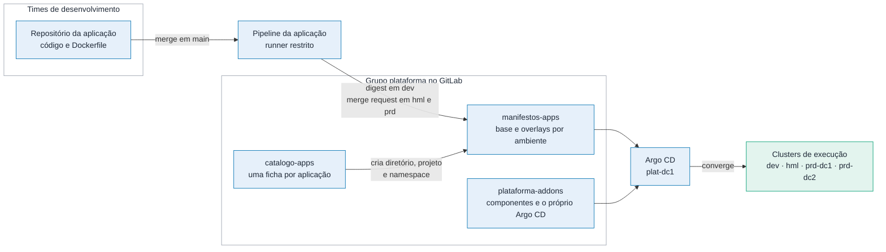
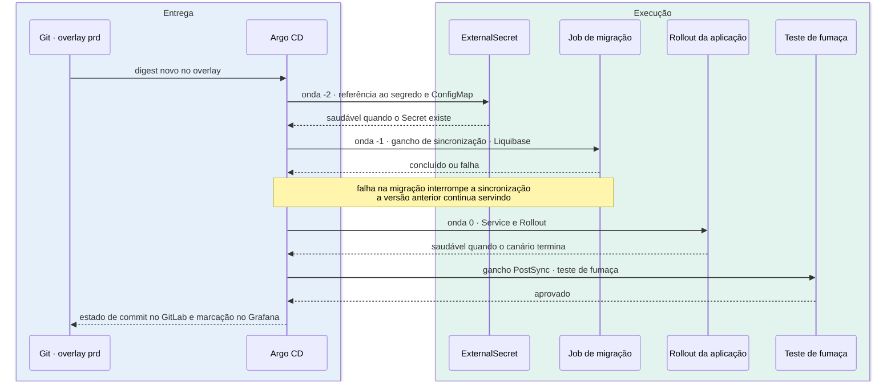
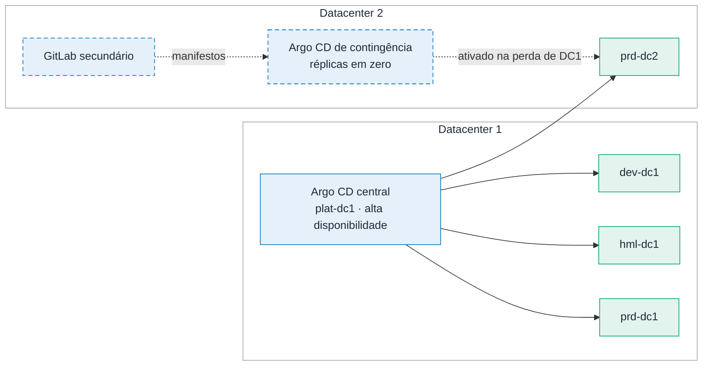

# 9. GitOps com Argo CD

O fluxo de entrega, em [`docs/03`](03-cicd.md), termina quando o pipeline altera uma linha no
repositório de manifestos. Este documento abre o que acontece dali em diante: como o repositório
é organizado, como o Argo CD decide o que aplicar e em que ordem, quem pode fazer o quê, e o que
acontece quando o próprio Argo CD falha.

É o aprofundamento da segunda tese do desenho. Se o pipeline publica e o GitOps implanta, então o
GitOps é a única porta de entrada em produção, e precisa ser desenhado com o mesmo cuidado que se
dá a uma porta assim.

---

## Os repositórios e quem escreve em cada um

**Figura 9.1 — Os repositórios e quem escreve em cada um.**



| Repositório | Conteúdo | Quem escreve | Quem aprova |
|---|---|---|---|
| `catalogo-apps` | Uma ficha por aplicação: time, nível, dependências, compromisso de nível de serviço | Time dono | Plataforma |
| `manifestos-apps` | Estado desejado das 60 aplicações, por ambiente | Promotor da esteira e time dono | Promotor em `dev` e `hml`, sem aprovação humana; em `prd`, duas pessoas do time dono, e a plataforma também quando a mudança vai além do digest |
| `plataforma-addons` | Componentes de cluster e a configuração do Argo CD | Plataforma | Plataforma, duas aprovações |

Os objetos de namespace (cota, `LimitRange`, `NetworkPolicy`, `RoleBinding`, `ServiceAccount` e
`SecretStore`) seguem outro caminho. O pipeline do catálogo faz commit deles em
`plataforma-addons/namespaces/`, e uma `Application` do projeto `plataforma`, que tem permissão de
escopo de cluster, os aplica nos quatro clusters. O pipeline continua sem credencial de cluster, e o
`AppProject` do time continua sem poder criar nenhum desses objetos.

> *Decisão: o catálogo escreve em Git, e o Argo CD aplica. A alternativa, o pipeline do catálogo
> criar os namespaces direto com uma credencial de cluster, abriria uma exceção à regra de que o
> GitLab nunca tem credencial de produção. O custo é a criação do namespace esperar a próxima
> sincronização do Argo CD, e o primeiro deploy de uma aplicação nova depender dela.*

O repositório de código da aplicação não aparece na lista de origens do Argo CD. **O Argo CD nunca
lê código, só manifesto.** Um time que consiga alterar o próprio pipeline não ganha, com isso,
caminho direto até o cluster.

---

## A estrutura de uma aplicação

```
manifestos-apps/
└── apps/fiscal/nfe-emissor/
    ├── base/
    │   └── values.yaml             # o que o time preenche, igual nos três ambientes
    └── overlays/
        ├── dev/kustomization.yaml  # infla o chart com o ambiente, fixa versão e digest
        ├── hml/kustomization.yaml
        ├── prd/                    # digest de produção, comum aos dois sítios
        │   ├── kustomization.yaml
        │   └── rollout-analise.yaml    # canário, só nível 1
        ├── prd-dc1/kustomization.yaml   # herda de prd; só o que é do sítio
        └── prd-dc2/kustomization.yaml
```

Os artefatos completos estão em [`exemplos/gitops/`](../exemplos/gitops/).

**O ambiente é um diretório, não um branch.** O Argo CD sempre lê `main`, e a diferença entre
homologação e produção é o conteúdo de dois arquivos lado a lado. Com branch por ambiente, uma
correção feita direto em produção não volta para homologação, e a diferença entre os dois vira
acúmulo acidental (ADR-011).

**Produção tem três diretórios, e o digest mora em um só.** `prd` guarda o digest e tudo o que é
igual nos dois sítios. `prd-dc1` e `prd-dc2` herdam de `prd` e carregam só a diferença: em
aplicação de nível 2, `prd-dc2` declara zero réplicas, que é a espera quente descrita em
[`docs/05`](05-resiliencia.md). Promover continua sendo alterar uma linha, e os dois sítios
recebem a versão nova no mesmo commit.

### Helm dentro do Kustomize

Nenhum diretório contém manifesto escrito à mão. A `base` guarda só o `values.yaml` do time. Cada
overlay infla o chart `app-base`, publicado no Harbor como artefato OCI, com esse arquivo e com o
que é do ambiente:

```yaml
helmCharts:
  - name: app-base
    repo: oci://harbor.sefaz.interno/charts
    version: 4.2.0
    releaseName: nfe-emissor
    valuesFile: ../../base/values.yaml
    valuesInline:
      ambiente: prd
      rota: { host: nfe.sefaz.exemplo.gov.br, publica: true }
```

O chart é inflado em cada overlay, e não uma vez na `base`, porque o ambiente entra nos valores, e
não só em ajuste do overlay: é ele que decide qual caminho do Conjur o `ExternalSecret` lê e com que atributos
a telemetria sai. Inflado uma vez só, o chart sairia com o ambiente de desenvolvimento em
produção.

Cada ferramenta faz o que faz melhor. O **Helm** dá ao time um arquivo de valores curto e esconde o
que ele não precisa saber, como a diferença entre Route e Ingress. O **Kustomize** dá ao overlay o
poder de ajustar o que o chart não previu, sem bifurcar o chart, e dá à promoção um campo nativo,
`images[].digest`, que qualquer ferramenta sabe editar.

> *Decisão: Helm para abstrair e Kustomize para variar por ambiente, em vez de só Helm com um
> arquivo de valores por ambiente. Com Helm puro, toda variação precisa ter sido prevista pelo
> autor do chart como um valor; quando não foi, o time bifurca o chart e sai do caminho
> pavimentado. O custo aceito é renderizar com duas ferramentas, o que exige as opções
> `--enable-helm` e `--load-restrictor LoadRestrictionsNone` no Argo CD, esta última para o
> overlay ler o `values.yaml` da `base`.*

A versão do chart fica fixada em cada overlay. Atualizar o chart é um merge request do time, no
tempo dele, com o diff da renderização no próprio merge request, e a versão nova sobe ambiente por
ambiente, como o digest: primeiro `dev`, depois `hml`, depois `prd`. É a mesma regra dos templates
de pipeline: a plataforma nunca altera o comportamento de uma aplicação sem o time trocar a
versão.

---

## Como as Applications nascem

Ninguém cria `Application` à mão. Um `ApplicationSet` parte dos diretórios de overlay em
`manifestos-apps` (`apps/<time>/<app>/overlays/<overlay>`) e cruza cada um com o cluster de execução
cujo rótulo `sefaz.io/overlay` é igual ao nome do diretório. Cada cruzamento vira uma `Application`:
uma por overlay existente. São, no máximo, quatro por aplicação, e menos quando a aplicação não tem
todos os overlays. Uma aplicação de nível 3 ou 4 sem `prd-dc2`, ou uma aplicação nova que só tem
`overlays/dev`, não gera `Application` nos outros clusters.

> *Decisão: gerar a partir dos overlays que existem, e não de toda aplicação vezes todo cluster. O
> cruzamento completo geraria `Application` em erro de comparação para cada overlay que não existe,
> e esse erro dispararia o alerta de aplicação degradada. O custo é um overlay esquecido não gerar
> erro: a aplicação simplesmente não aparece naquele cluster. O pipeline do catálogo confere que
> cada aplicação tem os overlays que o nível dela exige.*

O cluster entra no cruzamento pelos rótulos que recebe ao ser registrado:

| Cluster | `sefaz.io/ambiente` | `sefaz.io/overlay` | `sefaz.io/prune` |
|---|---|---|---|
| `dev-dc1` | dev | dev | true |
| `hml-dc1` | hml | hml | true |
| `prd-dc1` | prd | prd-dc1 | false |
| `prd-dc2` | prd | prd-dc2 | false |

Os quatro também levam `sefaz.io/execucao: "true"`, que é o que os separa de `plat-dc1` no
cruzamento. O diretório `overlays/prd` é a base que os dois overlays de produção compartilham, e
nenhum cluster tem o rótulo `prd`, então ele não gera `Application`.

O caminho de cada `Application` é o próprio diretório do overlay. Um cluster novo, como um
terceiro de produção, entra registrando o cluster com os rótulos certos, sem tocar no
`ApplicationSet`. O gerador está em
[`exemplos/gitops/appsets/aplicacoes.yaml`](../exemplos/gitops/appsets/aplicacoes.yaml).

**Cada time é um `AppProject`.** O projeto limita três coisas: de qual repositório a aplicação pode
vir, para quais namespaces ela pode ir (`fiscal-*`, para o time fiscal) e quais tipos de objeto ela
pode criar. Objeto de escopo de cluster é proibido, e cota, limite e política de rede também, porque
esses vêm do processo de catálogo. Um time não consegue, nem por engano, implantar no namespace de
outro ou afrouxar a própria cota.

---

## Política de sincronização por ambiente

| | Desenvolvimento | Homologação | Produção |
|---|---|---|---|
| Sincronização automática | Sim | Sim | Sim, depois do merge aprovado |
| Correção automática de desvio | Sim | Sim | Sim |
| Remoção de objeto que saiu do Git | Sim | Sim | Não, exige confirmação |
| Janela de sincronização | Livre | Livre | Dias úteis, das 7h às 19h |
| Quem sincroniza fora da janela | — | — | Plantão, com registro |

**A detecção é imediata nos dois sentidos.** O GitLab avisa o Argo CD a cada push no repositório
de manifestos, e a varredura periódica de três minutos fica só como rede de segurança. Do lado do
cluster, o Argo CD acompanha os objetos em tempo real: alguém que edite um Deployment em produção,
dentro da janela, vê a alteração desfeita em segundos, com o evento registrado.

**Fora da janela, a sincronização espera, não falha.** Um merge aprovado às 20h fica pendente e é
aplicado às 7h do dia útil seguinte. A janela também bloqueia a sincronização disparada pela
correção de desvio, o que é intencional: a madrugada de sábado não é hora de uma alteração
inesperada chegar sozinha a produção. Fora da janela, o desvio aparece como aplicação fora de
sincronia e gera alerta para o plantão, que decide se sincroniza na hora.

> *Decisão: remoção automática desligada em produção. Um diretório apagado por engano no Git, ou
> um recurso renomeado, removeria o objeto em produção na sincronização seguinte. Em produção, a
> remoção aparece como "fora de sincronia" no painel e alguém confirma. O custo é lixo acumulado,
> resolvido por uma revisão mensal.*

---

## A ordem dentro de uma sincronização

Uma sincronização aplica dezenas de objetos. A ordem importa, e o Argo CD a controla por ondas
(`sync-wave`) e ganchos (`hook`). Sem ordem, três falhas clássicas aparecem: o pod sobe antes do
segredo existir e fica em erro de configuração; a versão nova sobe antes da migração e roda contra
o esquema velho; e ninguém confirma que a versão nova responde antes de declarar a entrega pronta.

**Figura 9.2 — A ordem de uma sincronização em produção.**



**O gancho da migração é da fase de sincronização, não da fase anterior a ela.** O Argo CD
executa os ganchos `PreSync` antes de todas as ondas. A migração rodaria antes do
`ExternalSecret` existir e falharia na primeira sincronização de toda aplicação nova. Na fase de
sincronização, o gancho respeita as ondas e espera a credencial.

**A migração roda antes da versão nova, e isso só é seguro por causa do padrão expandir e
contrair.** A etapa de expandir deixa o esquema compatível com a versão antiga e com a nova ao mesmo
tempo. A versão antiga, ainda em execução, não percebe a migração. Se a migração falhar, a
sincronização para e nada muda para o usuário. O job faz parte do chart base e roda pelo mesmo
caminho nos três ambientes, então homologação exercita a migração exatamente como produção. Ele
está em [`exemplos/helm/app-base/templates/ganchos.yaml`](../exemplos/helm/app-base/templates/ganchos.yaml),
junto com o teste de fumaça que roda depois da sincronização.

**O segredo precisa estar pronto, não só declarado.** O Argo CD só passa para a onda seguinte
quando os objetos da onda atual estão saudáveis. Para o `ExternalSecret`, a verificação de saúde
que já vem no Argo CD só o aprova quando o External Secrets confirma que buscou o valor no Conjur.
Se o Conjur recusar a leitura, por política errada ou caminho inexistente, a sincronização para na
onda -2, com a mensagem do Conjur na tela, e nenhum pod sobe sem credencial.

---

## O que o revisor vê antes do merge

No repositório de infraestrutura, quem revisa lê o plano do Terraform e não só o diff
([`docs/06`](06-iac.md)). O repositório de manifestos tem o equivalente.

O pipeline do merge request renderiza o overlay alterado nos dois lados, `main` e o branch do
merge request, e publica a diferença dos objetos finais como comentário. Uma alteração de três
linhas no `values.yaml` pode mudar a sonda de saúde, a política de rede e o limite de memória ao
mesmo tempo, e é a renderização que mostra isso. O mesmo pipeline valida o resultado com
`kubeconform` e com as políticas do Kyverno, para que a violação apareça no merge request, perto de
quem a causou, e não no Argo CD, horas depois.

Esse pipeline roda sem credencial de cluster. Renderizar é transformar texto em texto.

---

## Quem pode fazer o quê

O login no Argo CD é pelo Keycloak, com os grupos do diretório corporativo. Os grupos viram papéis:

| Papel | Desenvolvimento e homologação | Produção |
|---|---|---|
| Time dono | Ver, sincronizar, reiniciar, ver log | Ver e ver log |
| Plantão do time | Igual ao time | Sincronizar, inclusive fora da janela, e ver log; toda ação fica registrada |
| Plantão da plataforma | Tudo | Igual ao plantão do time, mais desligar a sincronização automática de uma aplicação |
| Plataforma | Administração | Administração, com duas pessoas para alterar projeto e cluster |

O estado da aplicação se altera pelo Git. O que os papéis concedem é agir sobre o processo:
sincronizar, reiniciar, suspender. A única exceção é o plantão da plataforma, que pode alterar a
`Application` para desligar a sincronização automática durante um incidente. Se ele alterar
qualquer outro campo, como a origem, o controlador do `ApplicationSet` desfaz a mudança, e a ação
fica registrada. A configuração de permissão também mora em `plataforma-addons` e passa por merge
request.

---

## Desvio, incidente e acesso de emergência

A correção automática de desvio fecha a porta da alteração manual. Durante um incidente, essa
porta fechada atrapalha, e o procedimento de emergência precisa existir antes de ser necessário.

**O caminho normal é um `git revert`.** O commit que mudou o digest é revertido, o Argo CD
sincroniza, e os pods voltam à imagem anterior em um a dois minutos. Funciona dentro e fora da
janela, porque o plantão tem permissão para sincronizar fora dela.

**Durante um canário, a primeira ação é abortar o `Rollout`, não reverter.** A operação de
sincronização do Argo CD fica em andamento até o canário terminar, cerca de 25 minutos, e enquanto
ela dura o `git revert` só seria aplicado ao fim. O plantão executa
`kubectl argo rollouts abort <aplicação>`, que devolve o tráfego à versão estável sem esperar o
Git, e só depois faz o `git revert`, para o Git voltar a descrever a realidade. Os um a dois
minutos valem para a promoção já concluída. **Medir no laboratório** quanto tempo o aborto leva e
como o Argo CD trata a operação de sincronização que ficou presa.

**O caminho de emergência existe para quando o Git está lento demais**, por exemplo com o GitLab
indisponível. São quatro passos, e a ordem importa:

1. O plantão desliga a sincronização automática da `Application` afetada. O Argo CD não permite
   voltar a uma sincronização anterior com a sincronização automática ligada, porque ela traria o
   estado do Git de volta no ciclo seguinte.
2. O plantão executa `argocd app rollback` para a sincronização anterior.
3. Alguém abre o `git revert` correspondente, para o Git voltar a descrever a realidade.
4. Com o revert aplicado, a sincronização automática é religada.

Há um detalhe que costuma quebrar esse procedimento na primeira vez. As `Applications` são geradas
pelo `ApplicationSet`, e o controlador dele desfaz qualquer alteração feita direto numa
`Application` gerada, inclusive a do passo 1. O `ApplicationSet` da plataforma declara que a
política de sincronização das `Applications` geradas pode divergir do modelo
(`ignoreApplicationDifferences`), e é isso que torna o passo 1 possível.

> *Decisão: o acesso de emergência desliga a sincronização de uma aplicação, nunca do Argo CD
> inteiro. Desligar o Argo CD durante um incidente congela a correção de desvio das outras 59
> aplicações, e a pressa do incidente é exatamente o momento em que outra alteração manual
> acontece. O custo é repetir o procedimento aplicação por aplicação num incidente que atinja
> várias.*

---

## Notificação e rastreabilidade

O Argo CD avisa três destinos, configurados em
[`exemplos/gitops/argocd/configuracao.yaml`](../exemplos/gitops/argocd/configuracao.yaml):

- **O commit no GitLab** recebe o estado da sincronização. Quem abriu o merge request de promoção vê
  no próprio merge request se a versão subiu, sem abrir o Argo CD. Isso responde à pergunta
  previsível "meu pipeline passou, por que não subiu", registrada como consequência no ADR-003.
- **O Grafana** recebe uma marcação a cada sincronização em produção. Quando a taxa de erro sobe às
  14h02, o plantão vê no mesmo gráfico que houve implantação às 14h00.
- **O canal do time** recebe aviso quando a aplicação fica degradada ou a sincronização falha.

---

## Produção em dois sítios

O mesmo commit no overlay `prd` chega a `prd-dc1` e `prd-dc2` ao mesmo tempo, em duas
`Applications` independentes. No nível 1, cada uma faz o próprio canário, com a própria análise,
consultando o Prometheus do próprio cluster.

A alternativa seria uma sincronização em sequência, primeiro um sítio e depois o outro. O Argo CD
oferece isso no `ApplicationSet`, com a sincronização progressiva. Ela foi avaliada e descartada
por dois motivos: está em fase beta, e desliga a sincronização automática de todas as
`Applications` geradas, o que desfaz a correção automática de desvio em produção.

> *Decisão: sincronização simultânea nos dois sítios, com canário independente em cada um. O risco
> de uma versão ruim chegar aos dois sítios ao mesmo tempo é contido pelo canário, que expõe 10
> por cento do tráfego por quinze minutos antes de seguir. Se a sequência entre sítios virar
> exigência, ela entra como duas etapas de promoção, uma por sítio, e não pela sincronização
> progressiva.*

**O canário de `prd-dc2` precisa de volume para a análise valer.** Com a divisão 70/30 da borda, o
sítio de `prd-dc2` recebe cerca de 30 por cento do tráfego, e o canário de 10 por cento fica com
cerca de 3 por cento do total da aplicação. Um resultado vazio conta como falha, então, de
madrugada, o canário de `prd-dc2` tende a abortar por falta de dado, e não por defeito da versão.
A regra é um volume mínimo de requisições por minuto no canário, calibrado por aplicação (ponto de
partida: cerca de 30 requisições por minuto, suficiente para uma taxa de erro de 1,5 vez a da
estável ser distinguível de ruído). Abaixo dele, a análise de `prd-dc2` usa a métrica somada dos
dois sítios, consultada no Thanos de `plat-dc1`; se `plat-dc1` estiver fora, o canário de `prd-dc2`
roda só em horário com volume e a promoção espera.

> *Decisão: o canário de `prd-dc2` cai para a métrica somada dos dois sítios quando o volume local
> é baixo. A alternativa, tratar resultado vazio como sucesso, deixaria passar versão ruim de
> madrugada. O custo é a análise de `prd-dc2` depender, nesse caso, do Thanos de `plat-dc1`, o que
> contradiz a independência que o desenho busca; por isso é a exceção, e o volume mínimo deve ser
> medido no laboratório.*

---

## O próprio Argo CD

**Onde roda.** Uma instância central em `plat-dc1`, em modo de alta disponibilidade, gerencia os
quatro clusters de execução. Uma instância de contingência fica instalada e desligada em `prd-dc2`
(ADR-009).

**Figura 9.3 — Argo CD central em DC1 e contingência desligada em DC2.**



**Como escala.** São até 240 `Applications`, uma por overlay existente, mais os componentes de
plataforma. O controlador de
aplicação divide os clusters entre réplicas, uma fatia por réplica, e o servidor de renderização
guarda o resultado de cada commit. A renderização com Helm dentro do Kustomize é a parte mais cara,
e guardar o resultado é o que a torna aceitável.

**Como é observado.** O Argo CD exporta métrica para o Prometheus como qualquer aplicação. Três
alertas são da plataforma: aplicação de produção fora de sincronia há mais de trinta minutos dentro
da janela, sincronização falhando repetidamente e fila do controlador crescendo. O primeiro é o
mais útil: um merge aprovado que não chegou a produção é um problema que ninguém está vendo.

**Como se reconstrói.** O Argo CD gerencia a si mesmo, a partir de `plataforma-addons`. Projetos,
permissões, repositórios e registro de cluster estão no Git, e as credenciais vêm do Conjur.
Reconstruí-lo é instalar a versão mínima e apontar para o repositório.

**O que acontece quando ele cai.** Nada para de executar. O Argo CD não está no caminho do pedido
do contribuinte. A plataforma deixa de receber entrega nova e de corrigir desvio até ele voltar.

---

## O que este desenho não resolve

- **O Argo CD não reverte o banco.** Reverter a aplicação é um commit; reverter uma migração não
  é. O limite e o padrão expandir e contrair estão em [`docs/03`](03-cicd.md).
- **A correção automática de desvio briga com quem também escreve no objeto.** Três casos são
  conhecidos e tratados no `ApplicationSet`: o HPA e o Argo Rollouts alterando réplicas, ignorados
  pelo nome de quem escreveu, para que a réplica escrita no Git continue valendo; e o Reloader
  anotando o modelo do pod quando um segredo rotaciona. Cada operador novo instalado no cluster pode
  trazer outro caso, e ele só aparece como oscilação no painel.
- **A rotação de senha passa pelo canário.** Em aplicação de nível 1, a recriação dos pods pelo
  Reloader gera uma revisão nova do Rollout, que percorre os 25 minutos do canário. A conta dupla
  do PAM cobre esse tempo com folga, mas a rotação deixa de ser instantânea.
- **O canário no OpenShift depende de uma extensão.** O Argo Rollouts divide tráfego na Route por
  uma extensão mantida no `argoproj-labs`, fora do núcleo do projeto. Se ele parar de acompanhar as
  versões do Argo Rollouts, o canário volta a dividir por quantidade de réplicas, que é menos
  preciso, mas não depende do roteador.
- **O monorrepositório cresce.** Com 60 aplicações e dezenas de promoções por dia, o histórico de
  `main` fica longo. A mensagem padronizada pelo promotor torna o histórico filtrável, mas não
  menor.
