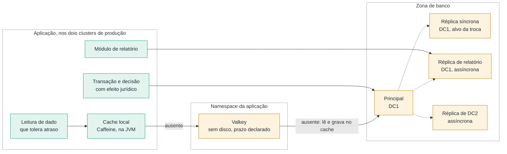

# 10. Plano de dados: leitura, cache e particionamento

Aprofundamento do plano de dados. O [`docs/05`](05-resiliencia.md) responde como o banco sobrevive
à falha; este documento responde como ele aguenta a carga. São três perguntas, cada uma com uma
decisão: onde a leitura é atendida, o que pode ir para cache e por que não há sharding.

A regra que amarra as três: **o banco é dimensionado para atender a carga inteira sem cache e sem
réplica de leitura.** Cache e réplica reduzem latência e dão folga. Nenhum dos dois é requisito de
capacidade. Quando o cache esfria ou a réplica cai, a aplicação fica mais lenta, não fora do ar.

---

## O caminho de uma leitura

**Figura 10.1 — Onde cada leitura é atendida.**

Quatro caminhos, escolhidos pelo tipo de leitura e não pela conveniência:

| Leitura | Onde é atendida | Atraso aceito |
|---|---|---|
| Dentro de uma transação, ou que decide algo com efeito jurídico | Principal | Nenhum |
| Tabela de referência pequena: alíquota, NCM, CFOP, município, feriado | Cache local na JVM | O prazo declarado, em geral horas |
| Consulta repetida que várias réplicas da aplicação fazem | Valkey, com cache-aside | O prazo declarado, em geral minutos |
| Relatório e consulta analítica | Réplica de relatório | Até 15 minutos |

---

## Cache: o que entra e o que nunca entra

### O padrão é cache-aside

A aplicação procura a chave no cache. Se acha, responde. Se não acha, lê do banco, grava no cache
com prazo de validade e responde. Na escrita, a aplicação grava no banco e apaga a chave do cache;
a próxima leitura repõe o valor. O banco continua sendo a única fonte da verdade, e o cache pode ser
apagado a qualquer momento sem perda.

> *Decisão: cache-aside, e não escrita através do cache (write-through) nem escrita adiada
> (write-behind). Nas duas alternativas, o cache fica no caminho da escrita. Na escrita adiada, o
> dado fiscal fica em memória antes de chegar ao banco, e um reinício do pod perde escrita
> confirmada ao contribuinte. O custo aceito é a primeira leitura depois de cada expiração ir ao
> banco, e a janela entre a escrita e a remoção da chave, em que outra réplica pode repor o valor
> antigo. O prazo de validade limita essa janela.*

### Duas camadas, nesta ordem

**Primeiro, o cache local na JVM**, com Caffeine e a abstração de cache do Spring (`@Cacheable`).
Serve à tabela de referência pequena, que muda pouco e que toda réplica lê o tempo todo. Não tem
infraestrutura, não tem rede, não tem senha. Cada réplica guarda a própria cópia, e a divergência
entre réplicas dura no máximo o prazo de validade.

**Depois, o Valkey**, quando o cache local não basta: o dado é grande demais para caber em cada
réplica, ou é caro o bastante de calcular para valer compartilhar o resultado entre trinta pods. O
time pede no catálogo e o chart base cria a instância no namespace da aplicação
([`exemplos/helm/app-base/templates/cache.yaml`](../exemplos/helm/app-base/templates/cache.yaml)).

O Valkey é o fork do Redis mantido pela Linux Foundation, com licença BSD. Fala o mesmo protocolo, e
o Spring Data Redis conecta nele sem mudança de código.

### A regra do que pode ir para cache

| Pode | Com prazo curto e declarado | Nunca |
|---|---|---|
| Tabela de referência: alíquota, NCM, CFOP, município | Extrato e consulta exibida ao contribuinte, quando o próprio processo de negócio já tem atraso maior que o prazo | Decisão com efeito jurídico: emissão de certidão, cálculo de imposto devido, autorização de documento fiscal |
| Configuração da aplicação | Resultado de consulta a outro órgão | Numeração, controle de duplicidade e qualquer estado que não possa ser perdido |
| Chave pública de assinatura do Keycloak | | Dado que só existe no cache |

A coluna "nunca" é a que importa na banca. Uma certidão negativa emitida a partir de um débito em
cache, já quitado ou recém-lançado, é um ato administrativo errado. O cache acelera a tela; não
decide.

**Sessão HTTP é exceção declarada.** Aplicação legada da classe B que guarda sessão em memória pode
movê-la para o Valkey com o Spring Session, como passo para funcionar com mais de uma réplica. O
custo aceito é o usuário entrar de novo quando o Valkey reinicia ou o tráfego troca de sítio. Isso
fica registrado no catálogo, e a sessão sai do Valkey quando a aplicação passar a usar o token do
Keycloak.

### Uma instância por aplicação, em cada cluster, sem disco

- **Por aplicação.** Cada aplicação que pede cache recebe a própria instância, no próprio
  namespace, com a NetworkPolicy que só aceita conexão dos pods dela. Dado de contribuinte de uma
  aplicação nunca divide memória com outra.
- **Por cluster.** `prd-dc1` e `prd-dc2` têm instâncias independentes. Não há replicação de cache
  entre sítios.
- **Sem disco.** A configuração desliga a gravação em disco (`save ""` e `appendonly no`). Dado
  protegido por sigilo fiscal não chega a volume persistente. Reiniciar é começar vazio.
- **Uma réplica, sem Sentinel.** Se o pod cai, o Kubernetes recria em segundos, e nesse intervalo a
  aplicação lê do banco. O disjuntor no cliente evita que cada leitura espere o tempo limite de
  conexão.
- **Memória com teto.** `maxmemory` abaixo do limite do contêiner e descarte da chave menos usada
  (`allkeys-lru`). Cache cheio descarta; não derruba o pod.
- **Senha pelo Conjur, sem TLS próprio.** A senha vem por ExternalSecret, como qualquer
  credencial. O tráfego entre a aplicação e o Valkey é cifrado pela rede do cluster entre nós
  (IPsec), a mesma regra que vale entre o roteador e o pod. TLS no Valkey obrigaria cada aplicação
  a confiar num certificado a mais, sem ganho sobre o IPsec.

> *Decisão: Valkey em instância por aplicação, dentro do cluster. As alternativas descartadas:*
>
> - *Redis. A partir de 2024 a licença deixou de ser BSD, e um órgão público teria de avaliar a
>   licença nova a cada atualização. O Valkey é o mesmo código na origem, sem essa conversa.*
> - *Red Hat Data Grid, o cache que a Red Hat suporta no OpenShift. Tem operador e suporte do
>   fornecedor, mas é subscrição à parte e usa cliente próprio. Passa a ser a escolha se a
>   Secretaria já tiver a subscrição.*
> - *Um agrupamento de cache compartilhado pelas 60 aplicações. Usa menos memória, mas mistura dado
>   de contribuinte de aplicações diferentes na mesma instância e cria um vizinho barulhento: uma
>   aplicação que enche o cache despeja a chave das outras.*
>
> *O custo aceito é operar dezenas de instâncias pequenas, e o cache frio na troca de sítio.*

O banco fica fora do Kubernetes (ADR-004), e o cache fica dentro. Não é contradição. O banco guarda
o dado; perder o volume é perder dado fiscal. O cache não guarda nada que não possa ser recalculado;
perder o pod é perder tempo de resposta por alguns minutos.

### O que o cache muda na resiliência

**A invalidação não cruza o sítio.** O nível 1 roda nos dois clusters, e cada cluster tem o próprio
Valkey. Uma escrita atendida em `prd-dc1` apaga a chave em DC1, e `prd-dc2` continua servindo o
valor antigo até o prazo expirar. O prazo de validade declarado no catálogo é, portanto, o atraso
máximo que o contribuinte pode ver entre sítios. Dado que não tolera esse atraso não vai para cache.

> *Decisão: o prazo de validade como único limite de atraso, e não a publicação da invalidação para
> o outro sítio. Publicar a invalidação entre sítios exige um canal que atravessa o enlace, e na
> partição de rede o canal some sem aviso: o cache de DC2 passaria a servir valor antigo sem
> prazo nenhum. O prazo funciona com o enlace caído.*

**Na troca de sítio, o cache de DC2 está frio para o nível 2**, que roda com réplicas em zero, e
morno para o nível 1. A primeira onda de leituras vai inteira ao banco promovido em DC2. É por isso
que a regra do início deste documento existe: se o banco só aguentasse a carga com o cache cheio, a
perda de DC1 viraria duas falhas em sequência.

**A expiração simultânea de uma chave quente** faz trinta réplicas irem ao banco ao mesmo tempo. O
`@Cacheable(sync = true)` do Spring segura a busca em uma só por JVM, e o prazo de validade recebe
uma variação aleatória de até 10 por cento, para que as chaves carregadas juntas não expirem juntas.

**A dependência escondida é o risco real.** Depois de seis meses, uma aplicação pode passar a
depender do cache sem ninguém perceber: o banco foi reduzido, a consulta pesada nunca foi otimizada.
O teste de carga de homologação roda uma vez por trimestre com o cache desligado, e o exercício
semestral de continuidade mede a primeira hora em DC2 com o cache vazio.

O Valkey expõe a taxa de acerto ao Prometheus. O alerta dela é informativo e nunca acorda ninguém:
taxa de acerto baixa é problema de desenho do cache, não incidente.

---

## Réplica de leitura: quem lê de onde

O desenho de alta disponibilidade do [`docs/05`](05-resiliencia.md) já tem réplicas. Elas existem
para a troca de papel, não para a leitura. A pergunta aqui é se alguma delas deve atender consulta.

### A réplica síncrona não atende relatório

No PostgreSQL, uma consulta longa numa réplica entra em conflito com a aplicação do registro de
transação que chega da principal. O banco tem duas saídas, e as duas são ruins na réplica
síncrona:

- **Cancelar a consulta**, e o relatório falha no meio.
- **Pausar a aplicação do registro** até a consulta terminar. A réplica fica minutos atrás, e se a
  principal cair nesse momento, a promoção espera a réplica alcançar. O tempo de troca dentro do
  sítio, que é de menos de 30 segundos, passa a depender do relatório mais lento do dia.

A réplica síncrona protege a perda máxima de dado do nível 1. Ela não divide esse papel com nada.

### Réplica de relatório, só onde houver relatório pesado

O banco que tem relatório pesado ganha uma quarta instância em DC1: assíncrona, marcada no Patroni
para nunca ser promovida e nunca ser síncrona (`nofailover` e `nosync`). Nela, a aplicação do
registro pode pausar até 15 minutos para uma consulta longa terminar. O relatório pode chegar 15
minutos atrasado, e isso fica declarado na tela do relatório.

> *Decisão: réplica de relatório dedicada e só para o banco que precisar. A alternativa é ler da
> réplica síncrona com `hot_standby_feedback` ligado, que evita o cancelamento fazendo a principal
> segurar linhas antigas. O custo dessa alternativa vai para a principal, que incha e precisa de
> mais manutenção, e a promoção continua refém do relatório. O custo aceito é uma máquina virtual a
> mais por banco com relatório pesado, contada no levantamento da fase 0.*

### Roteamento explícito, nunca automático

A aplicação Spring declara duas fontes de dados: a principal e a de relatório. O módulo de relatório
usa a segunda por configuração, e todo o resto usa a primeira.

> *Decisão: a aplicação escolhe a fonte de dados por módulo, e não por roteamento automático das
> transações marcadas como somente leitura. O roteamento automático manda para a réplica a leitura
> que vem logo depois de uma escrita, e o contribuinte não vê o que acabou de gravar. O custo é o
> time precisar separar o módulo de relatório, o que é bom desenho de qualquer forma.*

### Oracle

A instância Oracle em espera só atende consulta com o Active Data Guard, que é licença à parte. Sem
ele, o relatório pesado do Oracle tem duas saídas: rodar na principal em janela noturna, ou pagar o
Active Data Guard naquele banco. A decisão é por banco, com o inventário da fase 0, e não para todos.

### Relatório gerencial não é carga de banco transacional

O relatório que cruza dados de várias aplicações, por município, por setor, por período de anos,
pertence a um armazém de dados, alimentado fora do horário de pico. Esse armazém está fora do escopo
desta plataforma. A réplica de relatório serve ao relatório de uma aplicação sobre o próprio dado.

---

## Particionamento sim, sharding não

### O dado já está dividido por domínio

As 60 aplicações não dividem um banco. Cada uma tem o seu, e as dezenas de bancos ficam espalhadas
por instâncias diferentes. A carga de escrita da Secretaria já está distribuída por máquinas, pelo
domínio do negócio. É a divisão mais barata que existe, porque nenhuma transação precisa cruzá-la.

### Dentro de um banco, particionamento de tabela por período

A tabela que cresce sem parar, como documento fiscal emitido ou evento de arrecadação, é
particionada por mês, com o particionamento declarativo do PostgreSQL. Três ganhos:

- A consulta que filtra por data lê só as partições do período, e o índice de cada uma é pequeno.
- A retenção vira uma operação de catálogo: a partição antiga é desanexada e arquivada, sem
  `DELETE` de milhões de linhas.
- A manutenção roda por partição, e só a do mês corrente recebe escrita.

No Oracle, o particionamento é opção paga da edição Enterprise. Quem já tem a opção usa; quem não
tem decide com o inventário, tabela por tabela.

### Sharding, e por que não

Sharding, ou divisão horizontal, é dividir uma mesma tabela entre vários bancos principais, por exemplo pela inscrição
estadual do contribuinte, cada faixa num servidor. Resolve o caso em que uma principal sozinha não
dá conta da escrita, mesmo com o maior servidor disponível. Não é o caso da Secretaria, pelo que se
sabe antes do inventário.

> *Decisão: sem sharding. O custo de adotar seria alto em quatro lugares:*
>
> - *Consulta que cruza contribuintes, como a malha fiscal por município, passa a atravessar todos
>   os bancos.*
> - *Transação que envolve dois contribuintes de faixas diferentes perde a garantia de um banco só.*
> - *Backup e restauração consistentes entre vários bancos exigem coordenação que hoje não existe.*
> - *A troca de papel entre sítios, que já é uma decisão humana em até 10 minutos, passaria a
>   promover vários bancos principais e garantir que todos pararam no mesmo ponto.*
>
> *O custo aceito é o limite de escrita de cada aplicação ser o de um servidor. A premissa está no
> README, com o que muda se ela cair (ADR-014).*

**O que faria o sharding entrar**, numa aplicação específica e não na plataforma:

- A principal acima de 70 por cento de CPU ou de escrita em disco no pico do mês, depois de escala
  vertical, particionamento e ajuste de consulta.
- O tempo de restauração do banco passar do tempo máximo de retomada da classe dele. Banco que não
  restaura dentro do compromisso precisa ser dividido, por sharding ou por arquivamento.

Nesse caso, o primeiro passo é o Citus, extensão de sharding do PostgreSQL, só no banco daquela
aplicação.

---

## O que é de quem

| Responsabilidade | Plataforma | Time da aplicação |
|---|---|---|
| Imagem do Valkey, configuração segura e chart | Sim | |
| Decidir o que vai para cache e com qual prazo | | Sim |
| Instância de banco, réplica de relatório e Patroni | Equipe de banco | |
| Separar o módulo de relatório e a fonte de dados dele | | Sim |
| Particionamento de tabela | Equipe de banco revisa | Sim, na migração de esquema |
| Teste de carga trimestral com o cache desligado | Fornece o ambiente | Executa e corrige |

O Valkey entra no chart base na fase 2, junto com a primeira onda de produção. Antes disso, não há
aplicação na plataforma para medir se precisa dele.
